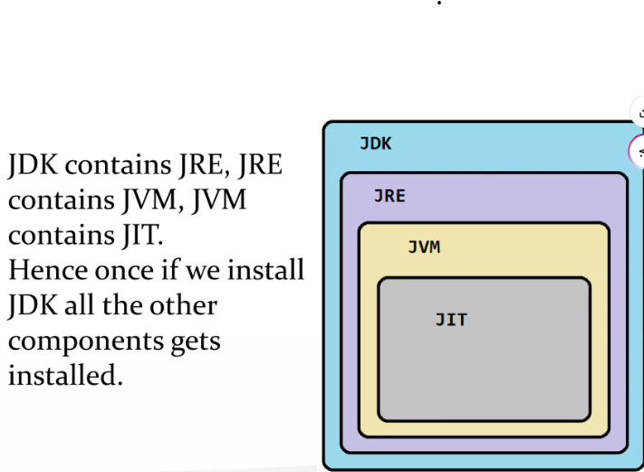

# 1. Java Platform Overview

### What is Java?

Java is a statically-typed, class-based, object-oriented language that compiles to bytecode and runs on the Java Virtual Machine (JVM). Unlike C# which targets the CLR, Java targets the JVM — but the conceptual parallel is very close.

### Platform Components

| Component | Purpose | Contains | C# Equivalent |
|-----------|---------|----------|---------------|
| JDK (Java Development Kit) | Compiler + tools + JRE | `javac`, `jar`, `javadoc`, `jdb` (debugger), `jshell` (REPL), JRE, development libraries, and source code | .NET SDK |
| JRE (Java Runtime Environment) | Runtime only (deprecated since Java 11) | JVM, core class libraries (`java.lang`, `java.util`, `java.io`, etc.), `java` launcher, and deployment tools | .NET Runtime |
| JVM (Java Virtual Machine) | Bytecode execution engine | Class loader, bytecode verifier, JIT compiler, garbage collector, runtime memory areas (heap, stack, metaspace) | CLR |
| javac | Java compiler | Lexer, parser, annotation processor, type checker, and bytecode generator — transforms `.java` source files into `.class` bytecode files | csc / Roslyn |
| jar | Archive format for compiled classes | Compiled `.class` files, resources (images, config), and a `META-INF/MANIFEST.MF` metadata file describing the archive | DLL / NuGet package |


#### JDK (Java Development Kit)

The JDK is the full development package required to write, compile, and run Java applications. It includes everything a developer needs — the compiler, debugging tools, profiling utilities, and the runtime itself.

```bash
# Compile a source file
javac MyApp.java

# Run the compiled class
java MyApp

# Launch interactive REPL (since Java 9)
jshell

# Generate documentation from Javadoc comments
javadoc -d docs src/*.java

# Debug a running application
jdb -connect com.sun.jdi.SocketAttach:hostname=localhost,port=5005
```

#### JRE (Java Runtime Environment)

The JRE is the minimum set of components needed to run a compiled Java application. It includes the JVM, core libraries, and the `java` launcher — but no compiler or dev tools. Since Java 11, the JRE is no longer distributed separately; developers use `jlink` to create custom runtimes.

```bash
# Run a compiled class (all you need the JRE for)
java MyApp

# Run a JAR file
java -jar myapp.jar

# Create a custom minimal runtime (replaces standalone JRE)
jlink --module-path $JAVA_HOME/jmods --add-modules java.base,java.sql --output my-runtime
```

#### JVM (Java Virtual Machine)

The JVM loads, verifies, and executes bytecode. It manages memory (heap allocation, garbage collection), performs just-in-time (JIT) compilation to native code for hot paths, and provides a security sandbox. It's the reason Java achieves "write once, run anywhere."

```bash
# Run with specific heap sizes
java -Xms256m -Xmx2g MyApp

# View JIT compilation activity
java -XX:+PrintCompilation MyApp

# Select a garbage collector
java -XX:+UseG1GC MyApp

# Print GC events
java -verbose:gc MyApp
```

#### javac (Java Compiler)

`javac` transforms `.java` source files into `.class` bytecode files. It performs syntax checking, type checking, annotation processing, and generates platform-independent bytecode that the JVM can execute.

```bash
# Compile a single file
javac HelloWorld.java

# Compile with a specific Java version target
javac --release 17 HelloWorld.java

# Compile multiple files with classpath dependencies
javac -cp lib/* -d out src/**/*.java

# Enable all warnings
javac -Xlint:all MyApp.java
```

#### jar (Java Archive)

A JAR file bundles compiled `.class` files, resources, and metadata into a single distributable archive (it's a ZIP file with a manifest). JARs can be libraries (consumed as dependencies) or executable applications.

```bash
# Create a JAR from compiled classes
jar cf mylib.jar -C out/ .

# Create an executable JAR with a main class
jar cfe myapp.jar com.example.Main -C out/ .

# Run an executable JAR
java -jar myapp.jar

# List contents of a JAR
jar tf mylib.jar

# Extract a JAR
jar xf mylib.jar
```

### Java Editions

- **Java SE (Standard Edition)** — Core language + standard library (this guide)
- **Java EE / Jakarta EE** — Enterprise APIs (web services, persistence, messaging)
- **Java ME** — Micro Edition for embedded devices (largely obsolete)

### Version History Highlights

Java uses a 6-month release cadence since Java 10. LTS versions (Long-Term Support) are released every 2 years:

- **Java 8** (2014) — Lambdas, Streams, Optional (massive release)
- **Java 11** (2018, LTS) — Modules stabilized, HTTP Client
- **Java 17** (2021, LTS) — Sealed classes, pattern matching preview
- **Java 21** (2023, LTS) — Virtual threads, sequenced collections, pattern matching finalized
- **Java 25** (2025, LTS) — Continued enhancements

---

