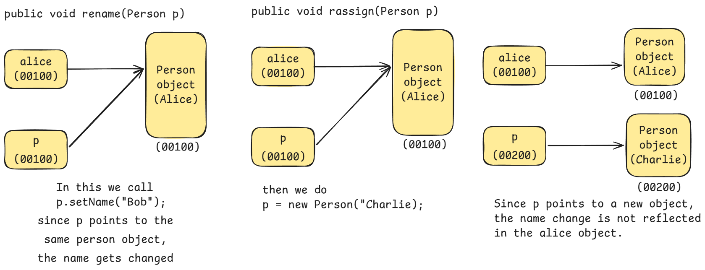

#### Primitives — Value is Copied

```java
public void increment(int x) {
    x++;  // modifies local copy only
}

int a = 5;
increment(a);
System.out.println(a);  // still 5 — original unchanged
```

#### Objects — Reference is Copied (Not the Object!)

```java
public void rename(Person p) {
    p.setName("Bob");  // modifies the SAME object (via copied reference)
}

public void reassign(Person p) {
    p = new Person("Charlie");  // reassigns LOCAL reference only — caller unaffected
}

Person alice = new Person("Alice");

rename(alice);
System.out.println(alice.getName());  // "Bob" — the object was mutated

reassign(alice);
System.out.println(alice.getName());  // still "Bob" — reassignment didn't propagate
```

**What's happening under the hood:**


#### C# Comparison

| | C# | Java |
|--|-----|------|
| Pass primitive by value | `void M(int x)` | `void m(int x)` — same |
| Pass primitive by reference | `void M(ref int x)` | **Not possible** |
| Output parameter | `void M(out int x)` | **Not possible** — return a value or use a holder |
| Pass object reference | `void M(Person p)` | `void m(Person p)` — same behavior |
| Reassign caller's reference | `void M(ref Person p)` | **Not possible** |

**Workarounds for "out" parameters in Java:**
```java
// Return multiple values via a record or array
public record ParseResult(boolean success, int value) {}

// Or use AtomicReference as a holder
public void parse(String input, AtomicReference<Integer> result) {
    result.set(Integer.parseInt(input));
}
```

