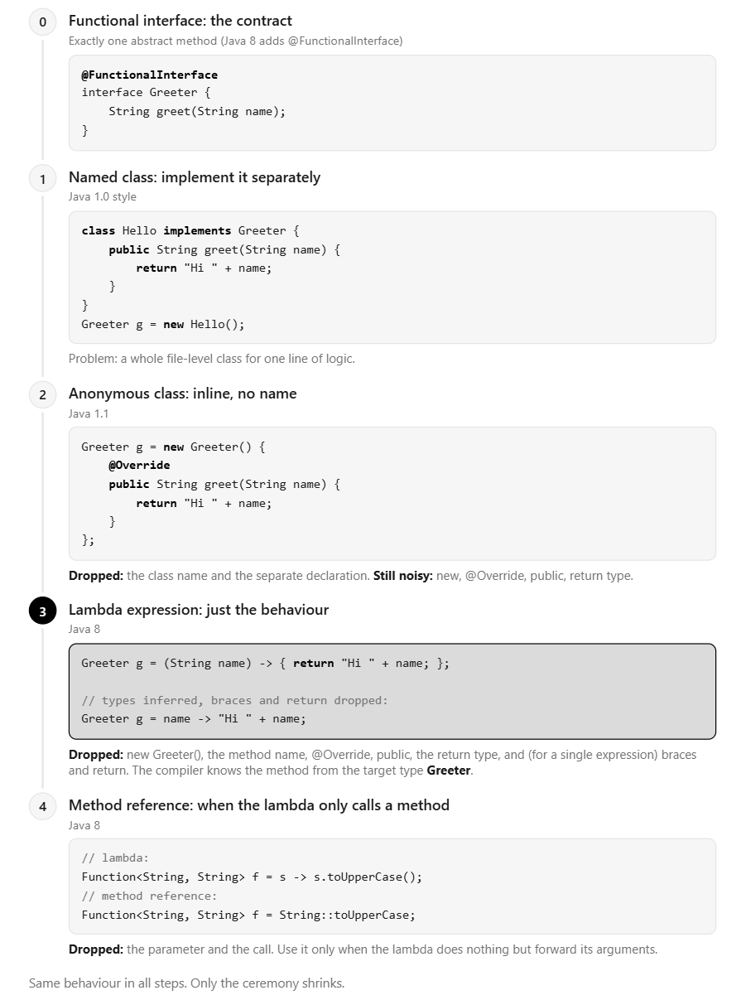
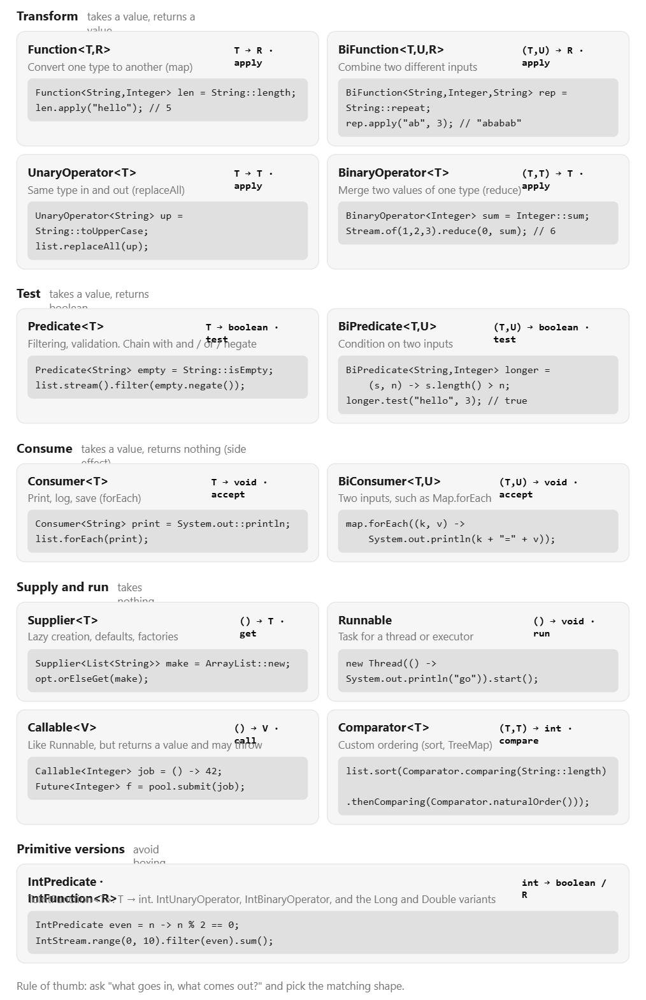

# 13. Interfaces and Abstract Classes

### Interfaces

```java
// Interfaces in Java are like C# interfaces but with more capabilities
public interface Drawable {
    // Abstract method (implicitly public abstract)
    void draw();

    // Default method (Java 8+) — like C# default interface methods
    default void drawWithBorder() {
        System.out.println("Drawing border...");
        draw();
    }

    // Static method (Java 8+)
    static Drawable empty() {
        return () -> {};  // lambda
    }

    // Private method (Java 9+) — for internal reuse in default methods
    private void logDrawing() {
        System.out.println("Drawing operation performed");
    }

    // Constants (implicitly public static final)
    int MAX_SIZE = 1000;
}
```

### Implementing Interfaces

```java
// Java uses 'implements' (not ':' like C#)
public class Circle implements Drawable, Serializable {
    @Override
    public void draw() {
        System.out.println("Drawing circle");
    }
}

// Multiple interface implementation
public class Shape implements Drawable, Comparable<Shape>, Cloneable {
    // ...
}
```

#### Why Were Default and Static Methods Introduced?

Both were introduced in **Java 8**, primarily to support the Streams API without breaking every existing implementation.

**Default methods — the backward compatibility problem**

Before Java 8, adding a method to an interface forced every implementing class to provide an implementation. Imagine adding `stream()` to `Collection`:

```java
public interface Collection<E> {
    // ... existing methods

    Stream<E> stream(); // NEW — every ArrayList, HashSet, LinkedList, 
                        // TreeSet, and thousands of third-party classes 
                        // would break instantly
}
```

That's not feasible. Default methods solved this by allowing interfaces to provide a body:

```java
public interface Collection<E> {
    default Stream<E> stream() {
        return StreamSupport.stream(spliterator(), false);
    }
}
```

Now existing classes inherit the default behavior without changing a line of code, and they can still override it if they want a custom implementation.

**Static methods — utility methods that belong to the interface**

Before Java 8, utility methods related to an interface lived in companion classes — `Collections` for `Collection`, `Paths` for `Path`, etc. Static methods on interfaces let you put them where they logically belong:

```java
// Before Java 8 — separate utility class
Comparator<String> c = Collections.reverseOrder();

// After Java 8 — on the interface itself
Comparator<String> c = Comparator.reverseOrder();
Comparator<String> c2 = Comparator.comparing(Person::getName);
```

No more hunting for a companion class. The interface is the single source of truth for both the contract and its related utilities.

**In short:**
- `default` methods — evolve interfaces without breaking existing implementations
- `static` methods — keep utility methods with the interface they belong to, eliminating companion classes

### Functional Interfaces

```java
// An interface with exactly ONE abstract method — can be used with lambdas
@FunctionalInterface
public interface Predicate<T> {
    boolean test(T t);

    // Default methods don't count
    default Predicate<T> negate() {
        return t -> !test(t);
    }
}

// Usage with lambda
Predicate<String> isLong = s -> s.length() > 10;
```




### Interface — Rules and Limitations

| Rule | Explanation |
|------|-------------|
| All abstract methods are `public` | You can't have `protected` or `private` abstract methods in an interface |
| All fields are `public static final` | Interfaces can only have constants — no instance variables |
| Cannot be instantiated | `new Drawable()` is illegal (unless anonymous class) |
| Cannot have constructors | No initialization logic — no state to initialize |
| A class can implement multiple interfaces | `class X implements A, B, C` — Java's way around no multiple inheritance |
| An interface can extend multiple interfaces | `interface C extends A, B` — interface-to-interface is fine |
| Methods are `abstract` by default | No need to write `abstract` keyword (it's implicit) |
| `default` methods can have a body | Since Java 8 — provides backward-compatible evolution |
| `static` methods can have a body | Since Java 8 — utility methods on the interface |
| `private` methods can have a body | Since Java 9 — helper methods for default methods |
| Cannot have `final` methods | Makes no sense — interfaces are meant to be implemented |
| Cannot have `synchronized` methods | No object state to synchronize on |

```java
public interface Vehicle {
    // ✓ Allowed:
    int MAX_SPEED = 200;                  // implicitly public static final
    void accelerate();                     // implicitly public abstract
    default void honk() { System.out.println("Beep!"); }  // default method
    static Vehicle create() { return new Car(); }          // static method
    private void log() { System.out.println("..."); }     // private helper (Java 9+)

    // ❌ NOT allowed:
    // private int speed;                  // no instance fields
    // protected void brake();             // abstract methods must be public
    // Vehicle() { }                       // no constructors
    // final void stop() { }              // no final methods
}
```


#### The Diamond Problem (Default Method Conflict)

When a class implements two interfaces that have the same default method, you must resolve the ambiguity:

```java
interface A {
    default void hello() { System.out.println("A"); }
}

interface B {
    default void hello() { System.out.println("B"); }
}

// Must override to resolve conflict
class C implements A, B {
    @Override
    public void hello() {
        A.super.hello();   // explicitly choose A's version
        // or: B.super.hello();
        // or: provide entirely new implementation
    }
}
```

#### The "Class Wins" Rule

If a class inherits the same method from both a superclass and an interface default method, the **superclass method always takes precedence** — the default method is ignored entirely:

```java
interface Greeter {
    default void hello() { System.out.println("Interface"); }
}

class Parent {
    public void hello() { System.out.println("Parent class"); }
}

class Child extends Parent implements Greeter {
    // No override needed — Parent.hello() wins automatically
}

new Child().hello(); // "Parent class"
```

This is a deliberate design choice. Class hierarchies existed long before default methods (Java 8), so giving classes priority ensures that adding a default method to an interface never silently changes the behavior of existing classes that already inherit from a superclass.

| Conflict | Resolution |
|----------|------------|
| Two interfaces with same default method | Must override and explicitly choose (`A.super.hello()`) |
| Superclass method vs interface default method | Superclass wins automatically — no override needed |

### Abstract Classes

```java
// Same concept as C# abstract classes
public abstract class Shape {
    private String color;

    // Constructor (can't be instantiated directly)
    protected Shape(String color) {
        this.color = color;
    }

    // Abstract method (must be implemented by subclass)
    public abstract double area();

    // Concrete method
    public String getColor() {
        return color;
    }
}

public class Circle extends Shape {
    private double radius;

    public Circle(String color, double radius) {
        super(color);  // 'super' = 'base' in C#
        this.radius = radius;
    }

    @Override
    public double area() {
        return Math.PI * radius * radius;
    }
}
```

### Abstract Class — Rules and Limitations

| Rule | Explanation |
|------|-------------|
| Cannot be instantiated | `new Shape()` is illegal — must subclass it |
| Can have constructors | Called via `super()` from subclasses |
| Can have any access modifier on methods | `public`, `protected`, `private`, package-private — all valid |
| Can have instance fields (state) | Unlike interfaces — can hold mutable state |
| Can have `final` methods | Prevent subclasses from overriding specific methods |
| Can have `static` methods | Regular static methods, same as any class |
| Can have zero abstract methods | A class can be `abstract` with no abstract methods (prevents instantiation) |
| Single inheritance only | `class B extends A` — can't extend two abstract classes |
| Abstract methods have no body | `abstract void draw();` — subclass must implement |
| If a subclass doesn't implement all abstract methods, it must also be abstract | Chain of abstraction until a concrete class implements everything |
| Can implement interfaces | `abstract class X implements Drawable` — partial implementation allowed |

```java
public abstract class Shape {
    // ✓ Allowed:
    private String color;                          // instance field
    protected int sides;                           // any access modifier
    public static final String CATEGORY = "2D";   // static constant

    protected Shape(String color) { this.color = color; }  // constructor
    public abstract double area();                          // abstract method
    public final String getColor() { return color; }       // final method (can't override)
    private void log() { System.out.println("..."); }     // private method

    // ❌ NOT meaningfully restricted — abstract classes are very flexible

    // Only restriction: can't be instantiated directly
    // Shape s = new Shape("red");  // ❌ compile error
}

// Subclass MUST implement all abstract methods (or also be abstract)
public class Circle extends Shape {
    private double radius;

    public Circle(String color, double radius) {
        super(color);   // must call parent constructor
        this.radius = radius;
    }

    @Override
    public double area() {         // must implement
        return Math.PI * radius * radius;
    }
}

// If not all abstract methods implemented → must also be abstract
public abstract class Polygon extends Shape {
    // doesn't implement area() → stays abstract
    public abstract int getSides();
}
```

### Interface vs Abstract Class

| Feature | Interface | Abstract Class |
|---------|-----------|---------------|
| Multiple inheritance | Yes | No (single only) |
| Constructors | No | Yes |
| Instance fields | No (only constants) | Yes |
| Access modifiers on methods | Public only (abstract) | Any |
| Default implementations | Yes (Java 8+) | Yes |
| State (instance variables) | No | Yes |
| `final` methods | No | Yes |
| `static` methods | Yes (Java 8+) | Yes |
| `private` methods | Yes (Java 9+) | Yes |


### When to Use Which

| Use Case | Interface | Abstract Class |
|----------|:-:|:-:|
| Define a contract (API) with no state | ✓ | |
| Multiple inheritance needed | ✓ | ❌ (single only) |
| Share code with common state (fields) | | ✓ |
| Provide a partial implementation (template) | | ✓ |
| Evolve API with new methods without breaking implementors | ✓ (default methods) | ✓ |
| Tight coupling (IS-A relationship) | | ✓ |
| Loose coupling (CAN-DO relationship) | ✓ | |
| Used with lambdas | ✓ (functional interface) | ❌ |

**Rule of thumb:**
- Use **interfaces** for capabilities/behaviors: `Comparable`, `Serializable`, `Runnable`
- Use **abstract classes** for shared base with common state: `AbstractList`, `HttpServlet`, `Shape`
- When in doubt, prefer interfaces — they're more flexible (multiple inheritance, lambdas)

---

