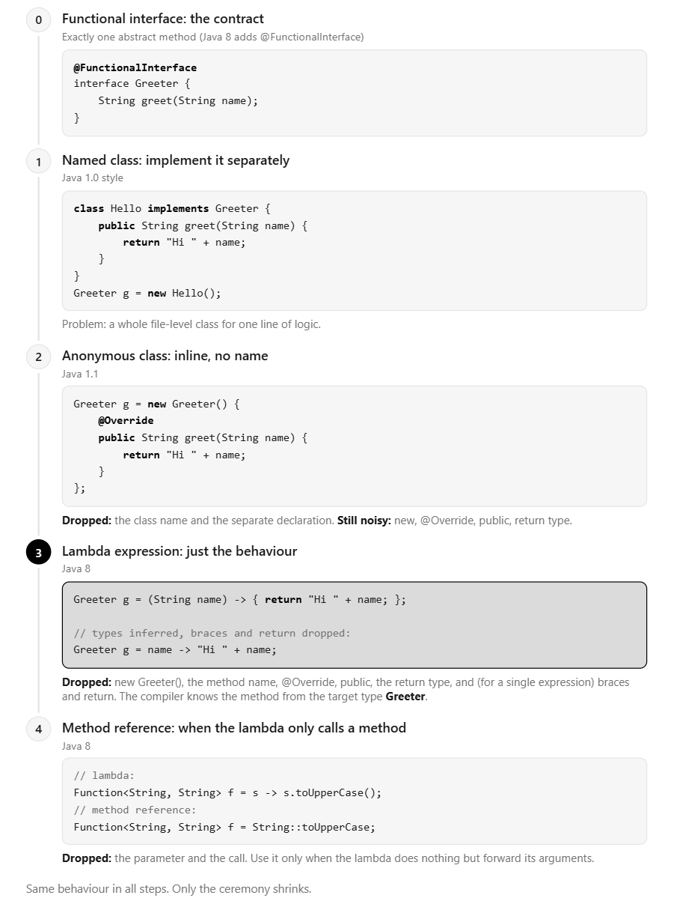
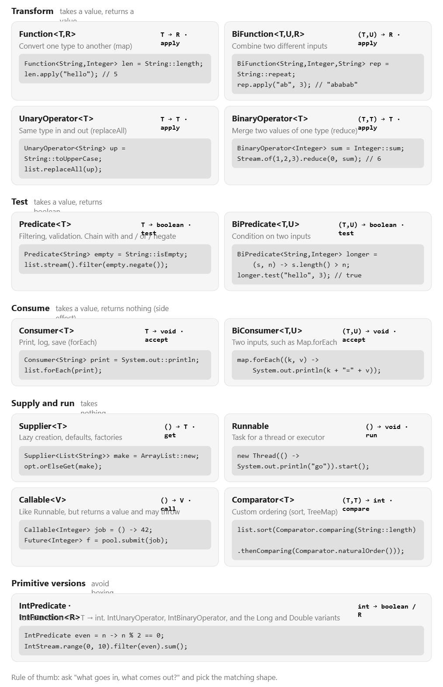

# Functional Interfaces, Anonymous Classes, Lambdas, and Method References

> The journey from verbose class-based implementations to concise lambda expressions. Same behavior in all steps — only the ceremony shrinks.

---

## Table of Contents

1. [The Evolution — From Classes to Lambdas](#1-the-evolution--from-classes-to-lambdas)
    - [Step 0: Functional Interface — The Contract](#step-0-functional-interface--the-contract)
    - [Step 1: Named Class — Implement It Separately (Java 1.0)](#step-1-named-class--implement-it-separately-java-10)
    - [Step 2: Anonymous Class — Inline, No Name (Java 1.1)](#step-2-anonymous-class--inline-no-name-java-11)
    - [Step 3: Lambda Expression — Just the Behavior (Java 8)](#step-3-lambda-expression--just-the-behavior-java-8)
    - [Step 4: Method Reference — When the Lambda Only Calls a Method (Java 8)](#step-4-method-reference--when-the-lambda-only-calls-a-method-java-8)
    - [Evolution Summary](#evolution-summary)
2. [Functional Interfaces in Depth](#2-functional-interfaces-in-depth)
    - [What Makes an Interface "Functional"?](#what-makes-an-interface-functional)
    - [The @FunctionalInterface Annotation](#the-functionalinterface-annotation)
3. [Anonymous Classes in Depth](#3-anonymous-classes-in-depth)
    - [Syntax and Mechanics](#syntax-and-mechanics)
    - [When Anonymous Classes Are Still Useful](#when-anonymous-classes-are-still-useful)
    - [Limitations](#limitations)
4. [Lambda Expressions in Depth](#4-lambda-expressions-in-depth)
    - [Syntax Variations](#syntax-variations)
    - [How Lambdas Work Under the Hood](#how-lambdas-work-under-the-hood)
    - [Variable Capture — Effectively Final](#variable-capture--effectively-final)
    - [Lambda vs Anonymous Class — Key Differences](#lambda-vs-anonymous-class--key-differences)
5. [Method References in Depth](#5-method-references-in-depth)
    - [Four Types of Method References](#four-types-of-method-references)
    - [When to Use Method References vs Lambdas](#when-to-use-method-references-vs-lambdas)
6. [Built-in Functional Interfaces (java.util.function)](#6-built-in-functional-interfaces-javautilfunction)
    - [Transform — Takes a Value, Returns a Value](#transform--takes-a-value-returns-a-value)
    - [Test — Takes a Value, Returns boolean](#test--takes-a-value-returns-boolean)
    - [Consume — Takes a Value, Returns Nothing](#consume--takes-a-value-returns-nothing)
    - [Supply and Run — Takes Nothing](#supply-and-run--takes-nothing)
    - [Primitive Versions — Avoid Boxing](#primitive-versions--avoid-boxing)
    - [Quick Reference Table](#quick-reference-table)
7. [Real-World Usage Patterns](#7-real-world-usage-patterns)

---

## 1. The Evolution — From Classes to Lambdas

The core problem: how do you pass a piece of behavior (a function) to another method in Java? Java is an object-oriented language — everything lives inside a class. Over time, the language evolved to reduce the boilerplate required to express a simple behavior.

All four steps below do the **exact same thing** — they provide an implementation of a single-method interface. The only difference is how much ceremony is involved.

### Step 0: Functional Interface — The Contract

A functional interface is any interface with **exactly one abstract method**. It defines the shape of the behavior — the input types and the return type. Java 8 added `@FunctionalInterface` to make the intent explicit, but any single-abstract-method interface qualifies, even ones written before Java 8.

```java
@FunctionalInterface
interface Greeter {
    String greet(String name);
}
```

This is the foundation for everything that follows. The interface defines **what** needs to happen (take a `String`, return a `String`). The implementations below define **how**.

---

### Step 1: Named Class — Implement It Separately (Java 1.0)

The original Java approach: write a separate class that implements the interface.

```java
class Hello implements Greeter {
    public String greet(String name) {
        return "Hi " + name;
    }
}

Greeter g = new Hello();
g.greet("Alice");   // "Hi Alice"
```

**The problem:** A whole file-level class for one line of logic. If you need 10 different greeting strategies, you need 10 separate classes. For simple behaviors, this is heavyweight — the ceremony (class declaration, method signature, file) far outweighs the logic (`"Hi " + name`).

**When this was the only option:** Java 1.0 (1996). Event listeners in AWT/Swing required separate classes for every button click, mouse move, and key press.

---

### Step 2: Anonymous Class — Inline, No Name (Java 1.1)

Java 1.1 introduced anonymous classes — define and instantiate a class in a single expression, right where you need it:

```java
Greeter g = new Greeter() {
    @Override
    public String greet(String name) {
        return "Hi " + name;
    }
};

g.greet("Alice");   // "Hi Alice"
```

**What improved:**
- Dropped the class name and the separate file/declaration
- The implementation lives right at the point of use

**What's still noisy:**
- `new Greeter()` — even though we're not really "constructing" a Greeter
- `@Override` annotation
- `public` access modifier
- Method name and return type — the compiler already knows these from the interface
- Curly braces and semicolon ceremony

**Real-world example — Swing button listener:**

```java
button.addActionListener(new ActionListener() {
    @Override
    public void actionPerformed(ActionEvent e) {
        System.out.println("Clicked!");
    }
});
```

This pattern was everywhere in pre-Java 8 code. The boilerplate-to-logic ratio is terrible — 5 lines of ceremony for 1 line of behavior.

---

### Step 3: Lambda Expression — Just the Behavior (Java 8)

Java 8 introduced lambdas — strip away everything the compiler can infer and keep only the behavior:

```java
// Full lambda syntax
Greeter g = (String name) -> { return "Hi " + name; };

// Types inferred, braces and return dropped (single expression):
Greeter g = name -> "Hi " + name;

g.greet("Alice");   // "Hi Alice"
```

**What was dropped:**
- `new Greeter()` — the compiler knows the target type from the variable declaration
- The method name (`greet`) — there's only one abstract method, so it's unambiguous
- `@Override`, `public`, return type — all inferred
- `return` keyword and braces — for single expressions, the result is implicit

**The compiler knows the method from the target type `Greeter`.** Since a functional interface has exactly one abstract method, there's no ambiguity about which method you're implementing.

**The Swing example collapses to one line:**

```java
button.addActionListener(e -> System.out.println("Clicked!"));
```

---

### Step 4: Method Reference — When the Lambda Only Calls a Method (Java 8)

When a lambda does nothing but forward its arguments to an existing method, you can replace it with a method reference:

```java
// Lambda:
Function<String, String> f = s -> s.toUpperCase();

// Method reference — even shorter:
Function<String, String> f = String::toUpperCase;
```

**What was dropped:** The parameter declaration and the call. The `::` operator tells the compiler "use this existing method as the implementation."

**Use it only when the lambda does nothing but forward its arguments.** If there's any additional logic, stick with a lambda:

```java
// ✓ Method reference — just forwarding
list.forEach(System.out::println);

// ✗ Can't use method reference — extra logic involved
list.forEach(s -> System.out.println("Item: " + s));
```

---

### Evolution Summary



```
Step 0: @FunctionalInterface          — define the contract (one abstract method)
Step 1: Named class         (Java 1.0) — separate class, separate file
Step 2: Anonymous class      (Java 1.1) — inline, but still verbose
Step 3: Lambda expression    (Java 8)   — just parameters → body
Step 4: Method reference     (Java 8)   — just ClassName::methodName
```

| Step | Syntax | Boilerplate removed |
|------|--------|---------------------|
| Named class | `class Hello implements Greeter { ... }` | — |
| Anonymous class | `new Greeter() { @Override ... }` | Class name, separate declaration |
| Lambda | `name -> "Hi " + name` | `new`, method name, `@Override`, `public`, return type |
| Method reference | `String::toUpperCase` | Parameter, method call |

**Same behavior in all steps. Only the ceremony shrinks.**

---

## 2. Functional Interfaces in Depth

### What Makes an Interface "Functional"?

A functional interface has **exactly one abstract method** (SAM — Single Abstract Method). Default methods, static methods, and private methods don't count — they already have implementations:

```java
@FunctionalInterface
interface Transformer {
    String transform(String input);          // the ONE abstract method

    // These don't count against the SAM rule:
    default String transformUpper(String s) { return transform(s).toUpperCase(); }
    static Transformer identity() { return s -> s; }
    private void log(String s) { System.out.println(s); }
}
```

Methods inherited from `Object` (`equals`, `hashCode`, `toString`) also don't count:

```java
@FunctionalInterface
interface MyInterface {
    void doWork();

    // These are from Object — don't break the functional interface rule
    boolean equals(Object o);
    String toString();
}
```

### The @FunctionalInterface Annotation

The annotation is **optional but recommended**. It tells the compiler to enforce the single-abstract-method rule:

```java
@FunctionalInterface
interface Valid {
    void execute();
}

@FunctionalInterface
interface Invalid {
    void execute();
    void another();   // ❌ compile error: multiple abstract methods
}
```

Without the annotation, the interface still works as a lambda target if it happens to have one abstract method — but there's no compile-time safety. Someone could add a second abstract method later and break all your lambdas.

**Pre-Java 8 functional interfaces** — these were functional interfaces before the term existed:

| Interface | Abstract method | Used for |
|-----------|----------------|----------|
| `Runnable` | `void run()` | Threads |
| `Callable<V>` | `V call()` | Threads with return values |
| `Comparator<T>` | `int compare(T o1, T o2)` | Sorting |
| `ActionListener` | `void actionPerformed(ActionEvent e)` | Swing events |

All of these can be replaced with lambdas since Java 8.

---

## 3. Anonymous Classes in Depth

### Syntax and Mechanics

An anonymous class creates a one-off subclass (or interface implementation) at the point of use:

```java
// Implementing an interface
Runnable r = new Runnable() {
    @Override
    public void run() {
        System.out.println("Running");
    }
};

// Extending a class
Thread t = new Thread() {
    @Override
    public void run() {
        System.out.println("Custom thread");
    }
};
```

**Under the hood**, the compiler generates a separate `.class` file for each anonymous class (e.g., `Outer$1.class`, `Outer$2.class`). It's a real class with a real constructor — just without a name.

### When Anonymous Classes Are Still Useful

Lambdas replaced most anonymous class use cases, but anonymous classes are still needed when:

**1. The interface has more than one abstract method:**

```java
// Can't use a lambda — two abstract methods
MouseListener listener = new MouseAdapter() {
    @Override
    public void mouseClicked(MouseEvent e) { System.out.println("Clicked"); }

    @Override
    public void mouseEntered(MouseEvent e) { System.out.println("Entered"); }
};
```

**2. You need to maintain state (fields):**

```java
Iterator<Integer> counter = new Iterator<>() {
    private int current = 0;

    @Override
    public boolean hasNext() { return current < 10; }

    @Override
    public Integer next() { return current++; }
};
```

**3. You need to refer to `this` as the anonymous class instance:**

```java
Runnable r = new Runnable() {
    @Override
    public void run() {
        System.out.println(this.getClass().getName()); // refers to the anonymous class
    }
};
```

### Limitations

- Cannot have explicit constructors (but can use instance initializer blocks)
- Cannot have static members (except `static final` constants)
- Can only access `final` or effectively final variables from the enclosing scope
- Generates a separate `.class` file — more disk I/O and classloading overhead

---

## 4. Lambda Expressions in Depth

### Syntax Variations

```java
// No parameters
Runnable r = () -> System.out.println("Hello");

// One parameter — parentheses optional
Consumer<String> c1 = (String s) -> System.out.println(s);
Consumer<String> c2 = (s) -> System.out.println(s);
Consumer<String> c3 = s -> System.out.println(s);       // shortest

// Multiple parameters — parentheses required
BiFunction<Integer, Integer, Integer> add = (a, b) -> a + b;

// Multi-line body — braces and explicit return required
Function<String, String> transform = s -> {
    String trimmed = s.trim();
    return trimmed.toUpperCase();
};

// Returning nothing (void-compatible)
Consumer<String> log = s -> {
    System.out.println("[LOG] " + s);
    // no return needed
};
```

**Type inference rules:**
- Parameter types are inferred from the target functional interface
- You can declare types explicitly: `(String s) -> ...`
- You **cannot** mix: `(String s, n) -> ...` is illegal — either all declared or all inferred

### How Lambdas Work Under the Hood

Lambdas are **not** anonymous classes. The compiler uses `invokedynamic` (introduced in Java 7) to generate the implementation at runtime:

```
Anonymous class:
  - Compiler creates Outer$1.class at compile time
  - JVM loads a new class, allocates an object every time
  - Each instance has its own identity (this, hashCode, etc.)

Lambda:
  - Compiler emits an invokedynamic instruction
  - JVM generates a lightweight implementation at first call (via LambdaMetafactory)
  - Can be optimized to a singleton if it captures no variables
  - No .class file, no classloading overhead
```

This matters for performance — lambdas in hot loops are cheaper than anonymous classes.

### Variable Capture — Effectively Final

Lambdas can capture variables from the enclosing scope, but those variables must be **effectively final** (assigned once and never modified):

```java
String prefix = "Hello";   // effectively final — never reassigned

// ✓ Works — prefix is effectively final
Function<String, String> greeter = name -> prefix + " " + name;

// ❌ Won't compile — count is modified
int count = 0;
Runnable r = () -> count++;   // error: local variables referenced from a lambda must be final or effectively final
```

**Why this restriction?** Lambdas capture the **value** of local variables, not a reference to them. Local variables live on the stack and disappear when the method returns — but the lambda might outlive the method. Allowing mutation would create confusion about which copy is being modified.

**Workaround — use a mutable container:**

```java
int[] count = {0};   // array is effectively final, but its contents can change
Runnable r = () -> count[0]++;   // ✓ modifying the array's contents, not the reference

// Or use AtomicInteger for thread safety
AtomicInteger atomicCount = new AtomicInteger(0);
Runnable r2 = () -> atomicCount.incrementAndGet();
```

### Lambda vs Anonymous Class — Key Differences

| | Lambda | Anonymous Class |
|--|--------|-----------------|
| `this` keyword | Refers to the **enclosing class** | Refers to the **anonymous class itself** |
| Scope | No new scope — shares enclosing scope | Creates a new scope |
| Compilation | `invokedynamic` — no .class file | Generates `Outer$1.class` |
| Performance | Lighter — can be cached as singleton | Heavier — new object every time |
| State (fields) | No — only captures variables | Yes — can have instance fields |
| Multiple methods | No — one abstract method only | Yes — can override multiple methods |
| Interfaces only? | Yes — must target a functional interface | No — can extend classes too |
| Shadowing | Cannot shadow enclosing variables | Can shadow enclosing variables |

```java
public class Outer {
    private String name = "Outer";

    void demo() {
        // Lambda — 'this' refers to Outer
        Runnable lambda = () -> System.out.println(this.name);   // "Outer"

        // Anonymous class — 'this' refers to the anonymous Runnable
        Runnable anon = new Runnable() {
            private String name = "Anon";
            @Override
            public void run() {
                System.out.println(this.name);     // "Anon"
                System.out.println(Outer.this.name); // "Outer" — explicit outer reference
            }
        };
    }
}
```

---

## 5. Method References in Depth

A method reference is shorthand for a lambda that only calls a single existing method, forwarding all arguments directly. The `::` operator replaces the lambda's parameter list and body.

### Four Types of Method References

#### 1. Static Method Reference — `ClassName::staticMethod`

```java
// Lambda
Function<String, Integer> parse = s -> Integer.parseInt(s);

// Method reference
Function<String, Integer> parse = Integer::parseInt;
```

The argument `s` is forwarded directly to `Integer.parseInt(s)`.

#### 2. Instance Method of a Particular Object — `instance::method`

```java
String prefix = "Hello";

// Lambda
Function<String, String> greeter = s -> prefix.concat(s);

// Method reference
Function<String, String> greeter = prefix::concat;
```

`prefix` is a specific object captured at the time the reference is created. The lambda's argument becomes the method's argument.

#### 3. Instance Method of an Arbitrary Object — `ClassName::instanceMethod`

```java
// Lambda
Function<String, String> upper = s -> s.toUpperCase();

// Method reference
Function<String, String> upper = String::toUpperCase;
```

Here `String::toUpperCase` means "call `toUpperCase()` on whatever `String` is passed in." The first argument becomes the receiver (`this`) of the method.

**This is the trickiest one.** Notice the difference:

```java
// Type 2: instance::method — 'out' is a specific object
Consumer<String> print = System.out::println;   // call println ON System.out

// Type 3: ClassName::instanceMethod — no specific object
Function<String, String> upper = String::toUpperCase;   // call toUpperCase ON the argument
```

#### 4. Constructor Reference — `ClassName::new`

```java
// Lambda
Supplier<ArrayList<String>> factory = () -> new ArrayList<>();

// Constructor reference
Supplier<ArrayList<String>> factory = ArrayList::new;

// With parameters — the functional interface determines which constructor
Function<Integer, ArrayList<String>> sized = ArrayList::new;   // calls new ArrayList(initialCapacity)
```

### When to Use Method References vs Lambdas

| Scenario | Use |
|----------|-----|
| Lambda just forwards arguments to one method | Method reference ✓ |
| Lambda has additional logic | Lambda ✓ |
| Method reference is less readable | Lambda ✓ |
| Creating objects | Constructor reference ✓ |

```java
// ✓ Method reference — cleaner
list.stream().map(String::toUpperCase).toList();
list.forEach(System.out::println);
list.stream().filter(Objects::nonNull).toList();

// ✓ Lambda — method reference would be awkward or impossible
list.stream().map(s -> s.substring(0, 3)).toList();
list.stream().filter(s -> s.length() > 5).toList();
list.stream().map(s -> "Item: " + s).toList();
```

---

## 6. Built-in Functional Interfaces (java.util.function)

Java 8 introduced `java.util.function` — a package of general-purpose functional interfaces that cover the most common shapes of behavior. Instead of creating your own `Greeter`, `Transformer`, or `Checker` interfaces, use these.

**Rule of thumb:** Ask "what goes in, what comes out?" and pick the matching shape.



---

### Transform — Takes a Value, Returns a Value

#### Function\<T, R\> — `T → R` (method: `apply`)

Convert one type to another. The workhorse of `.map()` operations.

```java
Function<String, Integer> len = String::length;
len.apply("hello");   // 5

// In streams — transform each element
List<Integer> lengths = names.stream()
    .map(String::length)        // Function<String, Integer>
    .toList();

// Chaining — compose functions
Function<String, String> trim = String::trim;
Function<String, String> upper = String::toUpperCase;
Function<String, String> pipeline = trim.andThen(upper);
pipeline.apply("  hello  ");   // "HELLO"
```

#### BiFunction\<T, U, R\> — `(T, U) → R` (method: `apply`)

Takes two different inputs, returns a result.

```java
BiFunction<String, Integer, String> rep = String::repeat;
rep.apply("ab", 3);   // "ababab"

// Useful for Map.replaceAll, Map.merge, etc.
map.replaceAll((key, value) -> value.toUpperCase());
```

#### UnaryOperator\<T\> — `T → T` (method: `apply`)

Special case of `Function` where input and output are the **same type**. Used for in-place transformations.

```java
UnaryOperator<String> up = String::toUpperCase;
list.replaceAll(up);   // modifies list in-place — every element uppercased

// UnaryOperator<T> extends Function<T, T>
UnaryOperator<Integer> doubler = n -> n * 2;
doubler.apply(5);   // 10
```

#### BinaryOperator\<T\> — `(T, T) → T` (method: `apply`)

Special case of `BiFunction` where both inputs and the output are the **same type**. Used in reduce operations.

```java
BinaryOperator<Integer> sum = Integer::sum;
Stream.of(1, 2, 3).reduce(0, sum);   // 6

BinaryOperator<String> concat = String::concat;
Stream.of("a", "b", "c").reduce("", concat);   // "abc"

// Finding max/min
BinaryOperator<Integer> max = BinaryOperator.maxBy(Comparator.naturalOrder());
max.apply(3, 7);   // 7
```

---

### Test — Takes a Value, Returns boolean

#### Predicate\<T\> — `T → boolean` (method: `test`)

Filtering and validation. The backbone of `.filter()` operations. Chainable with `and()`, `or()`, and `negate()`.

```java
Predicate<String> empty = String::isEmpty;
Predicate<String> notEmpty = empty.negate();

list.stream().filter(notEmpty).toList();

// Chaining predicates
Predicate<String> shortAndUpper = s -> s.length() < 5;
Predicate<String> startsWithA = s -> s.startsWith("A");
Predicate<String> combined = shortAndUpper.and(startsWithA);

list.stream().filter(combined).toList();

// Predicate.not() — static utility (Java 11+)
list.stream().filter(Predicate.not(String::isEmpty)).toList();
```

#### BiPredicate\<T, U\> — `(T, U) → boolean` (method: `test`)

Condition on two inputs.

```java
BiPredicate<String, Integer> longer = (s, n) -> s.length() > n;
longer.test("hello", 3);   // true
longer.test("hi", 5);      // false

// Chaining works the same way
BiPredicate<String, Integer> shorterThan10 = (s, n) -> s.length() < 10;
BiPredicate<String, Integer> combined = longer.and(shorterThan10);
```

---

### Consume — Takes a Value, Returns Nothing

#### Consumer\<T\> — `T → void` (method: `accept`)

Side-effect operations: print, log, save, send. The backbone of `.forEach()`.

```java
Consumer<String> print = System.out::println;
list.forEach(print);

// Chaining — execute multiple consumers in sequence
Consumer<String> log = s -> logger.info(s);
Consumer<String> save = s -> db.save(s);
Consumer<String> both = log.andThen(save);

list.forEach(both);   // logs AND saves each element
```

#### BiConsumer\<T, U\> — `(T, U) → void` (method: `accept`)

Two inputs, no return. Perfect for `Map.forEach`.

```java
BiConsumer<String, Integer> printEntry = (k, v) -> System.out.println(k + "=" + v);

Map<String, Integer> scores = Map.of("Alice", 95, "Bob", 87);
scores.forEach(printEntry);
// Alice=95
// Bob=87
```

---

### Supply and Run — Takes Nothing

#### Supplier\<T\> — `() → T` (method: `get`)

Lazy creation, default values, factories. Produces a value without taking any input.

```java
Supplier<List<String>> make = ArrayList::new;
List<String> list = make.get();   // new ArrayList<>() created on demand

// Lazy defaults with Optional
Optional<String> opt = Optional.empty();
String value = opt.orElseGet(() -> expensiveComputation());   // only called if empty

// Factory pattern
Supplier<UUID> idGenerator = UUID::randomUUID;
UUID id = idGenerator.get();
```

#### Runnable — `() → void` (method: `run`)

Task for a thread or executor. Takes nothing, returns nothing.

```java
Runnable task = () -> System.out.println("Running");

new Thread(task).start();

// With ExecutorService
executor.submit(() -> processInBackground());
```

#### Callable\<V\> — `() → V` (method: `call`)

Like `Runnable`, but returns a value and may throw checked exceptions.

```java
Callable<Integer> job = () -> 42;
Future<Integer> f = pool.submit(job);
f.get();   // 42

// Can throw checked exceptions — unlike Supplier
Callable<String> risky = () -> {
    if (Math.random() > 0.5) throw new IOException("Failed");
    return "Success";
};
```

#### Comparator\<T\> — `(T, T) → int` (method: `compare`)

Custom ordering for sorting, `TreeMap`, `PriorityQueue`, etc.

```java
// Sort by string length, then alphabetically
list.sort(Comparator.comparing(String::length)
    .thenComparing(Comparator.naturalOrder()));

// Reverse order
list.sort(Comparator.reverseOrder());

// Null-safe comparator
list.sort(Comparator.nullsLast(Comparator.naturalOrder()));
```

---

### Primitive Versions — Avoid Boxing

Generic functional interfaces like `Function<Integer, Integer>` box primitives into wrapper objects. For performance-sensitive code, use the primitive specializations:

```java
// ❌ Boxing — every int is wrapped in an Integer
Function<Integer, Integer> doubler = n -> n * 2;

// ✓ No boxing — works directly with int
IntUnaryOperator doubler = n -> n * 2;
IntStream.range(0, 10).map(doubler).sum();
```

| Generic version | Primitive version(s) | Signature |
|-----------------|---------------------|-----------|
| `Predicate<T>` | `IntPredicate`, `LongPredicate`, `DoublePredicate` | `int → boolean` |
| `Function<T, R>` | `IntFunction<R>`, `LongFunction<R>`, `DoubleFunction<R>` | `int → R` |
| `Function<T, R>` | `ToIntFunction<T>`, `ToLongFunction<T>`, `ToDoubleFunction<T>` | `T → int` |
| `Function<T, R>` | `IntToDoubleFunction`, `IntToLongFunction`, etc. | `int → double` |
| `UnaryOperator<T>` | `IntUnaryOperator`, `LongUnaryOperator`, `DoubleUnaryOperator` | `int → int` |
| `BinaryOperator<T>` | `IntBinaryOperator`, `LongBinaryOperator`, `DoubleBinaryOperator` | `(int, int) → int` |
| `Consumer<T>` | `IntConsumer`, `LongConsumer`, `DoubleConsumer` | `int → void` |
| `Supplier<T>` | `IntSupplier`, `LongSupplier`, `DoubleSupplier`, `BooleanSupplier` | `() → int` |

```java
IntPredicate even = n -> n % 2 == 0;
IntStream.range(0, 10).filter(even).sum();   // 20

IntFunction<String> intToStr = Integer::toString;
intToStr.apply(42);   // "42"

ToIntFunction<String> strLen = String::length;
strLen.applyAsInt("hello");   // 5
```

---

### Quick Reference Table

| Category | Interface | Signature | Method | Typical Use |
|----------|-----------|-----------|--------|-------------|
| **Transform** | `Function<T,R>` | `T → R` | `apply` | `.map()`, conversion |
| | `BiFunction<T,U,R>` | `(T,U) → R` | `apply` | Two-input transformation |
| | `UnaryOperator<T>` | `T → T` | `apply` | `.replaceAll()`, same-type transform |
| | `BinaryOperator<T>` | `(T,T) → T` | `apply` | `.reduce()`, merging |
| **Test** | `Predicate<T>` | `T → boolean` | `test` | `.filter()`, validation |
| | `BiPredicate<T,U>` | `(T,U) → boolean` | `test` | Two-input conditions |
| **Consume** | `Consumer<T>` | `T → void` | `accept` | `.forEach()`, logging |
| | `BiConsumer<T,U>` | `(T,U) → void` | `accept` | `Map.forEach()` |
| **Supply** | `Supplier<T>` | `() → T` | `get` | Lazy creation, `.orElseGet()` |
| | `Callable<V>` | `() → V` | `call` | Thread pools (can throw) |
| **Run** | `Runnable` | `() → void` | `run` | Threads, fire-and-forget |
| **Compare** | `Comparator<T>` | `(T,T) → int` | `compare` | Sorting, ordering |

---

## 7. Real-World Usage Patterns

#### Strategy Pattern with Lambdas

```java
// Before lambdas — separate class for each strategy
interface PricingStrategy {
    double calculatePrice(double basePrice);
}

class RegularPricing implements PricingStrategy {
    public double calculatePrice(double basePrice) { return basePrice; }
}

class PremiumPricing implements PricingStrategy {
    public double calculatePrice(double basePrice) { return basePrice * 0.8; }
}

// With lambdas — strategies are just functions
UnaryOperator<Double> regular = price -> price;
UnaryOperator<Double> premium = price -> price * 0.8;
UnaryOperator<Double> clearance = price -> price * 0.5;

double finalPrice = premium.apply(100.0);   // 80.0
```

#### Builder Validation with Predicates

```java
public class Validator<T> {
    private final List<Predicate<T>> rules = new ArrayList<>();

    public Validator<T> addRule(Predicate<T> rule) {
        rules.add(rule);
        return this;
    }

    public boolean validate(T value) {
        return rules.stream().allMatch(rule -> rule.test(value));
    }
}

Validator<String> passwordValidator = new Validator<String>()
    .addRule(s -> s.length() >= 8)
    .addRule(s -> s.chars().anyMatch(Character::isUpperCase))
    .addRule(s -> s.chars().anyMatch(Character::isDigit));

passwordValidator.validate("Hello123");   // true
passwordValidator.validate("hello");      // false
```

#### Lazy Initialization with Supplier

```java
public class Lazy<T> {
    private final Supplier<T> supplier;
    private T value;
    private boolean initialized = false;

    public Lazy(Supplier<T> supplier) {
        this.supplier = supplier;
    }

    public T get() {
        if (!initialized) {
            value = supplier.get();
            initialized = true;
        }
        return value;
    }
}

// Expensive object is only created when first accessed
Lazy<DatabaseConnection> conn = new Lazy<>(() -> new DatabaseConnection("jdbc:..."));
conn.get();   // creates connection on first call
conn.get();   // returns cached connection
```

#### Event Processing Pipeline with Function Chaining

```java
Function<String, String> sanitize = String::trim;
Function<String, String> normalize = String::toLowerCase;
Function<String, String> escape = s -> s.replace("<", "&lt;").replace(">", "&gt;");

Function<String, String> pipeline = sanitize
    .andThen(normalize)
    .andThen(escape);

pipeline.apply("  <Script>ALERT</Script>  ");   // "&lt;script&gt;alert&lt;/script&gt;"
```

