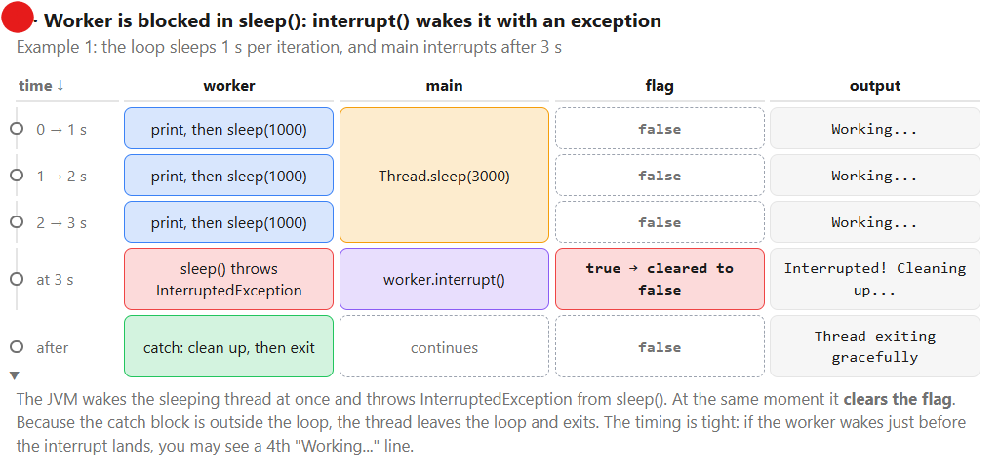
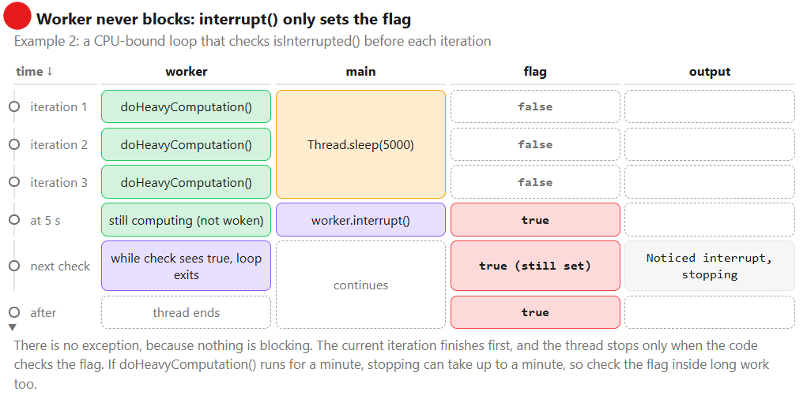

# Common Thread Methods

### `Thread.sleep(ms)` — Pause the Current Thread

Suspends the current thread for a specified duration. The thread goes to TIMED_WAITING and does NOT release any locks it holds.

```java
System.out.println("Start");
Thread.sleep(2000);          // pauses for 2 seconds (current thread)
System.out.println("End");   // prints 2 seconds later

// sleep() is a STATIC method — always affects the CURRENT thread
// You can't make another thread sleep: t.sleep() still sleeps YOUR thread!
```

**C# equivalent:** `Thread.Sleep(2000)`

### `join()` — Wait for Another Thread to Finish

The calling thread blocks (WAITING) until the target thread terminates:

```java
Thread worker = new Thread(() -> {
    try { Thread.sleep(3000); } catch (InterruptedException e) {}
    System.out.println("Worker done");
});

worker.start();
System.out.println("Waiting for worker...");
worker.join();              // main thread WAITS here until worker finishes
System.out.println("Worker finished, continuing");

// Output:
// Waiting for worker...
// Worker done              (after 3 seconds)
// Worker finished, continuing
```

With timeout — don't wait forever:

```java
worker.join(1000);   // wait at most 1 second, then continue regardless
if (worker.isAlive()) {
    System.out.println("Worker still running, moving on");
}
```

**C# equivalent:** `thread.Join()` / `thread.Join(1000)`

### `yield()` — Hint to Scheduler

Suggests to the thread scheduler that the current thread is willing to give up its time slice. The scheduler may ignore this hint entirely.

```java
Thread t1 = new Thread(() -> {
    for (int i = 0; i < 5; i++) {
        System.out.println("T1: " + i);
        Thread.yield();   // hint: "I can pause, let others run"
    }
});

Thread t2 = new Thread(() -> {
    for (int i = 0; i < 5; i++) {
        System.out.println("T2: " + i);
        Thread.yield();
    }
});

t1.start();
t2.start();
// Output: interleaved (but yield doesn't guarantee it — scheduler decides)
```

**Key points:**
- `yield()` is a hint, not a command — the scheduler may ignore it
- The thread stays in RUNNABLE state (doesn't go to WAITING)
- Rarely used in practice — prefer `sleep()`, locks, or higher-level constructs

**C# equivalent:** `Thread.Yield()` (also just a hint)

### `interrupt()` — Signal a Thread to Stop

Java's interrupt is a **cooperative signal** — it asks a thread to stop, but the thread decides whether to comply. It's not a forced termination like the deprecated `Thread.stop()`.

#### The Core Mechanism

Every thread has an **interrupt status** (a boolean flag, initially `false`). When you call `thread.interrupt()`:

1. The flag is set to `true`
2. If the thread is blocked (sleeping, waiting, etc.), it gets woken up with an `InterruptedException`

```java
Thread worker = new Thread(() -> {
    // Flag starts as: false
    while (!Thread.currentThread().isInterrupted()) {   // check if flag == true
        System.out.println("Working...");
    }
    // Flag is now: true (that's why we exited the loop)
    System.out.println("Interrupted — cleaning up and exiting");
});

worker.start();
Thread.sleep(100);
worker.interrupt();   // flag: false → true
```

#### Two Scenarios

**Scenario 1: Thread is running (CPU-bound work)**

The interrupt flag becomes `true`, but nothing happens automatically. The thread must **check** the flag:

```java
// Flag: false initially
worker.interrupt();   // flag: false → true

// Inside the thread — must check manually
while (!Thread.interrupted()) {   // returns true if flag was true, then sets flag to false
    doWork();
}

// or
while (!Thread.currentThread().isInterrupted()) {   // returns true if flag is true, flag stays true
    doWork();
}
```


**Scenario 2: Thread is blocked (sleep, wait, join, I/O)**

The blocking method throws `InterruptedException` immediately, and the **flag becomes `false`**:

```java
Thread worker = new Thread(() -> {
    // Flag: false
    try {
        Thread.sleep(10000);   // blocked here
    } catch (InterruptedException e) {
        // Flag is now: false (was set to false when exception was thrown)
        System.out.println("Woken up early!");
    }
});

worker.start();
Thread.sleep(100);
worker.interrupt();   // flag: false → true, then sleep() throws and sets flag: true → false
```



#### The Flag-Becomes-False Gotcha

When `InterruptedException` is thrown, the interrupt flag becomes `false`. This is the most common source of bugs:

```java
// ❌ BAD — exception sets flag to false, outer loop never sees true
while (!Thread.currentThread().isInterrupted()) {   // checks if flag == true
    try {
        Thread.sleep(1000);
    } catch (InterruptedException e) {
        // flag is now: false — loop condition sees false, continues!
        System.out.println("Interrupted but continuing forever...");
    }
}

// ✓ GOOD — restore the flag to true, or exit
while (!Thread.currentThread().isInterrupted()) {
    try {
        Thread.sleep(1000);
    } catch (InterruptedException e) {
        // flag is: false (set by the exception)
        Thread.currentThread().interrupt();   // flag: false → true
        break;   // or let the loop condition see true and exit
    }
}
```

#### Three Methods to Know

| Method | What it does | Flag after call |
|--------|--------------|-----------------|
| `thread.interrupt()` | Sets flag to `true` (and wakes if blocked) | `true` |
| `Thread.interrupted()` | Returns current flag value, then sets flag to `false` | `false` |
| `thread.isInterrupted()` | Returns current flag value, flag unchanged | unchanged |

```java
Thread t = Thread.currentThread();
// flag: false

t.interrupt();                           // flag: false → true
System.out.println(t.isInterrupted());   // prints: true, flag stays: true
System.out.println(Thread.interrupted()); // prints: true, flag: true → false
System.out.println(t.isInterrupted());   // prints: false, flag stays: false
```

#### Detailed Flow: What Happens When You Call interrupt()

```
Thread state: RUNNING (doing CPU work)
─────────────────────────────────────
    interrupt() called
         │
         ▼
    flag: false → true
         │
         ▼
    Nothing else happens!
    Thread must check flag manually.


Thread state: BLOCKED (in sleep/wait/join)
──────────────────────────────────────────
    interrupt() called
         │
         ▼
    flag: false → true
         │
         ▼
    Blocking method detects flag == true
         │
         ▼
    flag: true → false  (reset before throwing)
         │
         ▼
    InterruptedException thrown
         │
         ▼
    Thread wakes up in catch block
    with flag == false
```

#### Proper Interrupt Handling Pattern

```java
public class Worker implements Runnable {
    @Override
    public void run() {
        // flag: false
        try {
            while (!Thread.currentThread().isInterrupted()) {   // loop while flag == false
                doWork();
                Thread.sleep(100);   // interruptible
            }
            // If we get here: flag == true (exited loop normally)
        } catch (InterruptedException e) {
            // If we get here: flag == false (exception reset it)
            Thread.currentThread().interrupt();   // flag: false → true (restore for caller)
        }
        // flag: true
        System.out.println("Worker exiting gracefully");
    }
}
```

#### What Gets Interrupted?

**Interruptible operations** (throw `InterruptedException`, set flag to `false`):
- `Thread.sleep()`
- `Object.wait()`
- `Thread.join()`
- `BlockingQueue.take()`, `put()`
- `Lock.lockInterruptibly()`
- `Condition.await()`
- Many NIO operations

**NOT interruptible** (flag becomes `true` but nothing happens):
- `synchronized` block (waiting for monitor)
- Regular I/O (`InputStream.read()`) — use `InterruptibleChannel` or close the stream
- `Lock.lock()` — use `lockInterruptibly()` instead
- CPU-bound loops — must check flag manually

```java
// ❌ Not interruptible
// flag becomes true, but thread stays blocked waiting for lock
synchronized (lock) {
    // waiting to acquire monitor — interrupt() just sets flag to true, doesn't wake
}

// ✓ Interruptible alternative
ReentrantLock lock = new ReentrantLock();
try {
    lock.lockInterruptibly();   // if flag == true, throws InterruptedException (and sets flag to false)
} catch (InterruptedException e) {
    // flag: false
    Thread.currentThread().interrupt();   // flag: false → true
}
```

#### Interrupt vs Volatile Flag

| Approach | Mechanism | Wakes blocked threads? |
|----------|-----------|------------------------|
| `thread.interrupt()` | Sets internal flag to `true`, wakes blocking calls | ✓ Yes |
| Volatile flag | Sets your custom `volatile boolean` to `true` | ❌ No |

```java
// Volatile flag — simple but doesn't wake sleep/wait
class Worker implements Runnable {
    private volatile boolean cancelled = false;   // your custom flag

    public void cancel() { cancelled = true; }

    public void run() {
        while (!cancelled) {
            doWork();
            try {
                Thread.sleep(10000);   // cancel() won't wake this!
            } catch (InterruptedException e) {
                break;
            }
        }
    }
}

// Interrupt — wakes blocked threads
class BetterWorker implements Runnable {
    public void run() {
        // flag: false
        while (!Thread.currentThread().isInterrupted()) {
            try {
                doWork();
                Thread.sleep(10000);   // interrupt() wakes this immediately
            } catch (InterruptedException e) {
                // flag: false
                break;
            }
        }
    }
}
```

#### ExecutorService Shutdown and Interrupts

```java
ExecutorService executor = Executors.newFixedThreadPool(4);

executor.shutdown();       // no new tasks, running tasks continue, flag unchanged
executor.shutdownNow();    // calls interrupt() on all worker threads (flag: false → true)

List<Runnable> notStarted = executor.shutdownNow();   // returns tasks that never started
```

#### Interrupt Summary Table

| Situation | Flag before | Action | Flag after |
|-----------|-------------|--------|------------|
| Thread starts | — | — | `false` |
| `interrupt()` called | `false` | Sets flag | `true` |
| `interrupt()` called again | `true` | No-op | `true` |
| `Thread.interrupted()` returns | `true` | Returns `true`, resets flag | `false` |
| `Thread.interrupted()` returns | `false` | Returns `false` | `false` |
| `isInterrupted()` returns | any | Returns current value | unchanged |
| `InterruptedException` thrown | `true` | Resets flag, throws | `false` |
| `sleep()`/`wait()` with flag `true` | `true` | Throws immediately | `false` |

**Key rules:**
1. `interrupt()` sets flag to `true`
2. `InterruptedException` sets flag to `false`
3. `Thread.interrupted()` sets flag to `false`
4. `isInterrupted()` never changes the flag
5. Always restore the flag (`Thread.currentThread().interrupt()`) if you catch the exception but don't exit

**C# equivalent:** `CancellationToken` / `CancellationTokenSource` (more structured than Java's approach)

### `isAlive()` — Check if Thread is Still Running

Returns `true` if the thread has been started and has not yet terminated:

```java
Thread t = new Thread(() -> {
    try { Thread.sleep(2000); } catch (InterruptedException e) {}
});

System.out.println(t.isAlive());  // false — not started yet (NEW)
t.start();
System.out.println(t.isAlive());  // true — running (RUNNABLE/TIMED_WAITING)
Thread.sleep(3000);
System.out.println(t.isAlive());  // false — finished (TERMINATED)
```

### `setPriority()` / `getPriority()` — Thread Priority

Thread priority is a hint to the OS scheduler about relative importance. Higher-priority threads get more CPU time — but this is NOT guaranteed (OS-dependent).

```java
Thread low = new Thread(() -> {
    for (int i = 0; i < 1_000_000; i++) { /* work */ }
    System.out.println("Low priority done");
});

Thread high = new Thread(() -> {
    for (int i = 0; i < 1_000_000; i++) { /* work */ }
    System.out.println("High priority done");
});

low.setPriority(Thread.MIN_PRIORITY);    // 1
high.setPriority(Thread.MAX_PRIORITY);   // 10

low.start();
high.start();
// High priority MIGHT finish first — but no guarantee
```

| Constant | Value | Meaning |
|----------|-------|---------|
| `Thread.MIN_PRIORITY` | 1 | Lowest priority |
| `Thread.NORM_PRIORITY` | 5 | Default priority |
| `Thread.MAX_PRIORITY` | 10 | Highest priority |

**Key points:**
- Priority is a suggestion — the OS can ignore it
- On most modern OS (Linux, Windows), thread priority has minimal effect
- Don't rely on priority for correctness — use proper synchronization instead
- New threads inherit their parent thread's priority

**C# equivalent:** `thread.Priority = ThreadPriority.Highest` (same caveats)

### `setName()` / `getName()` — Thread Naming

Useful for debugging — thread names show up in logs, stack traces, and profilers:

```java
Thread t = new Thread(() -> {
    System.out.println("Running in: " + Thread.currentThread().getName());
});
t.setName("order-processor-1");
t.start();
// Output: Running in: order-processor-1
```

### `currentThread()` — Get the Current Thread

Static method that returns the thread currently executing:

```java
Thread current = Thread.currentThread();
System.out.println(current.getName());        // "main" (if in main method)
System.out.println(current.getPriority());    // 5 (NORM_PRIORITY)
System.out.println(current.isDaemon());       // false
System.out.println(current.getState());       // RUNNABLE
```

### Quick Reference Table

| Method | Static? | What it Does | Affects |
|--------|:-------:|-------------|---------|
| `Thread.sleep(ms)` | Yes | Pause current thread | Current thread |
| `t.join()` | No | Wait for `t` to finish | Current thread waits |
| `Thread.yield()` | Yes | Hint: give up time slice | Current thread |
| `t.interrupt()` | No | Set interrupt flag on `t` | Target thread `t` |
| `t.isInterrupted()` | No | Check interrupt flag | Target thread `t` |
| `Thread.interrupted()` | Yes | Check AND clear interrupt flag | Current thread |
| `t.isAlive()` | No | Is `t` still running? | Query on `t` |
| `t.setPriority(n)` | No | Set scheduling priority | Target thread `t` |
| `t.setDaemon(bool)` | No | Set daemon status (before start) | Target thread `t` |
| `t.setName(str)` | No | Set thread name | Target thread `t` |
| `Thread.currentThread()` | Yes | Get the executing thread | Returns current |
| `t.getState()` | No | Get thread state | Query on `t` |
