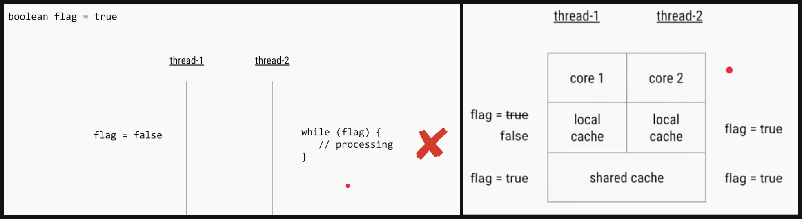
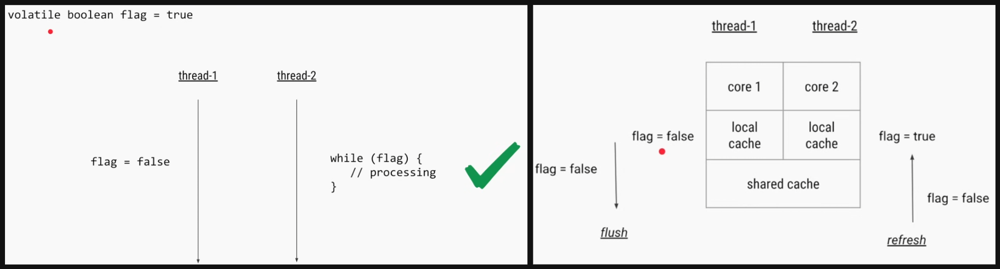
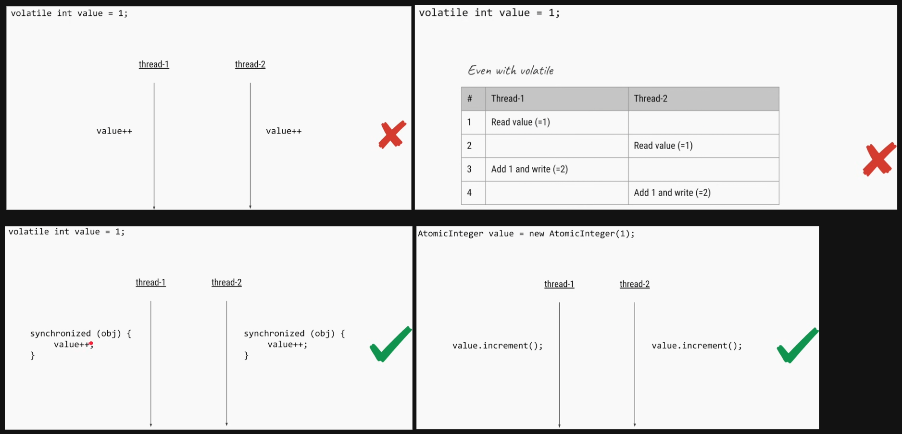
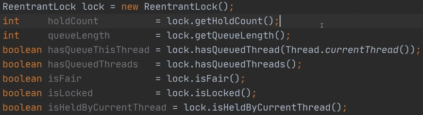
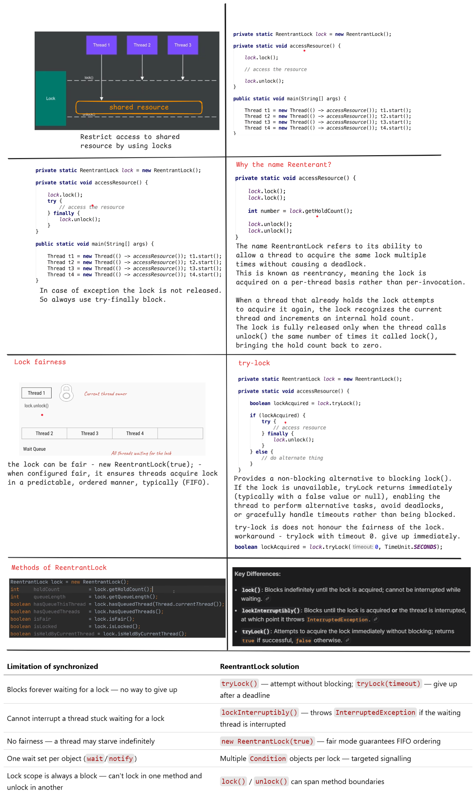
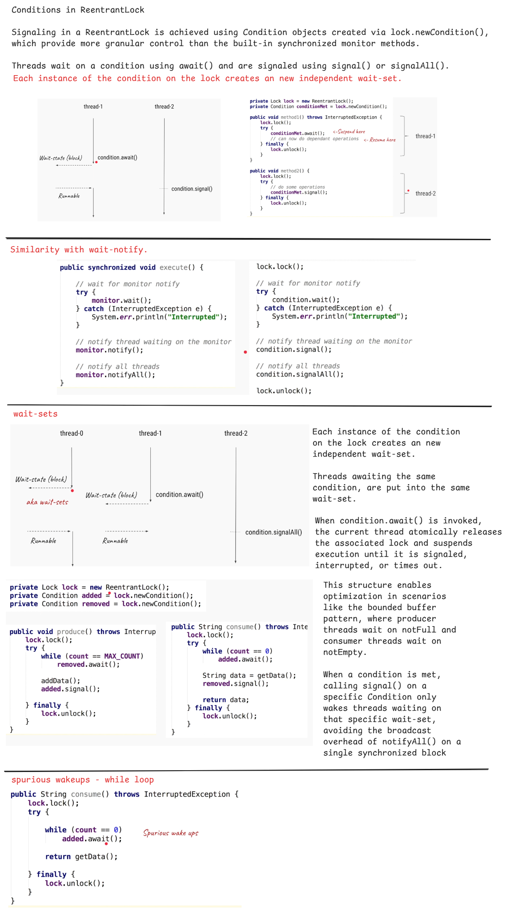
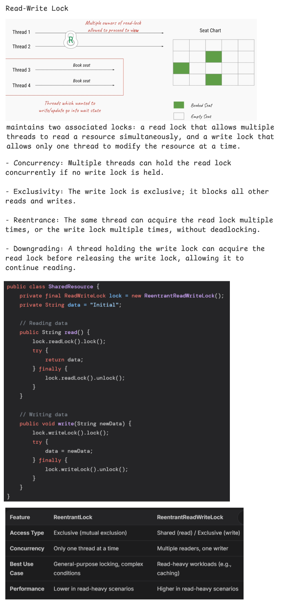

# 5. Synchronization

This section consolidates all synchronization mechanisms in Java — from the built-in `synchronized` keyword through lock-free atomics, explicit locks, and higher-level coordination primitives. They're presented in order from simplest to most specialized.

### 5.1 Intrinsic Locks (synchronized)

Every Java object has an associated **monitor lock** (intrinsic lock).

```java
public class SafeCounter {
    private int count = 0;

    // Method-level synchronization (lock = this)
    public synchronized void increment() {
        count++;
    }

    // Block-level synchronization (finer granularity)
    public void incrementBlock() {
        synchronized (this) {
            count++;
        }
    }

    // Static synchronized (lock = Class object)
    private static int globalCount = 0;
    public static synchronized void globalIncrement() {
        globalCount++;
    }
}
```

**Key properties of synchronized:**
- **Mutual exclusion**: Only one thread holds the lock at a time.
- **Visibility**: Changes made inside a synchronized block are visible to the next thread that acquires the same lock.
- **Reentrant**: A thread can re-acquire a lock it already holds (avoids self-deadlock).

**Limitations of synchronized:**
- Cannot interrupt a thread waiting for a lock
- Cannot attempt to acquire a lock without blocking (no tryLock)
- Cannot have multiple condition variables per lock
- No fairness guarantee (a thread may starve)

---

### 5.2 wait() / notify() / notifyAll()

Every Java object has a built-in **wait set** tied to its monitor. These three methods — defined on `Object`, not `Thread` — let threads coordinate inside `synchronized` blocks.

| Method | What it does |
|--------|-------------|
| `wait()` | Releases the monitor lock, puts the current thread into the wait set (WAITING state) until another thread calls `notify()`/`notifyAll()` on the same object |
| `notify()` | Wakes up one arbitrary thread from the wait set. The woken thread must re-acquire the lock before continuing |
| `notifyAll()` | Wakes up all threads in the wait set. They compete for the lock; only one proceeds at a time |

All three must be called from inside a `synchronized` block on the same object — otherwise you get `IllegalMonitorStateException`.

#### Why wait() releases the lock

If `wait()` held the lock while sleeping, no other thread could enter a `synchronized` block on that object to call `notify()` — instant deadlock. So `wait()` atomically releases the lock and suspends the thread. When the thread is woken, it re-acquires the lock before `wait()` returns.

```
Thread A                              Thread B
────────                              ────────
synchronized(lock) {
    while (!condition)
        lock.wait();  ──────────►  (releases lock, sleeps)
                                      synchronized(lock) {  ← acquires lock
                                          condition = true;
                                          lock.notify();     ← wakes A
                                      }                      ← releases lock
    // re-acquires lock ◄──────────
    // condition is true, proceed
}
```

#### The Guarded Block Pattern (always use while, never if)

```java
// WRONG — can miss the condition due to spurious wakeups
synchronized (lock) {
    if (!ready) lock.wait();   // ❌ might proceed even if still not ready
    doWork();
}

// CORRECT — re-check after every wakeup
synchronized (lock) {
    while (!ready) lock.wait(); // ✓ loops back if woken spuriously
    doWork();
}
```

Spurious wakeups are permitted by the JVM spec — a thread can wake from `wait()` without `notify()` being called. The `while` loop guards against this.

#### Producer-Consumer Example

```java
public class MessageQueue {
    private final Queue<String> queue = new LinkedList<>();
    private final int capacity;
    private final Object lock = new Object();

    public MessageQueue(int capacity) {
        this.capacity = capacity;
    }

    public void produce(String message) throws InterruptedException {
        synchronized (lock) {
            while (queue.size() == capacity) {
                lock.wait();    // queue full — wait for consumer to take
            }
            queue.add(message);
            lock.notifyAll();   // wake consumers (and other producers checking capacity)
        }
    }

    public String consume() throws InterruptedException {
        synchronized (lock) {
            while (queue.isEmpty()) {
                lock.wait();    // queue empty — wait for producer to add
            }
            String message = queue.poll();
            lock.notifyAll();   // wake producers (and other consumers checking empty)
            return message;
        }
    }
}
```

#### notify() vs notifyAll()

| | `notify()` | `notifyAll()` |
|--|-----------|--------------|
| Wakes | One arbitrary thread | All waiting threads |
| Risk | If the wrong thread wakes up (e.g., producer wakes producer), progress stalls — **lost wakeup** | All threads wake, re-check condition, losers go back to `wait()` — safe but more contention |
| Use when | Only one type of waiter, or you're certain which thread should proceed | Multiple types of waiters (producers + consumers), or when in doubt |

**Rule of thumb:** Prefer `notifyAll()` unless you have a clear reason to use `notify()` and can prove no lost wakeups occur.

#### wait(timeout) — Timed Wait

```java
synchronized (lock) {
    long deadline = System.currentTimeMillis() + 5000;
    while (!ready) {
        long remaining = deadline - System.currentTimeMillis();
        if (remaining <= 0) break;  // timed out
        lock.wait(remaining);       // wait up to remaining ms
    }
}
```

The thread wakes on `notify()`, timeout expiry, or spurious wakeup — the `while` loop handles all three.

**C# equivalent:** `Monitor.Wait(obj)` / `Monitor.Pulse(obj)` / `Monitor.PulseAll(obj)` — same semantics, same requirement to hold the lock.

---

### 5.3 Volatile Keyword

`volatile` ensures **visibility** and **ordering** but NOT atomicity.

#### The Visibility Problem (without volatile)

Each thread has its own working memory (CPU registers, L1/L2 cache). When a thread writes to a variable, the new value may stay in its local cache and never get flushed to main memory — so other threads keep reading the stale value.



   Thread A set it to false, but Thread B never sees the change.

```java
public class VisibilityBug {
    private boolean running = true; // NOT volatile

    public void stop() {
        running = false; // writes to Thread A's cache — may never reach main memory
    }

    public void run() {
        while (running) {
            // The JIT compiler sees that 'running' is never modified in this thread,
            // so it optimizes the loop to: while (true) { ... }
            // Even after stop() is called, this loop runs FOREVER.
            doWork();
        }
        System.out.println("Stopped"); // never printed!
    }

    private void doWork() {
        // simulate work
    }

    public static void main(String[] args) throws InterruptedException {
        VisibilityBug bug = new VisibilityBug();

        Thread worker = new Thread(() -> bug.run());   // Thread B — reads 'running'
        worker.start();

        Thread.sleep(1000);  // let worker spin for a second

        bug.stop();          // Thread A (main) — sets running = false

        worker.join(3000);   // wait up to 3s for worker to finish
        if (worker.isAlive()) {
            System.out.println("Worker is STILL running — visibility bug!");
            // On server JVMs with -server or C2 JIT, this is the typical outcome.
            // The worker thread never saw running == false.
        }
    }
}
```

This is not a theoretical issue — it happens reliably on server JVMs with JIT optimizations enabled. The JIT hoists the read of `running` out of the loop because it has no reason to believe another thread modifies it.

#### How volatile solves it

Adding `volatile` forces every read to go to main memory and every write to flush to main memory. The JIT cannot cache or hoist the variable.

#### What volatile guarantees:
1. **Visibility**: A write to a volatile variable is immediately visible to all threads (flushes to main memory).
2. **Happens-before**: A write to a volatile field happens-before every subsequent read of that field.
3. **Prevents reordering**: The JIT/CPU cannot reorder instructions across a volatile read/write.

```java
public class VolatileExample {
    private volatile boolean running = true; // visibility guaranteed

    public void stop() {
        running = false; // instantly visible to reader thread
    }

    public void run() {
        while (running) {
            // Without volatile, the JIT may hoist the read of 'running'
            // outside the loop (never re-reading from memory), creating
            // an infinite loop even after stop() is called.
            doWork();
        }
    }
}
```

#### When to use volatile:
- Simple flags (stop signals, status indicators)
- Double-checked locking pattern (singleton)
- Publishing immutable objects


#### What volatile does NOT guarantee:
- **Atomicity**: `volatileVar++` is still not atomic (read-modify-write is 3 steps).




```java
// Double-checked locking with volatile
public class Singleton {
    private static volatile Singleton instance;

    public static Singleton getInstance() {
        if (instance == null) {                  // first check (no lock)
            synchronized (Singleton.class) {
                if (instance == null) {          // second check (with lock)
                    instance = new Singleton();  // volatile prevents seeing
                }                               // partially constructed object
            }
        }
        return instance;
    }
}
```

---

### 5.4 Explicit Locks (java.util.concurrent.locks)

Explicit locks provide the same mutual exclusion as `synchronized` but with more control — tryLock, timed waits, interruptible acquisition, fairness policies, and multiple conditions per lock.

| Lock | When to use |
|------|-------------|
| `ReentrantLock` | Drop-in replacement for `synchronized` when you need tryLock, fairness, or multiple conditions |
| `ReentrantReadWriteLock` | Read-heavy workloads — multiple concurrent readers, exclusive writers |
| `StampedLock` | Read-heavy + high throughput — optimistic reads avoid locking entirely |

#### 5.4.1 ReentrantLock

##### How it's similar to synchronized — lock() and unlock()

`ReentrantLock` does the same job as `synchronized` — mutual exclusion. Only one thread holds the lock at a time. It's also reentrant, meaning a thread that already holds the lock can acquire it again without deadlocking (just like `synchronized`).

```java
// synchronized version:
synchronized (lockObj) {
    // critical section
}

// ReentrantLock equivalent:
ReentrantLock lock = new ReentrantLock();
lock.lock();          // acquire — blocks until available (like entering synchronized)
try {
    // critical section
} finally {
    lock.unlock();    // release — MUST be in finally (synchronized does this automatically)
}
```

The core difference: `synchronized` handles lock/unlock automatically (tied to the block scope), while `ReentrantLock` requires you to call `lock()` and `unlock()` manually. Miss the `unlock()` in a `finally` and you've got a permanent lock — one of the trade-offs of explicit control.

##### Why ReentrantLock exists if synchronized already works

`synchronized` is simple but limited. There are things you simply can't do with it:

| Limitation of synchronized | ReentrantLock solution |
|---------------------------|----------------------|
| Blocks forever waiting for a lock — no way to give up | `tryLock()` — attempt without blocking; `tryLock(timeout)` — give up after a deadline |
| Cannot interrupt a thread stuck waiting for a lock | `lockInterruptibly()` — throws `InterruptedException` if the waiting thread is interrupted |
| No fairness — a thread may starve indefinitely | `new ReentrantLock(true)` — fair mode guarantees FIFO ordering |
| One wait set per object (`wait`/`notify`) | Multiple `Condition` objects per lock — targeted signalling |
| Lock scope is always a block — can't lock in one method and unlock in another | `lock()` / `unlock()` can span method boundaries |

If you don't need any of these, `synchronized` is perfectly fine — simpler and slightly less error-prone.

##### Fairness

By default, both `synchronized` and `ReentrantLock` are **unfair** — when the lock is released, any waiting thread can grab it, even if another thread has been waiting longer. A thread that just arrived can "barge" ahead of threads that have been queued for a long time.

```java
// Unfair (default) — faster throughput, but threads can starve
ReentrantLock unfairLock = new ReentrantLock();        // fair = false

// Fair — threads acquire the lock in the order they requested it (FIFO)
ReentrantLock fairLock = new ReentrantLock(true);      // fair = true
```

**Why unfair is the default:** When thread A releases the lock and thread B is about to be unparked from the wait queue, there's a window where thread C (already running on a CPU) can grab the lock, do its work, and release it — all before B even wakes up. This is faster because it avoids the cost of a context switch. Under most workloads, unfair locks have significantly higher throughput.

**When fairness matters:** If many threads compete for the same lock for extended periods, unfair locking can starve unlucky threads indefinitely — they keep getting bumped by barging threads. Fair mode guarantees progress for every thread at the cost of lower throughput (more context switches, no barging).

```
Unfair (default):                     Fair:
                                      
Lock released                         Lock released
    │                                     │
    ▼                                     ▼
Any thread can grab it                Longest-waiting thread gets it
(barge-in allowed)                    (strict FIFO queue)
    │                                     │
    ▼                                     ▼
Higher throughput                     Lower throughput
Possible starvation                   No starvation — guaranteed progress
```

##### tryLock() — Non-blocking acquisition

`tryLock()` attempts to acquire the lock and returns immediately with `true` (got it) or `false` (didn't get it). The thread is never blocked.

```java
ReentrantLock lock = new ReentrantLock();

if (lock.tryLock()) {
    try {
        // critical section — we got the lock
    } finally {
        lock.unlock();
    }
} else {
    // lock not available — do something else instead of waiting
    log.info("Busy, will retry later");
}
```

The timed variant waits up to a deadline, then gives up:

```java
if (lock.tryLock(500, TimeUnit.MILLISECONDS)) {
    try { /* ... */ } finally { lock.unlock(); }
} else {
    // timed out — 500ms passed without acquiring the lock
}
```

**The killer use case — deadlock avoidance with multiple locks:**

If two threads need locks A and B but might acquire them in different order, `tryLock` lets a thread back off instead of blocking forever:

```java
public void transferMoney(Account from, Account to, int amount) {
    while (true) {
        if (from.lock.tryLock()) {
            try {
                if (to.lock.tryLock()) {
                    try {
                        from.debit(amount);
                        to.credit(amount);
                        return; // success — both locks acquired
                    } finally {
                        to.lock.unlock();
                    }
                }
                // couldn't get second lock — release first and retry
            } finally {
                from.lock.unlock();
            }
        }
        // back off briefly to avoid livelock
        Thread.sleep(ThreadLocalRandom.current().nextInt(1, 10));
    }
}
```

With `synchronized`, if Thread 1 holds `from` and waits for `to` while Thread 2 holds `to` and waits for `from` — deadlock, forever. With `tryLock`, the thread that fails to get the second lock releases the first and retries. Neither thread is stuck permanently.

##### lockInterruptibly()

```java
// lockInterruptibly: can be interrupted while waiting for the lock
lock.lockInterruptibly(); // throws InterruptedException if the thread is interrupted while waiting
```

```java
import java.util.concurrent.locks.ReentrantLock;
import java.util.concurrent.locks.Lock;

public class InterruptibleLockExample {
    private static final Lock lock = new ReentrantLock();

    public static void main(String[] args) {
        Thread t1 = new Thread(() -> {
            try {
                // Blocks until lock is acquired OR thread is interrupted
                lock.lockInterruptibly();
                try {
                    System.out.println(Thread.currentThread().getName() + " acquired lock");
                    Thread.sleep(2000);
                } finally {
                    lock.unlock();
                }
            } catch (InterruptedException e) {
                System.out.println(Thread.currentThread().getName() + " was interrupted while waiting");
                // Restore interrupted status
                Thread.currentThread().interrupt();
            }
        });

        Thread t2 = new Thread(() -> {
            try {
                lock.lock(); // Holds the lock for 500ms
                Thread.sleep(500);
                lock.unlock();
            } catch (InterruptedException e) {
                e.printStackTrace();
            }
        });

        t1.start();
        t2.start();

        // Interrupt t1 after 100ms to demonstrate interruptible behavior
        try {
            Thread.sleep(100);
            t1.interrupt();
        } catch (InterruptedException e) {
            e.printStackTrace();
        }
        
        try {
            t1.join();
            t2.join();
        } catch (InterruptedException e) {
            e.printStackTrace();
        }
    }
}   
```
Key Differences:
- `lock()`: Blocks indefinitely until the lock is acquired; cannot be interrupted while waiting. 
- `lockInterruptibly()`: Blocks until the lock is acquired or the thread is interrupted, at which point it throws `InterruptedException`. 
- `tryLock()`: Attempts to acquire the lock immediately without blocking; returns true if successful, false otherwise.


##### Methods of Reenterant Lock



##### Reentrant Lock Summary


##### BoundedBuffer — ReentrantLock + Condition in practice

```java
import java.util.concurrent.locks.ReentrantLock;
import java.util.concurrent.locks.Condition;

public class BoundedBuffer<T> {
    private final Object[] items;
    private int putIndex, takeIndex, count;

    private final ReentrantLock lock = new ReentrantLock(true); // fair=true
    private final Condition notFull = lock.newCondition();
    private final Condition notEmpty = lock.newCondition();

    public BoundedBuffer(int capacity) {
        items = new Object[capacity];
    }

    public void put(T item) throws InterruptedException {
        lock.lock();
        try {
            while (count == items.length) {
                notFull.await(); // releases lock and waits
            }
            items[putIndex] = item;
            if (++putIndex == items.length) putIndex = 0;
            count++;
            notEmpty.signal(); // wake up one consumer
        } finally {
            lock.unlock(); // ALWAYS in finally!
        }
    }

    @SuppressWarnings("unchecked")
    public T take() throws InterruptedException {
        lock.lock();
        try {
            while (count == 0) {
                notEmpty.await();
            }
            T item = (T) items[takeIndex];
            items[takeIndex] = null;
            if (++takeIndex == items.length) takeIndex = 0;
            count--;
            notFull.signal();
            return item;
        } finally {
            lock.unlock();
        }
    }
}
```

#### 5.4.2 Condition — Multiple Wait Sets Per Lock

`Condition` replaces `Object.wait()`/`notify()` when using explicit locks. The key advantage: you can have multiple conditions on a single lock, so producers and consumers wait on separate queues instead of one shared wait set.

| `Object` monitor methods | `Condition` equivalent | Difference |
|--------------------------|----------------------|------------|
| `obj.wait()` | `condition.await()` | Must hold `ReentrantLock`, not `synchronized` |
| `obj.notify()` | `condition.signal()` | Wakes one thread waiting on this specific condition |
| `obj.notifyAll()` | `condition.signalAll()` | Wakes all threads waiting on this specific condition |

##### What is a wait set?

A wait set is a queue of threads that called `await()` (or `wait()`) on a particular object or condition. They're parked — not consuming CPU, not holding the lock — just sleeping until someone calls `signal()` or `notify()` to wake them.

With `synchronized`, every object has exactly one wait set. Every thread that calls `obj.wait()` goes into the same queue, regardless of why it's waiting:

```
┌─────────────────────────────────────────────────────────┐
│                  synchronized (obj)                       │
│                                                          │
│   Owner: Thread-3                                        │
│                                                          │
│   ┌──────────────────────────────────────────────┐      │
│   │  Single wait set (obj.wait())                 │      │
│   │                                               │      │
│   │  → Producer-1  💤                             │      │
│   │  → Consumer-1  💤                             │      │
│   │  → Producer-2  💤                             │      │
│   │  → Consumer-2  💤                             │      │
│   └──────────────────────────────────────────────┘      │
│                                                          │
│   obj.notify() ──► wakes ONE random thread               │
│   Might wake Producer-1 when you needed a Consumer!      │
│   (lost wakeup — Producer checks condition,              │
│    goes right back to sleep)                             │
└─────────────────────────────────────────────────────────┘
```

With `Condition`, a single lock can have multiple wait sets — each `lock.newCondition()` creates a separate queue:

```
┌─────────────────────────────────────────────────────────┐
│                    ReentrantLock                          │
│                                                          │
│   Owner: Thread-3 (currently holding the lock)           │
│                                                          │
│   ┌──────────────────────┐  ┌──────────────────────┐    │
│   │  Condition: notFull   │  │  Condition: notEmpty  │    │
│   │  (producer wait set)  │  │  (consumer wait set)  │    │
│   │                       │  │                       │    │
│   │  → Producer-1  💤     │  │  → Consumer-1  💤     │    │
│   │  → Producer-2  💤     │  │  → Consumer-2  💤     │    │
│   └──────────────────────┘  └──────────────────────┘    │
│                                                          │
│   notEmpty.signal() ──► wakes Consumer-1 only            │
│   notFull.signal()  ──► wakes Producer-1 only            │
│                                                          │
│   (no wasted wakeups — each signal targets               │
│    the right type of thread)                             │
└─────────────────────────────────────────────────────────┘
```

##### When does Producer-2 get woken?

Producer-2 is in the `notFull` wait set — it called `notFull.await()` because the queue was full. It gets woken when a consumer takes an item and calls `notFull.signal()`:

```
Time  Action                                            notFull wait set        notEmpty wait set
────  ──────                                            ────────────────        ─────────────────
 1    Queue is full, Producer-1 calls notFull.await()   [Producer-1]            []
 2    Queue is full, Producer-2 calls notFull.await()   [Producer-1, Producer-2] []
 3    Consumer-1 takes an item                          [Producer-1, Producer-2] []
 4    Consumer-1 calls notFull.signal()                 [Producer-2]            []
      → wakes Producer-1 (head of queue)
 5    Producer-1 re-acquires lock, adds item            [Producer-2]            []
 6    Producer-1 calls notEmpty.signal()                [Producer-2]            []
      → no consumers waiting, signal is lost (that's OK)
 7    Consumer-2 takes an item                          [Producer-2]            []
 8    Consumer-2 calls notFull.signal()                 []                      []
      → wakes Producer-2 (now head of queue)
 9    Producer-2 re-acquires lock, adds item            []                      []
```

Producer-2 waits until it reaches the head of the `notFull` queue AND a consumer signals that queue. With a fair lock, the order is FIFO. With an unfair lock, Producer-1 still typically goes first since it's already queued, but barging from a new thread is possible.

```java
ReentrantLock lock = new ReentrantLock();
Condition notFull  = lock.newCondition();  // producers wait here
Condition notEmpty = lock.newCondition();  // consumers wait here

// Producer:
lock.lock();
try {
    while (queue.isFull())
        notFull.await();      // only releases THIS lock, waits on notFull
    queue.add(item);
    notEmpty.signal();        // wake a consumer — targeted, no wasted wakeups
} finally {
    lock.unlock();
}

// Consumer:
lock.lock();
try {
    while (queue.isEmpty())
        notEmpty.await();     // waits on notEmpty — separate from producers
    item = queue.remove();
    notFull.signal();         // wake a producer
} finally {
    lock.unlock();
}
```

**Why this matters:** With `synchronized` + `notify()`, you have one wait set per object. A `notify()` might wake a producer when you wanted to wake a consumer (lost wakeup). With `Condition`, producers and consumers have separate wait queues — `signal()` always targets the right thread type.

**Additional Condition features:**
- `await(long time, TimeUnit unit)` — timed wait
- `awaitUninterruptibly()` — cannot be interrupted
- `awaitUntil(Date deadline)` — wait until an absolute time

**C# equivalent:** `Monitor.Wait` / `Monitor.Pulse` only support one condition per lock. For multiple conditions, use `ManualResetEventSlim` or `SemaphoreSlim`.

**Condition Summary**

---

#### 5.4.3 ReadWriteLock (ReentrantReadWriteLock)

Allows concurrent reads but exclusive writes — ideal for read-heavy workloads.

```java
import java.util.concurrent.locks.ReentrantReadWriteLock;

ReentrantReadWriteLock rwLock = new ReentrantReadWriteLock();

// Multiple threads can read at the same time
public String read() {
    rwLock.readLock().lock();
    try {
        return data;           // concurrent reads — no blocking between readers
    } finally {
        rwLock.readLock().unlock();
    }
}

// Only one thread can write, and no readers allowed during a write
public void write(String newData) {
    rwLock.writeLock().lock();
    try {
        data = newData;        // exclusive access — all readers and writers wait
    } finally {
        rwLock.writeLock().unlock();
    }
}
```

##### Wait Queue (AQS) — How readers and writers are scheduled

`ReentrantReadWriteLock` uses a single AQS (AbstractQueuedSynchronizer) wait queue shared by both readers and writers. When the lock is released, AQS walks the queue from the head and wakes consecutive readers as a batch — until it hits a writer node. That writer acts as a barrier: readers behind it must wait, even though the lock is in read mode.

```
┌─────────────────────────────────────────────────────────────────┐
│            ReentrantReadWriteLock — AQS Wait Queue              │
│                                                                 │
│   Current state: Writer-A holds the write lock                  │
│                                                                 │
│   Wait queue (threads blocked trying to acquire):               │
│   ┌─────────┐   ┌─────────┐   ┌─────────┐   ┌─────────┐         │
│   │Reader-1 │──►│Reader-2 │──►│Writer-B │──►│Reader-3 │         │
│   │ (read)  │   │ (read)  │   │ (write) │   │ (read)  │         │
│   └─────────┘   └─────────┘   └─────────┘   └─────────┘         │
│       head                                       tail           │
└─────────────────────────────────────────────────────────────────┘
```

When Writer-A releases:

```
Writer-A releases write lock
        │
        ▼
  Head of queue is Reader-1 (read request)
        │
        ▼
  Wake Reader-1 ✓
  Next is Reader-2 (also read) → wake Reader-2 ✓  ← batch: concurrent reads
  Next is Writer-B (write) → STOP batching        ← writer is a barrier
        │
        ▼
  Reader-1 and Reader-2 run concurrently
  Writer-B and Reader-3 remain queued
        │
        ▼
  When Reader-1 and Reader-2 both release:
  Writer-B acquires write lock (exclusive)
  Reader-3 still waits (behind Writer-B)
```

##### Condition with ReadWriteLock

You can only create a `Condition` from the **write lock** — not the read lock. This is because `await()` requires exclusive ownership of the lock (to safely release and re-acquire it), and multiple readers can hold the read lock simultaneously.

```java
ReentrantReadWriteLock rwLock = new ReentrantReadWriteLock();
Condition condition = rwLock.writeLock().newCondition();  // ✓ OK
// Condition condition = rwLock.readLock().newCondition();  // ✗ throws UnsupportedOperationException
```

```
┌──────────────────────────────────────────────────────────────────┐
│                  ReentrantReadWriteLock                            │
│                                                                    │
│   ┌──────────────────────┐    ┌────────────────────────────┐     │
│   │      Read Lock        │    │        Write Lock           │     │
│   │  (shared — multiple   │    │  (exclusive — one holder)   │     │
│   │   readers allowed)    │    │                              │     │
│   │                       │    │   ┌────────────────────┐    │     │
│   │  newCondition() ✗     │    │   │  Condition          │    │     │
│   │  (UnsupportedOp)      │    │   │  (await/signal OK)  │    │     │
│   │                       │    │   └────────────────────┘    │     │
│   └──────────────────────┘    └────────────────────────────┘     │
└──────────────────────────────────────────────────────────────────┘
```

If you need condition-based signalling with read-write semantics, coordinate through the write lock. Here's a shared data store where a writer publishes data and multiple readers wait for it:

```java
public class SharedDataStore<T> {
    private T data = null;
    private boolean hasData = false;
    private final ReentrantReadWriteLock rwLock = new ReentrantReadWriteLock();
    private final Condition dataAvailable = rwLock.writeLock().newCondition();

    // Writer — publishes new data and wakes all waiting readers
    public void publish(T newData) {
        rwLock.writeLock().lock();
        try {
            data = newData;
            hasData = true;
            dataAvailable.signalAll();  // wake all threads waiting for data
        } finally {
            rwLock.writeLock().unlock();
        }
    }

    // Called under write lock — waits until data is available
    // (must use write lock because Condition requires exclusive ownership)
    public T waitForData() throws InterruptedException {
        rwLock.writeLock().lock();
        try {
            while (!hasData) {
                dataAvailable.await();  // releases write lock, sleeps
            }
            return data;
        } finally {
            rwLock.writeLock().unlock();
        }
    }

    // Reader — concurrent reads, no waiting
    public T read() {
        rwLock.readLock().lock();
        try {
            return data;  // multiple readers run concurrently
        } finally {
            rwLock.readLock().unlock();
        }
    }
}
```

```java
// Client code
SharedDataStore<String> store = new SharedDataStore<>();

// 5 reader threads — read concurrently once data exists
for (int i = 0; i < 5; i++) {
    new Thread(() -> {
        try {
            String value = store.waitForData();  // blocks until writer publishes
            System.out.println(Thread.currentThread().getName() + " got: " + value);
            // After first read, subsequent reads can use store.read() concurrently
        } catch (InterruptedException e) {
            Thread.currentThread().interrupt();
        }
    }, "reader-" + i).start();
}

Thread.sleep(1000); // let readers block

// Writer publishes — all 5 readers wake up
new Thread(() -> store.publish("Hello from writer"), "writer").start();
```

**Note:** `waitForData()` uses the write lock (not read lock) because `Condition.await()` requires exclusive ownership. Once data is published, subsequent reads can use `read()` which only takes the read lock — allowing full concurrency.

**Summary**



#### 5.4.4 StampedLock (Java 8+ — optimistic reading)

```java
import java.util.concurrent.locks.StampedLock;

public class Point {
    private double x, y;
    private final StampedLock sl = new StampedLock();

    public void move(double deltaX, double deltaY) {
        long stamp = sl.writeLock(); // exclusive
        try {
            x += deltaX;
            y += deltaY;
        } finally {
            sl.unlockWrite(stamp);
        }
    }

    public double distanceFromOrigin() {
        // Optimistic read: no lock, no blocking, no CAS
        long stamp = sl.tryOptimisticRead();
        double currentX = x, currentY = y;

        if (!sl.validate(stamp)) {
            // A write occurred during our read — fall back to pessimistic read lock
            stamp = sl.readLock();
            try {
                currentX = x;
                currentY = y;
            } finally {
                sl.unlockRead(stamp);
            }
        }
        return Math.sqrt(currentX * currentX + currentY * currentY);
    }
}
```

**StampedLock characteristics:**
- NOT reentrant (do not call recursively!)
- Optimistic reads have zero overhead when no writes occur
- 3 modes: write, read (pessimistic), optimistic read
- Stamps can be converted: optimistic → read → write

### 5.5 Compare-And-Swap (CAS)

#### The Core Concept

CAS is a **hardware-level atomic instruction** (CPU instruction like `CMPXCHG` on x86) that forms the foundation of all lock-free/non-blocking algorithms in Java.

**CAS operation:**
```
CAS(memoryLocation, expectedValue, newValue)
  → if (memoryLocation == expectedValue)
        memoryLocation = newValue
        return true   // success
    else
        return false  // someone else changed it; retry
```

This entire operation is **atomic at the hardware level** — no other thread can intervene between the comparison and the swap.

#### How CAS Works Internally

```
┌──────────────┐          ┌─────────────────────┐
│   Thread A   │          │      Main Memory     │
│              │          │                       │
│  1. Read     │◄─────────│  counter = 5          │
│     value=5  │          │                       │
│              │          │                       │
│  2. Compute  │          │                       │
│     new=6    │          │                       │
│              │          │                       │
│  3. CAS(5,6) │─────────►│  if(5==5) → set to 6 │ ← atomic CPU instruction
│     SUCCESS  │          │  counter = 6          │
└──────────────┘          └─────────────────────┘

┌──────────────┐          ┌─────────────────────┐
│   Thread B   │          │      Main Memory     │
│              │          │                       │
│  1. Read     │◄─────────│  counter = 5          │
│     value=5  │          │                       │
│              │          │                       │
│  2. Compute  │          │  (Thread A changes    │
│     new=6    │          │   counter to 6)       │
│              │          │                       │
│  3. CAS(5,6) │─────────►│  if(5==6) → FAIL!    │ ← expected≠actual
│     FAIL     │          │  counter still = 6    │
│              │          │                       │
│  4. RETRY:   │◄─────────│  read counter = 6     │
│     read=6   │          │                       │
│  5. CAS(6,7) │─────────►│  if(6==6) → set to 7 │ ← retry succeeds
│     SUCCESS  │          │  counter = 7          │
└──────────────┘          └─────────────────────┘
```

#### CAS vs Locking

| Aspect | CAS (Lock-Free) | synchronized/Lock |
|--------|-----------------|-------------------|
| Blocking | Never blocks; retries on failure | Blocks waiting threads |
| Deadlock | Impossible | Possible |
| Performance (low contention) | Excellent (no kernel calls) | Good (biased locking helps) |
| Performance (high contention) | Degrades (spin-retry wastes CPU) | Better (threads sleep) |
| Progress guarantee | Lock-free (system-wide progress) | May starve |
| Complexity | Higher (ABA problem, etc.) | Lower |

#### The ABA Problem

```java
// Thread 1: reads value A, gets preempted
// Thread 2: changes A → B → A (back to original)
// Thread 1: CAS succeeds (sees A, expects A) — but the state has changed!

// Example: lock-free stack
// Stack: A → B → C
// Thread 1: pop() reads top=A, next=B, about to CAS(A, B)
// Thread 2: pops A, pops B, pushes A back  →  Stack: A → C
// Thread 1: CAS(A, B) succeeds! But B is gone — corrupted stack!
```

**Solution: AtomicStampedReference**
```java
AtomicStampedReference<String> ref = new AtomicStampedReference<>("A", 0);

int[] stampHolder = new int[1];
String current = ref.get(stampHolder); // gets value AND stamp
int stamp = stampHolder[0];

// CAS now checks BOTH value AND stamp
boolean success = ref.compareAndSet(current, "B", stamp, stamp + 1);
// Even if value goes A → B → A, the stamp will be different (0 → 1 → 2)
```

#### CAS in the JVM: sun.misc.Unsafe and VarHandle

```java
// Pre-Java 9: sun.misc.Unsafe (internal API)
// The Atomic classes delegate to Unsafe internally:
// Unsafe.compareAndSwapInt(object, offset, expected, newValue)

// Java 9+: VarHandle (public API replacement for Unsafe)
import java.lang.invoke.MethodHandles;
import java.lang.invoke.VarHandle;

public class CASWithVarHandle {
    private volatile int counter = 0;

    private static final VarHandle COUNTER;
    static {
        try {
            COUNTER = MethodHandles.lookup()
                .findVarHandle(CASWithVarHandle.class, "counter", int.class);
        } catch (Exception e) {
            throw new ExceptionInInitializerError(e);
        }
    }

    public void increment() {
        int prev;
        do {
            prev = counter; // volatile read
        } while (!COUNTER.compareAndSet(this, prev, prev + 1)); // CAS loop
    }

    // Weaker variants for performance when full ordering not needed:
    // COUNTER.weakCompareAndSet(this, prev, prev + 1);       // may spuriously fail
    // COUNTER.compareAndExchange(this, prev, prev + 1);      // returns witness value
    // COUNTER.getAndAdd(this, 1);                            // fetch-and-add
}
```

---

### 5.6 Atomic Classes

Atomic classes are lock-free, thread-safe wrappers in `java.util.concurrent.atomic` that use CAS (Compare-And-Swap) CPU instructions instead of locks. They provide atomicity without the overhead of `synchronized`.

#### Why They Exist

```java
// Problem: count++ is NOT atomic (read → modify → write = 3 operations)
int count = 0;
count++;   // race condition with multiple threads — updates get lost

// Solution: AtomicInteger — single atomic CPU instruction, no lock needed
AtomicInteger count = new AtomicInteger(0);
count.incrementAndGet();   // ONE atomic operation — no race condition
```

#### Common Methods Across All Atomic Classes

**Read / Write**
| Method | What it does |
|--------|-------------|
| `get()` | Volatile read — returns current value |
| `set(newValue)` | Volatile write — sets value, immediately visible to all threads |
| `lazySet(newValue)` | Eventual write — no StoreLoad barrier, slightly faster but visibility is delayed |

**Atomic Update**
| Method | What it does |
|--------|-------------|
| `getAndSet(newValue)` | Atomically sets to newValue, returns the old value |
| `compareAndSet(expected, new)` | CAS — if current == expected, set to new. Returns true/false |
| `weakCompareAndSet(expected, new)` | Same as CAS but may spuriously fail. Slightly faster on some architectures |

**Numeric (AtomicInteger / AtomicLong only)**
| Method | What it does |
|--------|-------------|
| `incrementAndGet()` | `++value` — atomically increment, return new value |
| `getAndIncrement()` | `value++` — return old value, then atomically increment |
| `decrementAndGet()` | `--value` |
| `getAndDecrement()` | `value--` |
| `addAndGet(delta)` | `value += delta`, return new value |
| `getAndAdd(delta)` | return old value, then `value += delta` |

**Functional (Java 8+)**
| Method | What it does |
|--------|-------------|
| `updateAndGet(UnaryOperator)` | Atomically apply a function: `value = fn(value)`, return new value |
| `getAndUpdate(UnaryOperator)` | Return old value, then atomically apply function |
| `accumulateAndGet(x, BinaryOperator)` | `value = fn(value, x)`, return new value |
| `getAndAccumulate(x, BinaryOperator)` | Return old value, then `value = fn(value, x)` |

The functional methods use CAS loops internally — they read the current value, apply your function, then CAS. If another thread modified the value in between, they retry automatically.

#### Common Atomic Classes

| Class | Wraps | C# Equivalent |
|-------|-------|---------------|
| `AtomicInteger` | `int` | `Interlocked.Increment(ref int)` |
| `AtomicLong` | `long` | `Interlocked.Increment(ref long)` |
| `AtomicBoolean` | `boolean` | `Interlocked.Exchange(ref int, ...)` |
| `AtomicReference<T>` | Object reference | `Interlocked.CompareExchange<T>` |
| `AtomicIntegerArray` | `int[]` | — |
| `AtomicLongArray` | `long[]` | — |
| `AtomicStampedReference<T>` | Reference + version stamp | Solves ABA problem |
| `LongAdder` | `long` (high contention) | — (no direct equivalent) |

#### Thread-Safe Counter (Without Locks)

```java
AtomicInteger counter = new AtomicInteger(0);

// All of these are single atomic operations:
counter.get();                  // read: 0
counter.set(10);                // write: 10
counter.incrementAndGet();      // ++counter → 11 (returns new value)
counter.getAndIncrement();      // counter++ → 11 (returns old value, then becomes 12)
counter.decrementAndGet();      // --counter → 11
counter.addAndGet(5);           // counter += 5 → 16 (returns new value)
counter.getAndAdd(5);           // returns 16, counter becomes 21
counter.compareAndSet(21, 0);   // if counter == 21, set to 0 → returns true/false
counter.updateAndGet(x -> x * 2);           // atomic: read, apply function, write
counter.accumulateAndGet(10, Integer::sum);  // atomic: combine with accumulator
```

```java
// Proof it works — always produces 20,000
AtomicInteger count = new AtomicInteger(0);
Thread t1 = new Thread(() -> { for (int i = 0; i < 10_000; i++) count.incrementAndGet(); });
Thread t2 = new Thread(() -> { for (int i = 0; i < 10_000; i++) count.incrementAndGet(); });
t1.start(); t2.start();
t1.join(); t2.join();
System.out.println(count.get());  // always 20,000 ✓ (no locks needed)
```

#### When to Use What

| Scenario | Use |
|----------|-----|
| Simple counter | `AtomicInteger` / `AtomicLong` |
| Boolean flag (stop signal) | `AtomicBoolean` |
| Thread-safe reference swap | `AtomicReference<T>` |
| Need lock with `wait`/`notify` | `synchronized` or `ReentrantLock` |
| Multiple fields must change together | `synchronized` or `ReentrantLock` (CAS works on ONE variable only) |
| High contention counter (many threads) | `LongAdder` (faster than AtomicLong under contention) |

---

#### AtomicInteger / AtomicLong — Detailed

```java
import java.util.concurrent.atomic.AtomicInteger;

public class AtomicCounter {
    private final AtomicInteger count = new AtomicInteger(0);

    public void increment() {
        count.incrementAndGet(); // atomically: count = count + 1, returns new value
    }

    public void decrement() {
        count.decrementAndGet();
    }

    public int getCount() {
        return count.get(); // volatile read
    }

    // Other useful methods:
    public void demonstrate() {
        count.set(10);                          // volatile write
        count.lazySet(10);                      // eventual write (no StoreLoad barrier)

        int old = count.getAndSet(20);          // atomically set and return old value
        int old2 = count.getAndAdd(5);          // atomically add and return old value
        int newVal = count.addAndGet(5);        // atomically add and return new value

        // CAS
        boolean success = count.compareAndSet(25, 30); // if current==25, set to 30

        // Functional update (Java 8+)
        count.updateAndGet(x -> x * 2);         // atomically apply function
        count.accumulateAndGet(10, Integer::max); // atomically apply binary function
        // accumulateAndGet(10, Math::max) → count = max(count, 10)
    }
}
```

#### Internal Implementation of AtomicInteger.incrementAndGet()

```java
// Simplified view of what happens inside:
public final int incrementAndGet() {
    // This is essentially:
    int prev, next;
    do {
        prev = this.value; // volatile read (VarHandle.get)
        next = prev + 1;
    } while (!VALUE.weakCompareAndSetVolatile(this, prev, next));
    // ↑ CAS loop: keeps retrying until no other thread interfered
    return next;
}
```

#### AtomicBoolean

```java
public class ToggleFlag {
    private final AtomicBoolean initialized = new AtomicBoolean(false);

    public void initialize() {
        // Ensure initialization happens exactly once, even with multiple threads
        if (initialized.compareAndSet(false, true)) {
            // Only one thread enters here
            performExpensiveInit();
        }
    }
}
```

#### AtomicReference

```java
import java.util.concurrent.atomic.AtomicReference;

public class LockFreeStack<T> {
    private final AtomicReference<Node<T>> top = new AtomicReference<>(null);

    private static class Node<T> {
        final T value;
        final Node<T> next;

        Node(T value, Node<T> next) {
            this.value = value;
            this.next = next;
        }
    }

    public void push(T value) {
        Node<T> newNode, currentTop;
        do {
            currentTop = top.get();
            newNode = new Node<>(value, currentTop);
        } while (!top.compareAndSet(currentTop, newNode));
        // CAS: if top hasn't changed, set it to newNode
    }

    public T pop() {
        Node<T> currentTop, newTop;
        do {
            currentTop = top.get();
            if (currentTop == null) return null;
            newTop = currentTop.next;
        } while (!top.compareAndSet(currentTop, newTop));
        return currentTop.value;
    }
}
```

#### AtomicIntegerArray / AtomicLongArray / AtomicReferenceArray

```java
import java.util.concurrent.atomic.AtomicIntegerArray;

// Each element can be atomically updated independently
AtomicIntegerArray array = new AtomicIntegerArray(10);
array.set(0, 42);
array.getAndIncrement(0);    // atomically increment index 0
array.compareAndSet(3, 0, 99); // CAS on index 3: if==0, set to 99
```

#### AtomicFieldUpdater (avoid object overhead)

```java
import java.util.concurrent.atomic.AtomicIntegerFieldUpdater;

public class Account {
    // Field MUST be volatile and non-private (for the updater to access)
    volatile int balance;

    // One static updater shared by all instances — avoids per-object AtomicInteger overhead
    private static final AtomicIntegerFieldUpdater<Account> BALANCE =
        AtomicIntegerFieldUpdater.newUpdater(Account.class, "balance");

    public void deposit(int amount) {
        BALANCE.addAndGet(this, amount);
    }

    public boolean withdraw(int amount) {
        int current;
        do {
            current = balance;
            if (current < amount) return false; // insufficient funds
        } while (!BALANCE.compareAndSet(this, current, current - amount));
        return true;
    }
}
```

#### LongAdder and LongAccumulator (Java 8+ — High Contention)

Under high contention, `AtomicLong` degrades because all threads CAS on the same memory location. `LongAdder` **distributes** the value across multiple cells, reducing contention.

```java
import java.util.concurrent.atomic.LongAdder;
import java.util.concurrent.atomic.LongAccumulator;

public class HighPerformanceCounter {
    // LongAdder: optimized for frequent add, infrequent read
    private final LongAdder adder = new LongAdder();

    public void increment() {
        adder.increment(); // spreads updates across internal Cell[] array
    }

    public long getCount() {
        return adder.sum(); // sums all cells — O(n) where n = #cells
        // Note: sum() is NOT atomic — may miss concurrent updates
    }
}

// LongAccumulator: generalization of LongAdder for arbitrary functions
LongAccumulator max = new LongAccumulator(Long::max, Long.MIN_VALUE);
max.accumulate(42);
max.accumulate(99);
max.accumulate(7);
System.out.println(max.get()); // 99
```

**Internal structure of LongAdder:**
```
┌───────────────────────────────────────────────────┐
│                    LongAdder                        │
│                                                     │
│  base (long)  ← used under no contention           │
│                                                     │
│  cells[] ← lazily allocated when contention occurs  │
│  ┌────────┬────────┬────────┬────────┐              │
│  │ Cell 0 │ Cell 1 │ Cell 2 │ Cell 3 │  ...        │
│  │ val=3  │ val=7  │ val=2  │ val=5  │              │
│  └────────┴────────┴────────┴────────┘              │
│                                                     │
│  sum() = base + cells[0] + cells[1] + ... = 17     │
│                                                     │
│  Each thread hashes to a cell → less CAS contention │
└───────────────────────────────────────────────────┘
```

---

### 5.7 Coordination Utilities (java.util.concurrent)

#### Semaphore — Limit concurrent access

```java
import java.util.concurrent.Semaphore;

// Limit concurrent database connections to 10
Semaphore connectionPool = new Semaphore(10, true); // fair=true

public Connection getConnection() throws InterruptedException {
    connectionPool.acquire(); // blocks if 10 connections in use
    try {
        return createConnection();
    } catch (Exception e) {
        connectionPool.release(); // release on failure
        throw e;
    }
}

public void releaseConnection(Connection conn) {
    conn.close();
    connectionPool.release(); // permit returned
}

// Non-blocking acquire
if (connectionPool.tryAcquire(100, TimeUnit.MILLISECONDS)) {
    try { /* use resource */ } finally { connectionPool.release(); }
}
```

---

#### CountDownLatch — Wait for N events

```java
import java.util.concurrent.CountDownLatch;

// Wait for 3 services to initialize before proceeding
CountDownLatch latch = new CountDownLatch(3);

for (int i = 0; i < 3; i++) {
    new Thread(() -> {
        initializeService();
        latch.countDown(); // decrement count
    }).start();
}

latch.await(); // blocks until count reaches 0
// All services initialized — proceed
// Note: CountDownLatch is one-shot, cannot be reset
```

---

#### CyclicBarrier — Reusable synchronization point

```java
import java.util.concurrent.CyclicBarrier;

// 4 threads must reach barrier before any proceed
CyclicBarrier barrier = new CyclicBarrier(4, () -> {
    // Barrier action: runs after all parties arrive, before any released
    System.out.println("Phase complete, advancing...");
});

for (int i = 0; i < 4; i++) {
    new Thread(() -> {
        while (!done()) {
            computePhase();
            barrier.await(); // wait for all 4 threads
            // Barrier resets automatically — can be reused
        }
    }).start();
}
```

---

#### Phaser — Flexible multi-phase synchronization

```java
import java.util.concurrent.Phaser;

// Dynamic registration — parties can join/leave at runtime
Phaser phaser = new Phaser(1); // register self (main thread)

for (int i = 0; i < 5; i++) {
    phaser.register(); // dynamically register each worker
    new Thread(() -> {
        for (int phase = 0; phase < 3; phase++) {
            doWork(phase);
            phaser.arriveAndAwaitAdvance(); // sync point
        }
        phaser.arriveAndDeregister(); // done — leave the phaser
    }).start();
}

phaser.arriveAndDeregister(); // main thread deregisters
```

---

#### Exchanger — Two threads swap data

```java
import java.util.concurrent.Exchanger;

Exchanger<List<String>> exchanger = new Exchanger<>();

// Producer thread fills buffer, swaps with consumer's empty buffer
new Thread(() -> {
    List<String> buffer = new ArrayList<>();
    while (true) {
        buffer.add(produce());
        if (buffer.size() == 100) {
            buffer = exchanger.exchange(buffer); // swap with consumer
            buffer.clear(); // reuse consumer's empty buffer
        }
    }
}).start();

// Consumer thread processes buffer, swaps with producer's full buffer
new Thread(() -> {
    List<String> buffer = new ArrayList<>();
    while (true) {
        buffer = exchanger.exchange(buffer); // get full buffer
        buffer.forEach(this::consume);
        buffer.clear();
    }
}).start();
```

---

### 5.8 ThreadLocal

Each thread gets its own independent copy of the variable.

```java
public class RequestContext {
    // Each thread has its own instance — no synchronization needed
    private static final ThreadLocal<UserSession> session = new ThreadLocal<>();

    // With initial value
    private static final ThreadLocal<SimpleDateFormat> dateFormat =
        ThreadLocal.withInitial(() -> new SimpleDateFormat("yyyy-MM-dd"));

    public static void setSession(UserSession s) {
        session.set(s);
    }

    public static UserSession getSession() {
        return session.get();
    }

    public static void clear() {
        session.remove(); // IMPORTANT: prevent memory leaks in thread pools!
    }
}

// Usage in a web application filter:
public void doFilter(Request req, Response resp, FilterChain chain) {
    try {
        RequestContext.setSession(authenticate(req));
        chain.doFilter(req, resp);
    } finally {
        RequestContext.clear(); // MUST clear — thread will be reused by pool
    }
}
```

**InheritableThreadLocal** — child threads inherit parent's value:
```java
InheritableThreadLocal<String> traceId = new InheritableThreadLocal<>();
traceId.set("trace-abc123");

new Thread(() -> {
    System.out.println(traceId.get()); // "trace-abc123" — inherited from parent
}).start();
// Warning: does NOT work with thread pools (threads are created once, reused)
```
