# 7. Thread Pools and Executor Framework

---

## Why Thread Pools?

### CPU-bound vs I/O-bound Tasks

Understanding the nature of your tasks is crucial for choosing the right pool configuration:

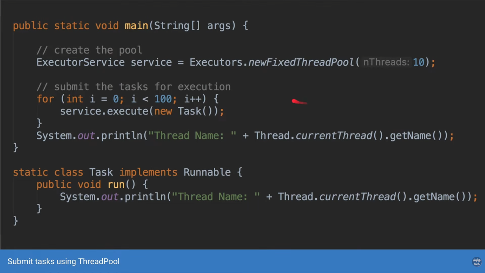

**CPU-bound tasks:** Mathematical computations, data processing, encryption - limited by CPU speed
**I/O-bound tasks:** Network calls, file operations, database queries - waiting for external resources

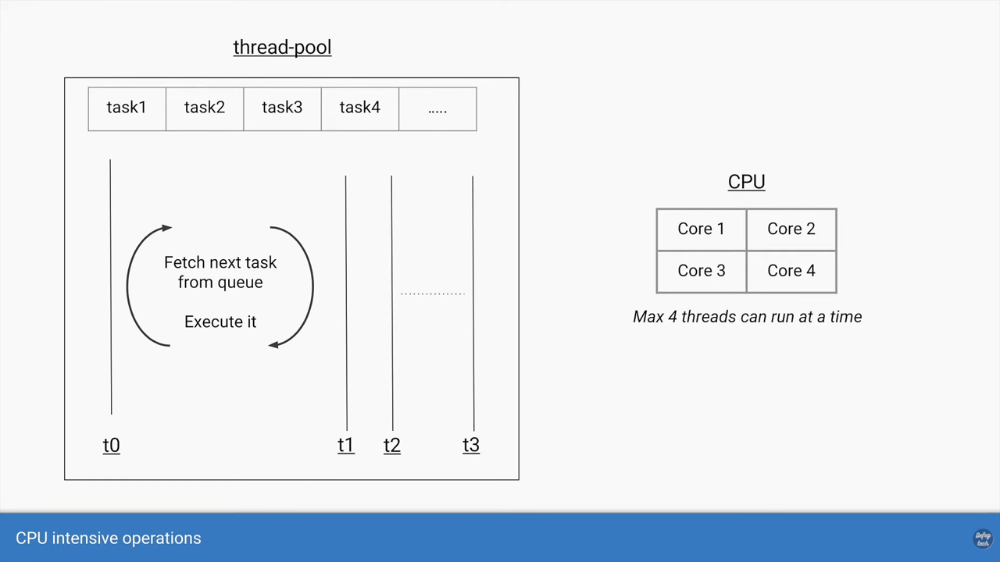

For I/O-bound tasks, threads spend most of their time waiting. This is why we can have more threads than CPU cores for I/O-heavy workloads.

Creating threads is expensive (~1MB stack per thread, OS scheduling overhead). Thread pools reuse a fixed set of threads instead of creating new ones for each task.

**Problems with creating threads manually:**
```java
// ❌ BAD — creating a new thread per task
for (int i = 0; i < 10000; i++) {
    new Thread(() -> processRequest()).start();  // 10,000 threads! OOM likely
}

// ✓ GOOD — reuse a fixed pool of threads
ExecutorService pool = Executors.newFixedThreadPool(10);
for (int i = 0; i < 10000; i++) {
    pool.submit(() -> processRequest());  // 10 threads handle 10,000 tasks
}
```

---

## Types of Executors (Factory Methods)

```java
import java.util.concurrent.*;
```

### Choosing Pool Size by Task Type

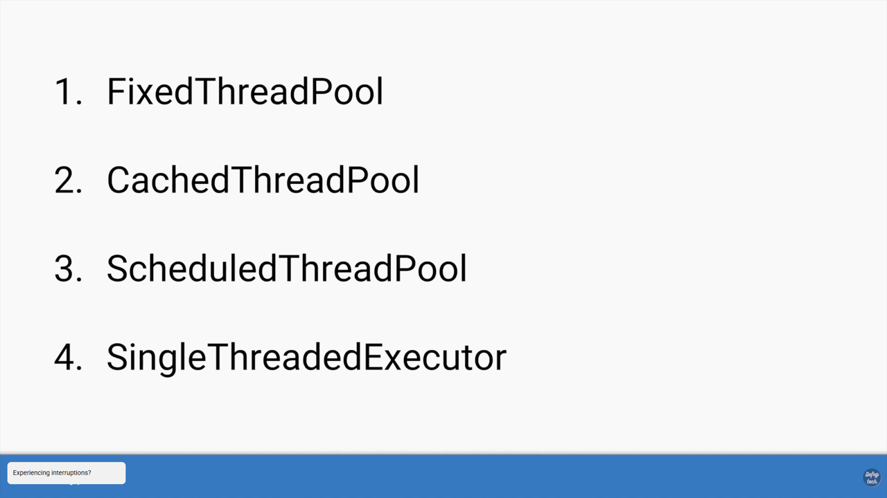

| Task Type | Ideal Pool Size | Considerations |
|-----------|-----------------|----------------|
| CPU intensive | CPU Core count | Consider other apps/executors sharing the CPU |
| IO intensive | High | Depends on task submission rate and average wait time. Too many threads increases memory consumption |

### 1. Fixed Thread Pool — Best for CPU-bound tasks

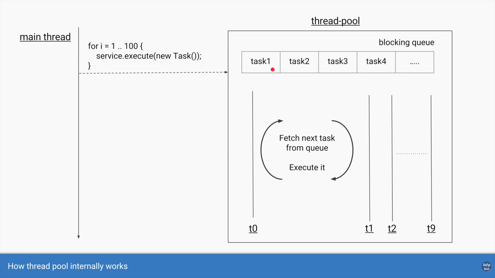

```java
ExecutorService fixed = Executors.newFixedThreadPool(
    Runtime.getRuntime().availableProcessors()  // match CPU cores
);
```

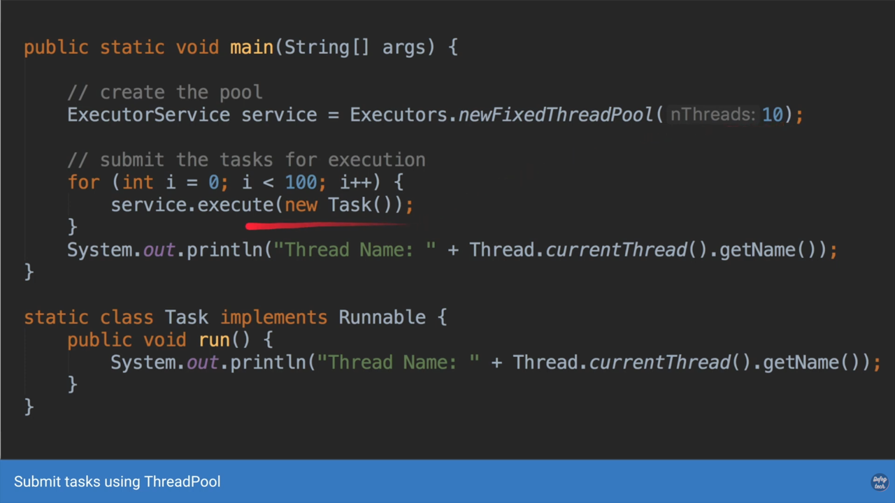

**How it works:**
- Exactly N threads, no more, no less
- Tasks queue in an unbounded LinkedBlockingQueue
- Threads fetch tasks from queue in a loop
- Threads never die (unless shutdown)

**Caution:** Unbounded queue can cause OOM if tasks pile up faster than they're processed.

### 2. Cached Thread Pool — Best for short-lived I/O tasks

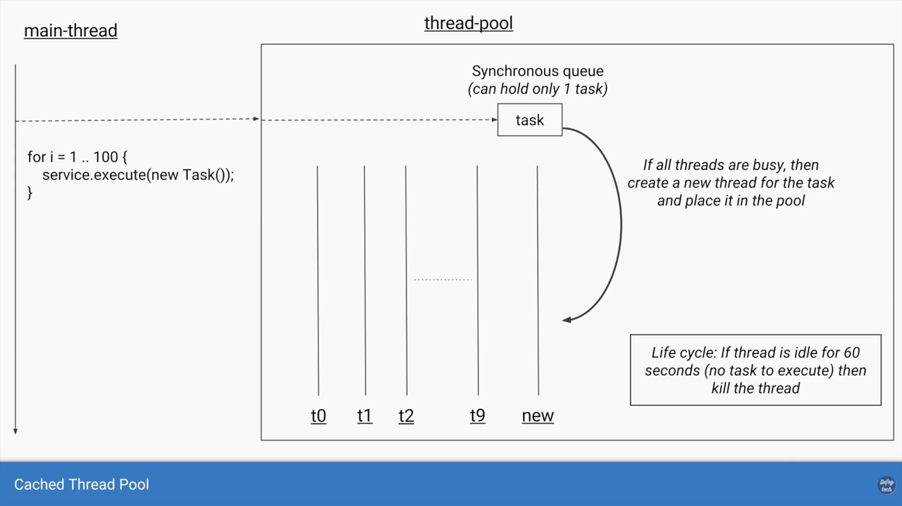

```java
ExecutorService cached = Executors.newCachedThreadPool();
```

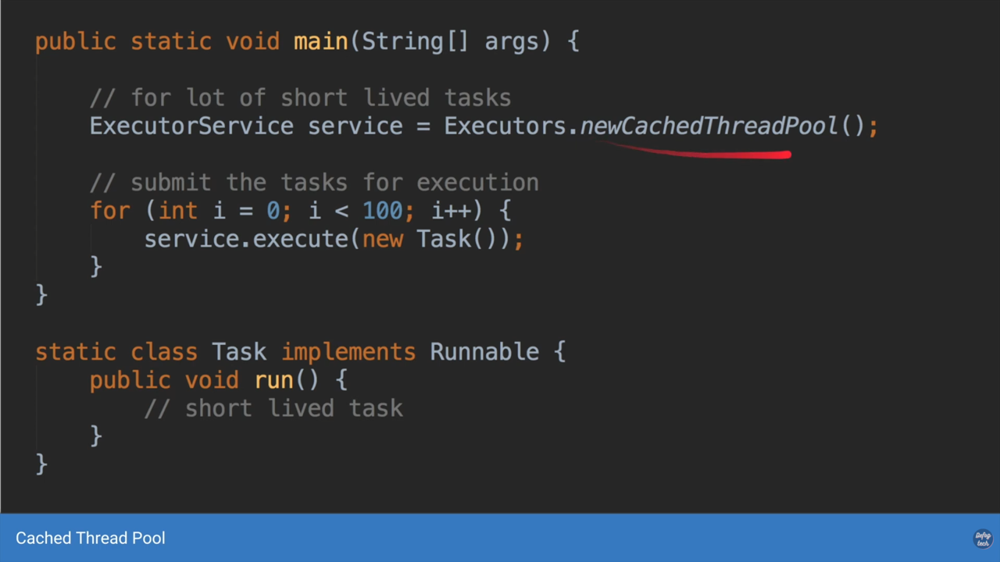

**How it works:**
- Uses SynchronousQueue (can hold only 1 task)
- If all threads are busy → creates a new thread
- Idle threads are killed after 60 seconds
- Pool can grow unbounded

**Life Cycle:** If thread is idle for 60 seconds (no task to execute), then kill the thread.

**Caution:** Can grow unbounded — dangerous for bursty workloads with long-running tasks.

### 3. Single Thread Executor — Sequential execution

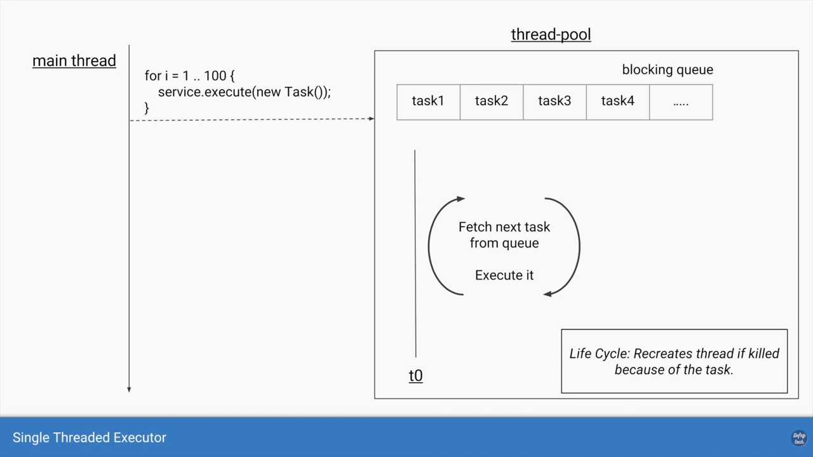

```java
ExecutorService single = Executors.newSingleThreadExecutor();
```

**How it works:**
- Only one thread (t0) processes all tasks
- Tasks queue in blocking queue (FIFO order)
- **Life Cycle:** Recreates thread if killed because of the task

**Good for:** Logging, sequential file writes, maintaining strict order.

### 4. Work-Stealing Pool (Java 8+) — Best for recursive/parallel tasks

```java
ExecutorService workStealing = Executors.newWorkStealingPool();
// Uses ForkJoinPool with parallelism = availableProcessors()
```
- Each thread has its own deque
- Idle threads "steal" work from busy threads
- Good for: divide-and-conquer algorithms, parallel streams

*(See Section 24.9 Parallel Programming for detailed ForkJoinPool coverage)*

### 5. Scheduled Thread Pool — For delayed/periodic tasks

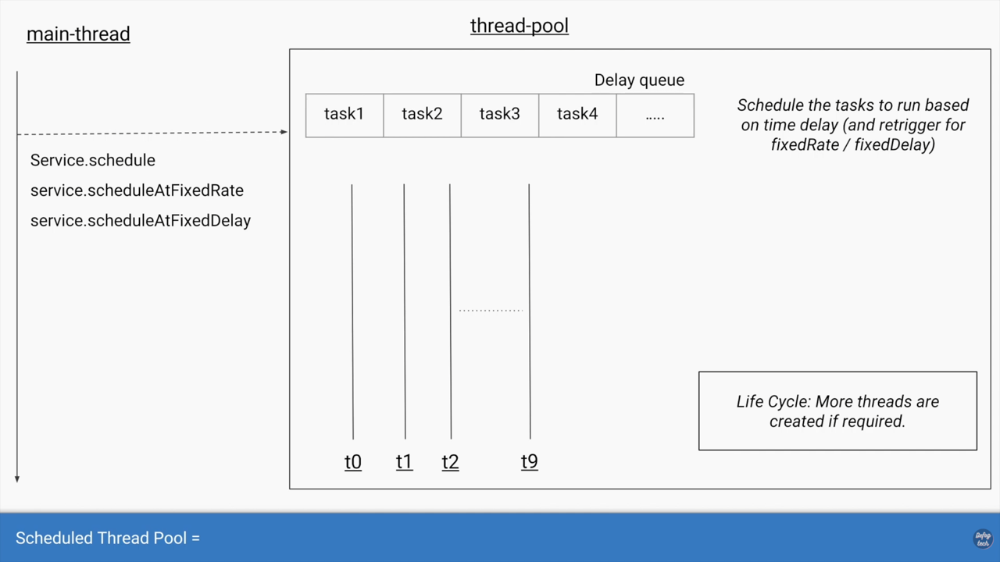

```java
ScheduledExecutorService scheduled = Executors.newScheduledThreadPool(4);
```

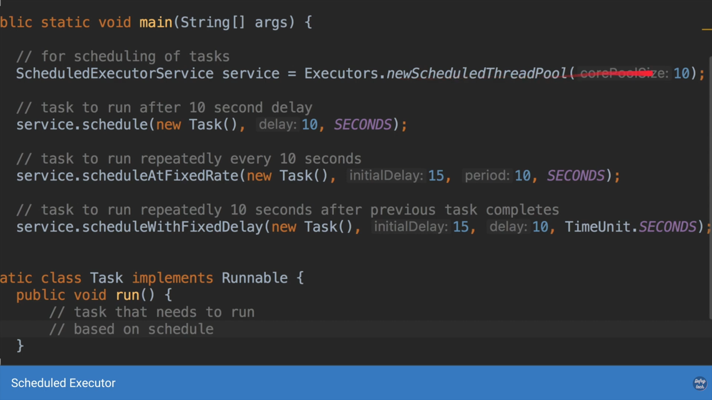

**How it works:**
- Uses DelayQueue to schedule tasks based on time delay
- Supports three scheduling methods:
  - `schedule()` — run once after delay
  - `scheduleAtFixedRate()` — run repeatedly at fixed intervals
  - `scheduleWithFixedDelay()` — run repeatedly with fixed delay after each completion
- **Life Cycle:** More threads are created if required (up to Integer.MAX_VALUE)

### Comparison Table

| Factory Method | Pool Size | Queue | Use Case |
|----------------|-----------|-------|----------|
| `newFixedThreadPool(n)` | Fixed (n) | Unbounded | CPU-bound, predictable load |
| `newCachedThreadPool()` | 0 to ∞ | None (SynchronousQueue) | Short I/O tasks, bursty |
| `newSingleThreadExecutor()` | 1 | Unbounded | Sequential tasks |
| `newWorkStealingPool()` | ~CPU cores | Per-thread deques | Recursive/parallel work |
| `newScheduledThreadPool(n)` | Fixed (n) | DelayedWorkQueue | Timers, periodic tasks |

### Internal Configuration Comparison

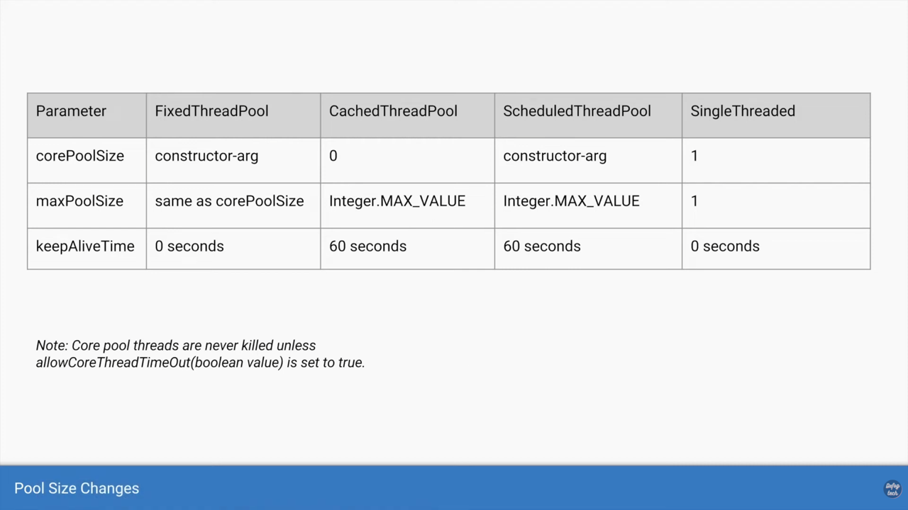

| Parameter | FixedThreadPool | CachedThreadPool | ScheduledThreadPool | SingleThreaded |
|-----------|-----------------|------------------|---------------------|----------------|
| corePoolSize | constructor-arg | 0 | constructor-arg | 1 |
| maxPoolSize | same as core | Integer.MAX_VALUE | Integer.MAX_VALUE | 1 |
| keepAliveTime | 0 seconds | 60 seconds | 60 seconds | 0 seconds |

**Note:** Core pool threads are never killed unless `allowCoreThreadTimeOut(true)` is called.

---

## submit() vs execute() — The Key Difference

Both methods submit tasks to the pool, but they differ in **return value** and **exception handling**:

### execute(Runnable) — Fire and forget

```java
executor.execute(() -> {
    System.out.println("Running task");
});
// Returns: void
// Exceptions: Propagate to UncaughtExceptionHandler (crashes the thread)
```

### submit(Runnable) / submit(Callable) — Returns a Future

```java
// Submit Runnable — Future<?> returns null on success
Future<?> future1 = executor.submit(() -> {
    System.out.println("Runnable task");
});
future1.get();  // returns null (Runnable has no return value)

// Submit Runnable with explicit result
Future<String> future2 = executor.submit(() -> {
    System.out.println("Task done");
}, "completed");  // result to return on success
future2.get();  // returns "completed"

// Submit Callable — Future<T> returns the computed value
Future<Integer> future3 = executor.submit(() -> {
    return 42;  // Callable returns a value
});
Integer result = future3.get();  // returns 42
```

### Comparison Table

| Method | Parameter | Returns | Exception Handling |
|--------|-----------|---------|-------------------|
| `execute(Runnable)` | `Runnable` | `void` | Crashes thread, goes to UncaughtExceptionHandler |
| `submit(Runnable)` | `Runnable` | `Future<?>` | Wrapped in Future, thrown on `get()` |
| `submit(Runnable, T)` | `Runnable`, result | `Future<T>` | Wrapped in Future, thrown on `get()` |
| `submit(Callable<T>)` | `Callable<T>` | `Future<T>` | Wrapped in Future, thrown on `get()` |

---

## Runnable vs Callable

```java
// Runnable — no return value, cannot throw checked exceptions
Runnable runnable = () -> {
    System.out.println("I return nothing");
    // throw new IOException();  // ❌ Won't compile — checked exception
};

// Callable — returns a value, can throw checked exceptions
Callable<Integer> callable = () -> {
    if (Math.random() > 0.5) {
        throw new IOException("Random failure");  // ✓ Allowed
    }
    return 42;
};
```

| | Runnable | Callable\<V\> |
|--|----------|---------------|
| Method | `void run()` | `V call() throws Exception` |
| Returns | Nothing | A value of type V |
| Checked exceptions | Cannot throw | Can throw |
| Functional interface | `() -> void` | `() -> V` |
| Used with | `execute()`, `submit()` | `submit()` only |

---

## Exception Handling in Thread Pools

### With execute() — Exceptions crash the thread

```java
executor.execute(() -> {
    throw new RuntimeException("Boom!");
});
// The thread dies, exception goes to UncaughtExceptionHandler
// A new thread is created to replace it (in most pool types)
```

**Setting an UncaughtExceptionHandler:**

```java
ThreadFactory factory = r -> {
    Thread t = new Thread(r);
    t.setUncaughtExceptionHandler((thread, ex) -> {
        System.err.println("Thread " + thread.getName() + " crashed: " + ex.getMessage());
        // Log it, send alert, etc.
    });
    return t;
};

ExecutorService executor = Executors.newFixedThreadPool(4, factory);
```

### With submit() — Exceptions are captured in the Future

```java
Future<?> future = executor.submit(() -> {
    throw new RuntimeException("Boom!");
});

// Exception is NOT thrown yet — it's stored in the Future
System.out.println("Task submitted, no crash yet");

try {
    future.get();  // Exception thrown HERE, wrapped in ExecutionException
} catch (ExecutionException e) {
    Throwable cause = e.getCause();  // The original RuntimeException
    System.err.println("Task failed: " + cause.getMessage());
} catch (InterruptedException e) {
    Thread.currentThread().interrupt();
}
```

### Silent Exception Swallowing — The Gotcha

```java
// ❌ DANGEROUS — exception silently swallowed if you don't call get()
executor.submit(() -> {
    throw new RuntimeException("This disappears into the void");
});
// No crash, no log, nothing. The exception is trapped in the Future you ignored.

// ✓ SAFE — always handle the Future or use execute() for fire-and-forget
Future<?> future = executor.submit(task);
try {
    future.get();
} catch (ExecutionException e) {
    log.error("Task failed", e.getCause());
}
```

### Best Practice — Wrap tasks with try-catch

```java
executor.execute(() -> {
    try {
        riskyOperation();
    } catch (Exception e) {
        log.error("Task failed", e);
        // Handle gracefully instead of crashing the thread
    }
});
```

---

## invokeAll() and invokeAny() — Batch Execution

### invokeAll() — Run all tasks, wait for all to complete

```java
List<Callable<Integer>> tasks = List.of(
    () -> { Thread.sleep(1000); return 1; },
    () -> { Thread.sleep(2000); return 2; },
    () -> { Thread.sleep(500);  return 3; }
);

// Blocks until ALL tasks complete (or timeout)
List<Future<Integer>> futures = executor.invokeAll(tasks);

// All futures are now done
for (Future<Integer> f : futures) {
    System.out.println(f.get());  // 1, 2, 3 (order preserved)
}

// With timeout — cancels incomplete tasks after deadline
List<Future<Integer>> futures2 = executor.invokeAll(tasks, 1500, TimeUnit.MILLISECONDS);
// Task 2 (2000ms) will be cancelled
```

### invokeAny() — Run all, return first successful result

```java
// Blocks until ANY task completes successfully, cancels the rest
Integer firstResult = executor.invokeAny(tasks);
System.out.println(firstResult);  // 3 (the fastest one)

// With timeout
Integer result = executor.invokeAny(tasks, 1, TimeUnit.SECONDS);
```

| Method | Waits for | Returns | Cancels others? |
|--------|-----------|---------|-----------------|
| `invokeAll()` | All tasks | `List<Future<T>>` | No |
| `invokeAny()` | First success | `T` (the result) | Yes |

---

## ScheduledExecutorService — Delayed and Periodic Tasks

```java
ScheduledExecutorService scheduler = Executors.newScheduledThreadPool(2);
```

### schedule() — Run once after a delay

```java
// Run once after 5 seconds
ScheduledFuture<?> future = scheduler.schedule(
    () -> System.out.println("Delayed task"),
    5, TimeUnit.SECONDS
);

// With return value (Callable)
ScheduledFuture<Integer> result = scheduler.schedule(
    () -> computeValue(),
    10, TimeUnit.SECONDS
);
```

### scheduleAtFixedRate() — Fixed interval from START of each execution

```java
// Runs every 1 second, starting immediately
// If task takes 300ms: runs at 0s, 1s, 2s, 3s...
// If task takes 1500ms: runs at 0s, 1.5s, 3s, 4.5s... (overlaps prevented, runs immediately after previous)
scheduler.scheduleAtFixedRate(
    () -> System.out.println("Tick: " + System.currentTimeMillis()),
    0,              // initialDelay
    1,              // period
    TimeUnit.SECONDS
);
```

```
scheduleAtFixedRate (period = 1s, task takes 300ms):
|--300ms--|       |--300ms--|       |--300ms--|
0s        1s        2s        3s
▲─────────▲─────────▲─────────▲
Fixed 1s intervals from START of each task

scheduleAtFixedRate (period = 1s, task takes 1.5s):
|----1.5s----|----1.5s----|----1.5s----|
0s           1.5s         3s           4.5s
▲────────────▲────────────▲────────────▲
Task takes longer than period → runs immediately after previous finishes
```

### scheduleWithFixedDelay() — Fixed delay from END of each execution

```java
// Waits 1 second AFTER each task finishes before starting the next
// If task takes 300ms: runs at 0s, 1.3s, 2.6s, 3.9s...
// If task takes 1500ms: runs at 0s, 2.5s, 5s, 7.5s...
scheduler.scheduleWithFixedDelay(
    () -> System.out.println("Tick: " + System.currentTimeMillis()),
    0,              // initialDelay
    1,              // delay after completion
    TimeUnit.SECONDS
);
```

```
scheduleWithFixedDelay (delay = 1s, task takes 300ms):
|--300ms--|   1s   |--300ms--|   1s   |--300ms--|
0s        0.3s     1.3s      1.6s     2.6s
▲─────────────────▲─────────────────▲
1s delay AFTER task completes

scheduleWithFixedDelay (delay = 1s, task takes 1.5s):
|----1.5s----|   1s   |----1.5s----|   1s   |----1.5s----|
0s           1.5s     2.5s         4s       5s
▲─────────────────────▲─────────────────────▲
1s delay AFTER task completes
```

### Comparison: scheduleAtFixedRate vs scheduleWithFixedDelay

| | scheduleAtFixedRate | scheduleWithFixedDelay |
|--|---------------------|------------------------|
| Timing | Fixed interval from **start** | Fixed delay from **end** |
| If task < period | Runs at exact intervals | Runs with extra gap |
| If task > period | Runs immediately (no overlap) | Runs with delay after completion |
| Use case | Heartbeats, fixed sampling rate | Polling with guaranteed gap |
| Drift | Can drift if tasks take varying time | Accumulates task time |

**Rule of thumb:**
- Use `scheduleAtFixedRate` when you need consistent intervals (e.g., send heartbeat every 5 seconds)
- Use `scheduleWithFixedDelay` when you need a guaranteed gap between executions (e.g., poll API, wait, poll again)

### Cancelling Scheduled Tasks

```java
ScheduledFuture<?> future = scheduler.scheduleAtFixedRate(task, 0, 1, TimeUnit.SECONDS);

// Cancel after 10 seconds
scheduler.schedule(() -> {
    future.cancel(false);  // false = let running task finish; true = interrupt
    System.out.println("Cancelled periodic task");
}, 10, TimeUnit.SECONDS);
```

### Exception Handling in Scheduled Tasks

**GOTCHA:** If a scheduled task throws an exception, it silently stops running. No more executions, no error log!

```java
// ❌ BAD — exception kills the periodic task silently
scheduler.scheduleAtFixedRate(() -> {
    if (Math.random() > 0.8) {
        throw new RuntimeException("Random failure");  // Task stops forever!
    }
    System.out.println("Running...");
}, 0, 1, TimeUnit.SECONDS);

// ✓ GOOD — catch exceptions to keep the task alive
scheduler.scheduleAtFixedRate(() -> {
    try {
        if (Math.random() > 0.8) {
            throw new RuntimeException("Random failure");
        }
        System.out.println("Running...");
    } catch (Exception e) {
        log.error("Task failed, but will retry next period", e);
    }
}, 0, 1, TimeUnit.SECONDS);
```

---

## ThreadPoolExecutor — Full Control

The `Executors` factory methods are convenient but hide important configuration. For production, use `ThreadPoolExecutor` directly:

### Understanding the Constructor

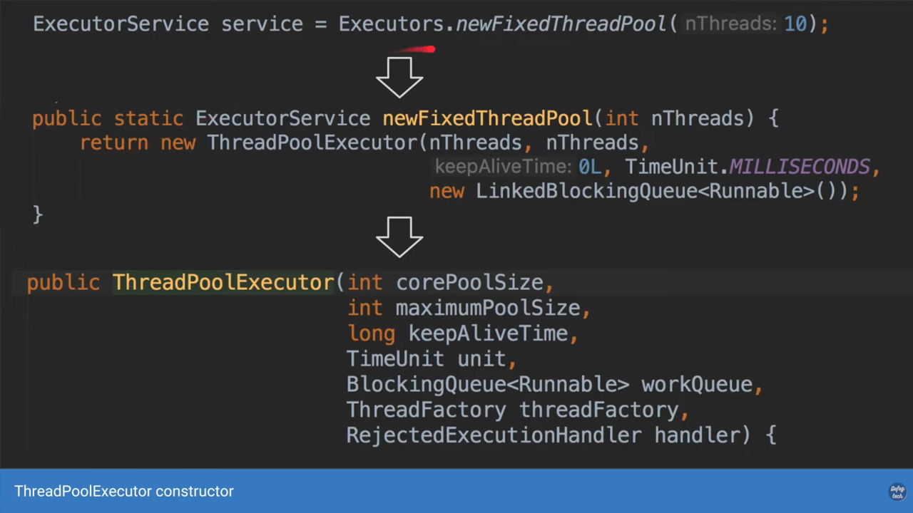

```java
ThreadPoolExecutor executor = new ThreadPoolExecutor(
    4,                              // corePoolSize — threads always kept alive
    16,                             // maximumPoolSize — max threads under load
    60L, TimeUnit.SECONDS,          // keepAliveTime for threads > corePoolSize
    new ArrayBlockingQueue<>(1000), // bounded work queue
    new ThreadFactory() {           // custom thread naming
        private final AtomicInteger count = new AtomicInteger(0);
        @Override
        public Thread newThread(Runnable r) {
            Thread t = new Thread(r, "mypool-worker-" + count.incrementAndGet());
            t.setDaemon(false);
            return t;
        }
    },
    new ThreadPoolExecutor.CallerRunsPolicy()  // rejection policy
);
```

### Constructor Parameters Explained

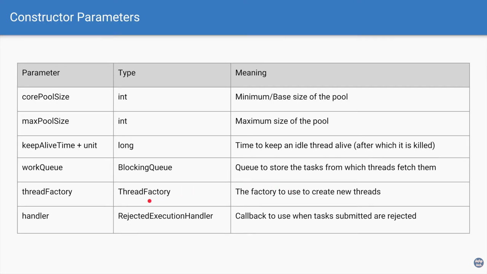

| Parameter | Description |
|-----------|-------------|
| `corePoolSize` | Threads always kept alive (even if idle) |
| `maximumPoolSize` | Maximum threads allowed |
| `keepAliveTime` | How long excess threads (above core) wait before dying |
| `workQueue` | Queue for tasks when all core threads are busy |
| `threadFactory` | Factory for creating new threads (naming, priority, daemon) |
| `handler` | What to do when queue is full and max threads reached |

### Pool Size Dynamics

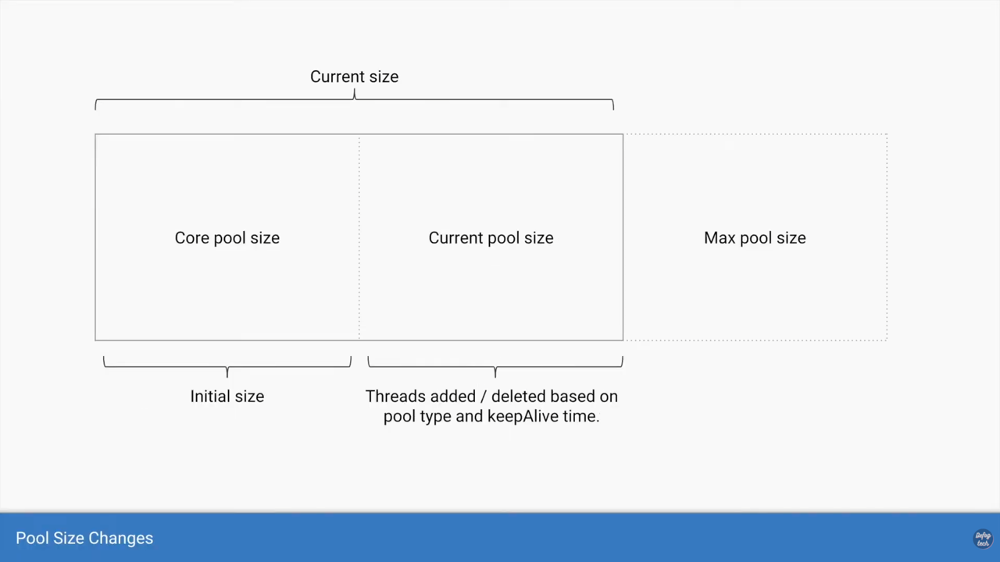

The pool size dynamically adjusts between core and maximum based on workload:
- **Core pool size:** Initial/minimum threads (always kept alive)
- **Current pool size:** Active threads at any moment
- **Max pool size:** Upper limit on thread creation

Threads beyond core size are added when queue is full and removed after `keepAliveTime` of idleness.

### How Tasks Flow Through ThreadPoolExecutor

```
Task submitted
     │
     ▼
corePoolSize threads busy? ───No───► Create core thread → Execute
     │
    Yes
     │
     ▼
Queue full? ───No───► Enqueue → Execute later (when a thread is free)
     │
    Yes
     │
     ▼
maxPoolSize reached? ───No───► Create non-core thread → Execute
     │
    Yes
     │
     ▼
RejectionPolicy (AbortPolicy by default → throws RejectedExecutionException)
```

### Rejection Policies

When the queue is full and maximum threads are reached, new tasks are rejected:

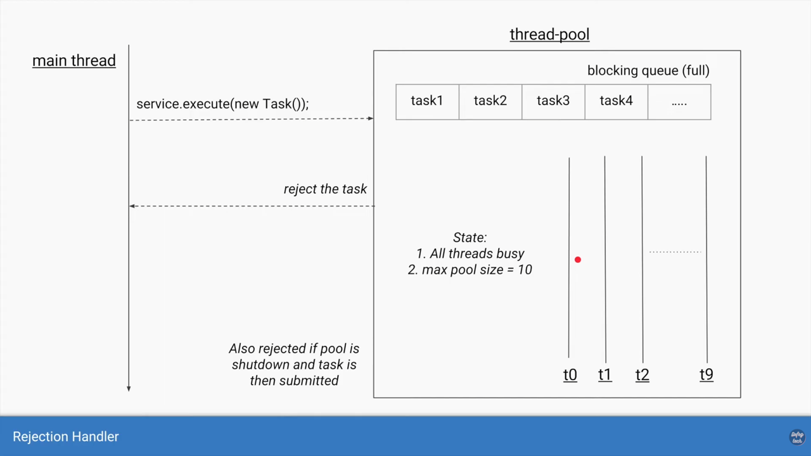

Tasks are also rejected if the pool is shutdown and a task is then submitted.

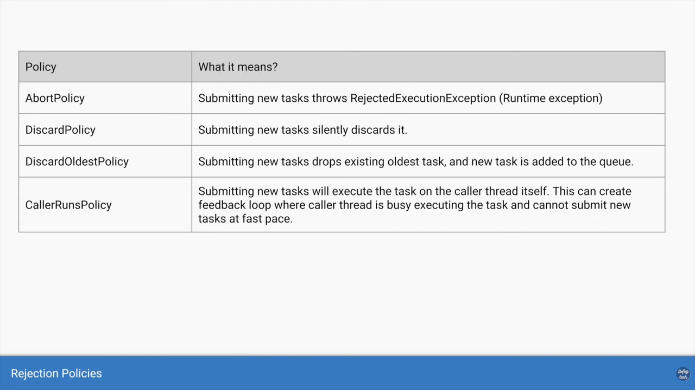

| Policy | Behavior | Use Case |
|--------|----------|----------|
| `AbortPolicy` (default) | Throws `RejectedExecutionException` | Fail fast, alert on overload |
| `CallerRunsPolicy` | Caller's thread executes the task | Backpressure, slows down producer |
| `DiscardPolicy` | Silently drops the task | Lossy workloads (metrics sampling) |
| `DiscardOldestPolicy` | Drops oldest queued task, retries submit | Prefer newest data |

```java
// Custom rejection handler
RejectedExecutionHandler customHandler = (task, executor) -> {
    log.warn("Task rejected! Queue size: {}", executor.getQueue().size());
    // Could: save to dead-letter queue, write to disk, alert ops team
};
```

### Queue Types

Different pools use different queue types for specific reasons:

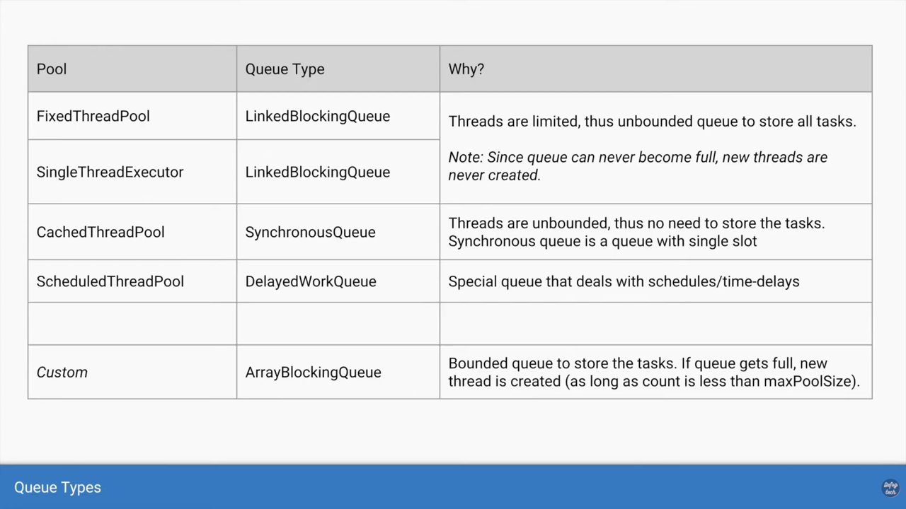

| Queue | Behavior | Use With |
|-------|----------|----------|
| `LinkedBlockingQueue` | Unbounded (or bounded) FIFO | Fixed pools — threads limited, need unbounded queue |
| `ArrayBlockingQueue` | Bounded FIFO | Custom pools — when you need backpressure |
| `SynchronousQueue` | No capacity, direct handoff | Cached pools — threads unbounded, single-slot queue |
| `DelayedWorkQueue` | Special queue for scheduled tasks | Scheduled pools |
| `PriorityBlockingQueue` | Unbounded, ordered by priority | Priority scheduling |

**Key insight:** Queue never becomes full for Fixed/Single pools (unbounded), so new threads beyond core are never created. For Custom pools with bounded queue, new threads are created when queue fills up.

---

## Proper Shutdown

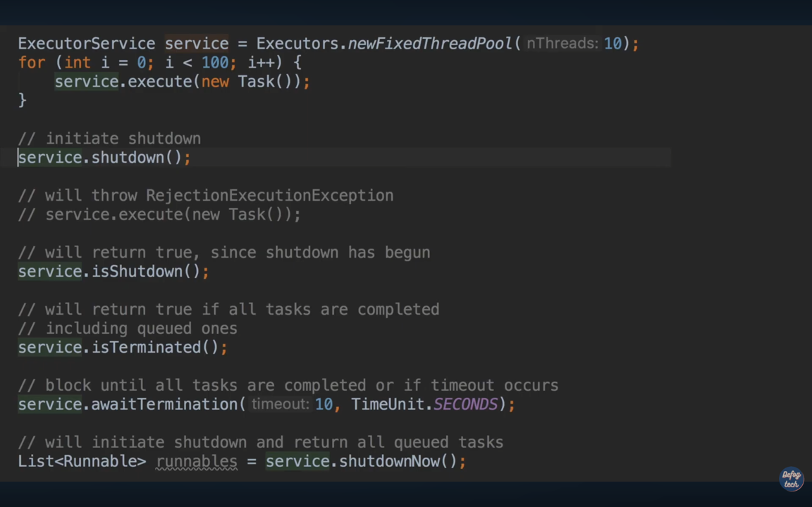

```java
// Step 1: Stop accepting new tasks
executor.shutdown();

try {
    // Step 2: Wait for existing tasks to finish
    if (!executor.awaitTermination(30, TimeUnit.SECONDS)) {
        // Step 3: Force shutdown if tasks don't finish
        List<Runnable> dropped = executor.shutdownNow();  // interrupts running tasks
        log.warn("Dropped {} tasks", dropped.size());
        
        // Step 4: Wait again for interrupted tasks to respond
        if (!executor.awaitTermination(10, TimeUnit.SECONDS)) {
            log.error("Pool did not terminate");
        }
    }
} catch (InterruptedException e) {
    // Step 5: If current thread is interrupted, force shutdown
    executor.shutdownNow();
    Thread.currentThread().interrupt();
}
```

### shutdown() vs shutdownNow()

| Method | New tasks | Running tasks | Queued tasks | Returns |
|--------|-----------|---------------|--------------|---------|
| `shutdown()` | Rejected | Continue | Continue | void |
| `shutdownNow()` | Rejected | Interrupted | Returned | `List<Runnable>` |

---

## Monitoring Thread Pools

```java
ThreadPoolExecutor executor = (ThreadPoolExecutor) Executors.newFixedThreadPool(10);

// Runtime metrics
int activeCount = executor.getActiveCount();        // threads currently executing
int poolSize = executor.getPoolSize();              // current number of threads
int queueSize = executor.getQueue().size();         // tasks waiting in queue
long completedCount = executor.getCompletedTaskCount();  // tasks finished
long taskCount = executor.getTaskCount();           // total tasks (submitted)

// Log periodically
scheduler.scheduleAtFixedRate(() -> {
    log.info("Pool stats: active={}, poolSize={}, queue={}, completed={}",
        executor.getActiveCount(),
        executor.getPoolSize(),
        executor.getQueue().size(),
        executor.getCompletedTaskCount()
    );
}, 0, 10, TimeUnit.SECONDS);
```

---

## Best Practices

### 1. Name your threads

```java
ThreadFactory namedFactory = r -> {
    Thread t = new Thread(r, "order-processor-" + counter.incrementAndGet());
    return t;
};
// Makes debugging and profiling much easier
```

### 2. Use bounded queues in production

```java
// ❌ Unbounded queue can cause OOM
Executors.newFixedThreadPool(10);  // uses LinkedBlockingQueue (unbounded)

// ✓ Bounded queue with rejection handling
new ThreadPoolExecutor(10, 10, 0L, TimeUnit.MILLISECONDS,
    new ArrayBlockingQueue<>(1000),
    new ThreadPoolExecutor.CallerRunsPolicy());
```

### 3. Don't ignore Future results

```java
// ❌ Exception silently swallowed
executor.submit(() -> { throw new RuntimeException(); });

// ✓ Handle the result
Future<?> f = executor.submit(task);
try { f.get(); } catch (ExecutionException e) { log.error("Failed", e); }
```

### 4. Always shut down executors

```java
// Use try-with-resources (Java 19+)
try (ExecutorService executor = Executors.newFixedThreadPool(4)) {
    executor.submit(task);
}  // auto-shutdown

// Or explicit shutdown in finally block
ExecutorService executor = Executors.newFixedThreadPool(4);
try {
    executor.submit(task);
} finally {
    executor.shutdown();
}
```

### 5. Choose the right pool size

```java
// CPU-bound tasks: threads ≈ number of cores
int cpuBound = Runtime.getRuntime().availableProcessors();

// I/O-bound tasks: threads ≈ cores × (1 + wait_time / compute_time)
// If task waits 80% of the time: threads ≈ cores × 5
int ioBound = Runtime.getRuntime().availableProcessors() * 5;
```

---

## Quick Reference

| Need | Solution |
|------|----------|
| Fixed number of workers | `newFixedThreadPool(n)` |
| Unlimited short-lived tasks | `newCachedThreadPool()` |
| Sequential execution | `newSingleThreadExecutor()` |
| Delayed execution | `scheduler.schedule(task, delay, unit)` |
| Periodic execution (fixed rate) | `scheduler.scheduleAtFixedRate(...)` |
| Periodic execution (fixed delay) | `scheduler.scheduleWithFixedDelay(...)` |
| Get result from task | `submit(Callable)` + `future.get()` |
| Fire and forget | `execute(Runnable)` |
| Run all, wait for all | `invokeAll(tasks)` |
| Run all, get first result | `invokeAny(tasks)` |
| Production-grade pool | `new ThreadPoolExecutor(...)` with bounded queue |
