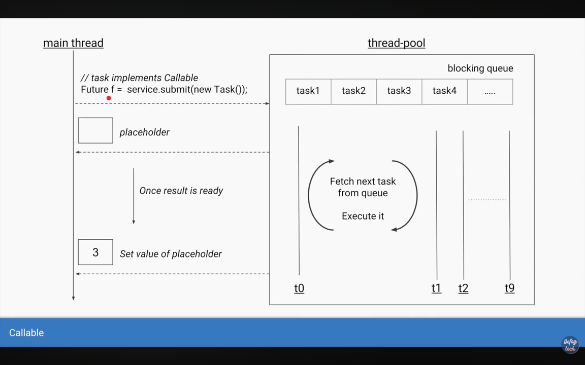
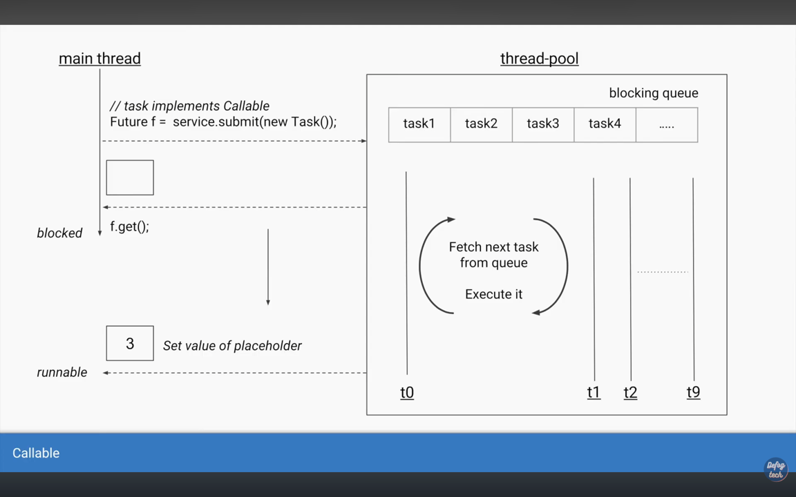
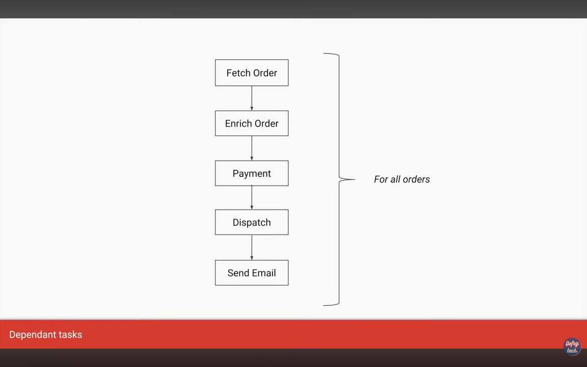
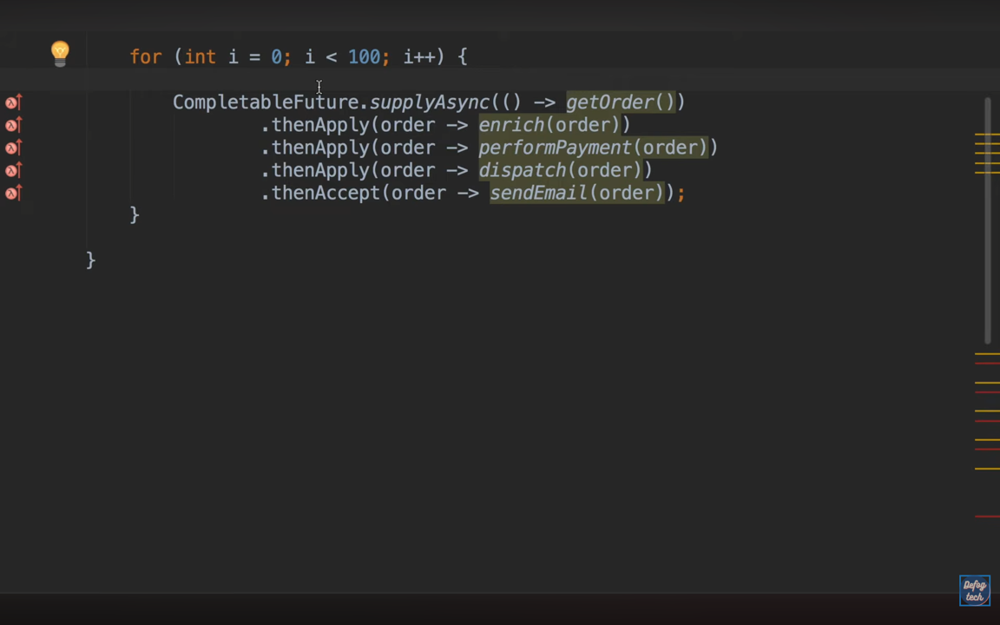
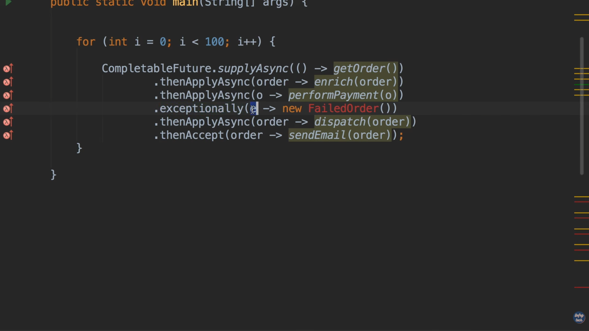
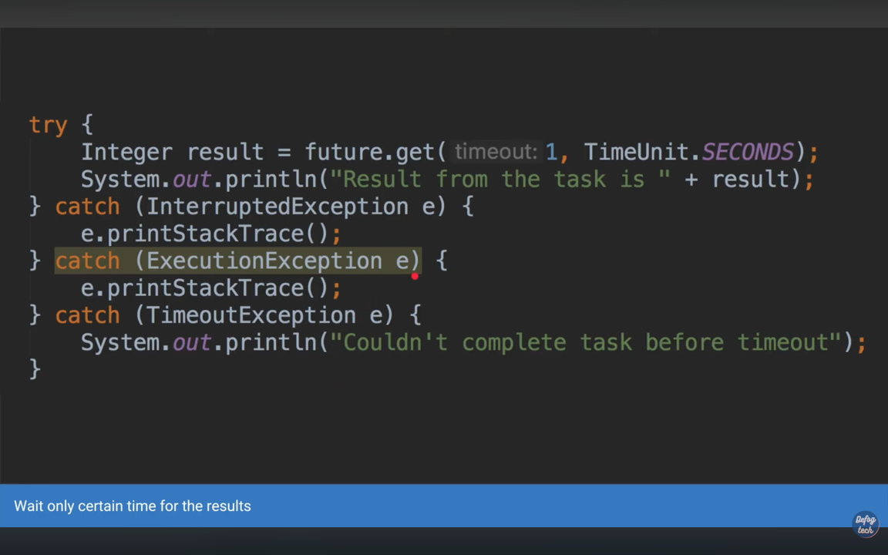

# 8. Asynchronous Programming with CompletableFuture

---

## Why CompletableFuture?

### The Problem with Future

Traditional `Future` returned by `ExecutorService.submit()` has limitations:



The Future acts as a placeholder for the result. When you call `get()`, it blocks until the result is available:



**The blocking problem with dependent tasks:**



Consider an order processing pipeline where each step depends on the previous:
- Fetch Order → Enrich Order → Payment → Dispatch → Send Email

With `Future`, you must block after each step:

```java
// ❌ BAD — sequential blocking
ExecutorService service = Executors.newFixedThreadPool(10);

Future<Order> future = service.submit(getOrderTask());
Order order = future.get();  // blocking

Future<Order> future1 = service.submit(enrichTask(order));
order = future1.get();  // blocking

Future<Order> future2 = service.submit(performPaymentTask(order));
order = future2.get();  // blocking

// And so on... Main thread is blocked at each step!
```

### The CompletableFuture Solution



CompletableFuture allows you to chain dependent operations without blocking:

```java
// ✓ GOOD — non-blocking chain
for (int i = 0; i < 100; i++) {
    CompletableFuture.supplyAsync(() -> getOrder())
        .thenApply(order -> enrich(order))
        .thenApply(order -> performPayment(order))
        .thenApply(order -> dispatch(order))
        .thenAccept(order -> sendEmail(order));
}
// Main thread continues immediately — all 100 pipelines run concurrently!
```

---

## Creating CompletableFutures

```java
import java.util.concurrent.CompletableFuture;
import java.util.concurrent.ExecutorService;
import java.util.concurrent.Executors;

// supplyAsync — returns a value (like Callable)
CompletableFuture<String> future = CompletableFuture.supplyAsync(() -> {
    return fetchDataFromAPI();  // runs in ForkJoinPool.commonPool() by default
});

// runAsync — no return value (like Runnable)
CompletableFuture<Void> voidFuture = CompletableFuture.runAsync(() -> {
    sendNotification();
});

// With custom executor
ExecutorService ioBound = Executors.newCachedThreadPool();
CompletableFuture<Data> customFuture = CompletableFuture.supplyAsync(
    () -> fetchData(),
    ioBound  // use custom pool instead of commonPool
);
```

### Default Thread Pool

By default, CompletableFuture uses `ForkJoinPool.commonPool()`. This is a shared pool across all CompletableFutures and parallel streams. For I/O-bound tasks, provide a custom executor:

```java
ExecutorService cpuBound = Executors.newFixedThreadPool(4);
ExecutorService ioBound = Executors.newCachedThreadPool();

CompletableFuture
    .supplyAsync(() -> getOrder(), ioBound)       // I/O task
    .thenApplyAsync(order -> enrich(order), cpuBound)     // CPU task
    .thenApplyAsync(o -> performPayment(o), ioBound)      // I/O task
    .thenApplyAsync(order -> dispatch(order), cpuBound);  // CPU task
```

---

## Chaining Operations

### thenApply — Transform result (map)

```java
CompletableFuture<Integer> lengthFuture = 
    CompletableFuture.supplyAsync(() -> "Hello World")
        .thenApply(s -> s.toUpperCase())     // "HELLO WORLD"
        .thenApply(s -> s.length());         // 11
```

### thenAccept — Consume result (no return)

```java
CompletableFuture<Void> future = 
    CompletableFuture.supplyAsync(() -> fetchUser())
        .thenAccept(user -> System.out.println("User: " + user));
```

### thenRun — Run after completion (ignores result)

```java
CompletableFuture<Void> future = 
    CompletableFuture.supplyAsync(() -> processOrder())
        .thenRun(() -> System.out.println("Processing complete!"));
```

### thenCompose — Flatten nested futures (flatMap)

```java
// ❌ Without thenCompose — nested CompletableFuture
CompletableFuture<CompletableFuture<List<Order>>> nested = 
    CompletableFuture.supplyAsync(() -> fetchUser())
        .thenApply(user -> fetchOrdersAsync(user));  // returns CompletableFuture

// ✓ With thenCompose — flattened
CompletableFuture<List<Order>> flat = 
    CompletableFuture.supplyAsync(() -> fetchUser())
        .thenCompose(user -> fetchOrdersAsync(user));  // unwraps the future
```

### Async Variants

Methods ending in `Async` run the callback in a pool thread instead of the completing thread:

```java
// thenApply — runs in thread that completed the previous stage
future.thenApply(s -> transform(s));

// thenApplyAsync — runs in ForkJoinPool.commonPool()
future.thenApplyAsync(s -> transform(s));

// thenApplyAsync with executor — runs in specified pool
future.thenApplyAsync(s -> transform(s), myExecutor);
```

**When to use Async variants:**
- Use `thenApply` for quick, non-blocking transformations
- Use `thenApplyAsync` for potentially blocking or CPU-intensive callbacks

---

## Combining Multiple Futures

### thenCombine — Combine two futures when both complete

```java
CompletableFuture<String> f1 = CompletableFuture.supplyAsync(() -> "Hello");
CompletableFuture<String> f2 = CompletableFuture.supplyAsync(() -> "World");

CompletableFuture<String> combined = f1.thenCombine(f2, (a, b) -> a + " " + b);
combined.join();  // "Hello World"
```

### allOf — Wait for ALL futures to complete

```java
CompletableFuture<String> f1 = fetchUserAsync();
CompletableFuture<String> f2 = fetchOrdersAsync();
CompletableFuture<String> f3 = fetchProductsAsync();

CompletableFuture<Void> all = CompletableFuture.allOf(f1, f2, f3);

// When all complete, collect results
all.thenRun(() -> {
    String user = f1.join();
    String orders = f2.join();
    String products = f3.join();
    // All available now
});
```

### anyOf — Complete when ANY future completes (race)

```java
CompletableFuture<Object> any = CompletableFuture.anyOf(f1, f2, f3);

any.thenAccept(result -> {
    System.out.println("First completed: " + result);
    // Other futures are NOT cancelled!
});
```

---

## Exception Handling

### exceptionally — Recover from exceptions



```java
CompletableFuture<Order> future = CompletableFuture
    .supplyAsync(() -> getOrder())
    .thenApplyAsync(order -> enrich(order))
    .thenApplyAsync(o -> performPayment(o))
    .exceptionally(ex -> new FailedOrder())  // recovery fallback
    .thenApplyAsync(order -> dispatch(order))
    .thenAccept(order -> sendEmail(order));
```

### handle — Always runs (like finally)

```java
CompletableFuture<String> future = CompletableFuture
    .supplyAsync(() -> riskyOperation())
    .handle((result, ex) -> {
        if (ex != null) {
            log.error("Failed", ex);
            return "default";
        }
        return result;
    });
```

### whenComplete — Side effects without changing result

```java
CompletableFuture<String> future = CompletableFuture
    .supplyAsync(() -> fetchData())
    .whenComplete((result, ex) -> {
        if (ex != null) {
            log.error("Fetch failed", ex);
        } else {
            log.info("Fetch succeeded: {}", result);
        }
    });  // exception still propagates, result unchanged
```

### Exception Handling Comparison

| Method | On Success | On Exception | Returns |
|--------|------------|--------------|---------|
| `exceptionally(fn)` | Passes through | Applies fn | Original or recovered value |
| `handle(bifn)` | Applies bifn | Applies bifn | New value |
| `whenComplete(biConsumer)` | Runs consumer | Runs consumer | Original value (exception propagates) |

---

## Timeout Handling (Java 9+)

```java
CompletableFuture<String> future = CompletableFuture
    .supplyAsync(() -> slowOperation());

// orTimeout — fails with TimeoutException
future.orTimeout(5, TimeUnit.SECONDS);

// completeOnTimeout — returns default value on timeout
future.completeOnTimeout("default", 5, TimeUnit.SECONDS);

// Combined pattern
CompletableFuture<String> robust = CompletableFuture
    .supplyAsync(() -> slowOperation())
    .completeOnTimeout("timeout-default", 5, TimeUnit.SECONDS)
    .exceptionally(ex -> "error-default");
```

---

## Getting the Result

### get() vs join()

```java
CompletableFuture<String> future = CompletableFuture.supplyAsync(() -> "result");

// get() — throws checked exceptions
try {
    String result = future.get();
    String resultWithTimeout = future.get(5, TimeUnit.SECONDS);
} catch (InterruptedException | ExecutionException | TimeoutException e) {
    // Must handle
}

// join() — throws unchecked exceptions (easier in lambdas)
String result = future.join();  // throws CompletionException if failed
```



### getNow() — Non-blocking check

```java
String result = future.getNow("not-ready");  // returns default if not complete
```

---

## Cancellation

```java
CompletableFuture<String> future = CompletableFuture.supplyAsync(() -> longTask());

// Cancel the future
boolean cancelled = future.cancel(true);  // mayInterruptIfRunning (often ignored)

// Check status
future.isCancelled();  // true if cancelled
future.isDone();       // true if completed (success, exception, or cancelled)
```

---

## Best Practices

### 1. Use custom executors for I/O

```java
// ❌ Don't saturate the common pool with I/O
CompletableFuture.supplyAsync(() -> httpClient.fetch(url));

// ✓ Use dedicated I/O pool
ExecutorService ioPool = Executors.newCachedThreadPool();
CompletableFuture.supplyAsync(() -> httpClient.fetch(url), ioPool);
```

### 2. Always handle exceptions

```java
// ❌ Exception silently swallowed
CompletableFuture.supplyAsync(() -> riskyOperation());

// ✓ Handle exceptions
CompletableFuture.supplyAsync(() -> riskyOperation())
    .exceptionally(ex -> {
        log.error("Operation failed", ex);
        return defaultValue;
    });
```

### 3. Avoid blocking in async chains

```java
// ❌ Blocking in thenApply defeats the purpose
future.thenApply(data -> {
    return otherFuture.get();  // BLOCKS!
});

// ✓ Use thenCompose for async dependencies
future.thenCompose(data -> otherFutureAsync(data));
```

### 4. Collect results properly from allOf

```java
List<CompletableFuture<String>> futures = urls.stream()
    .map(url -> fetchAsync(url))
    .collect(Collectors.toList());

CompletableFuture<List<String>> allResults = CompletableFuture
    .allOf(futures.toArray(new CompletableFuture[0]))
    .thenApply(v -> futures.stream()
        .map(CompletableFuture::join)
        .collect(Collectors.toList()));
```

---

## Quick Reference

| Need | Solution |
|------|----------|
| Start async task with result | `supplyAsync(() -> value)` |
| Start async task without result | `runAsync(() -> action)` |
| Transform result | `thenApply(fn)` |
| Consume result | `thenAccept(consumer)` |
| Chain async operation | `thenCompose(fn)` |
| Combine two futures | `thenCombine(other, bifn)` |
| Wait for all | `allOf(f1, f2, ...)` |
| Get first completed | `anyOf(f1, f2, ...)` |
| Recover from exception | `exceptionally(fn)` |
| Handle both success/failure | `handle(bifn)` |
| Add timeout | `orTimeout(n, unit)` |
| Default on timeout | `completeOnTimeout(value, n, unit)` |
