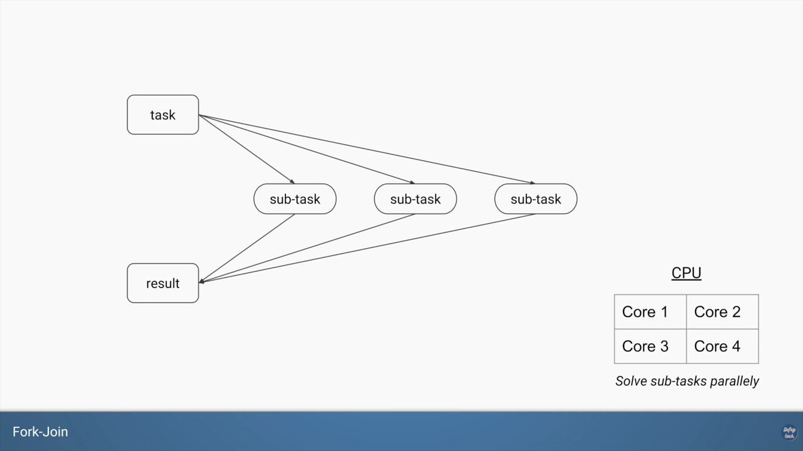
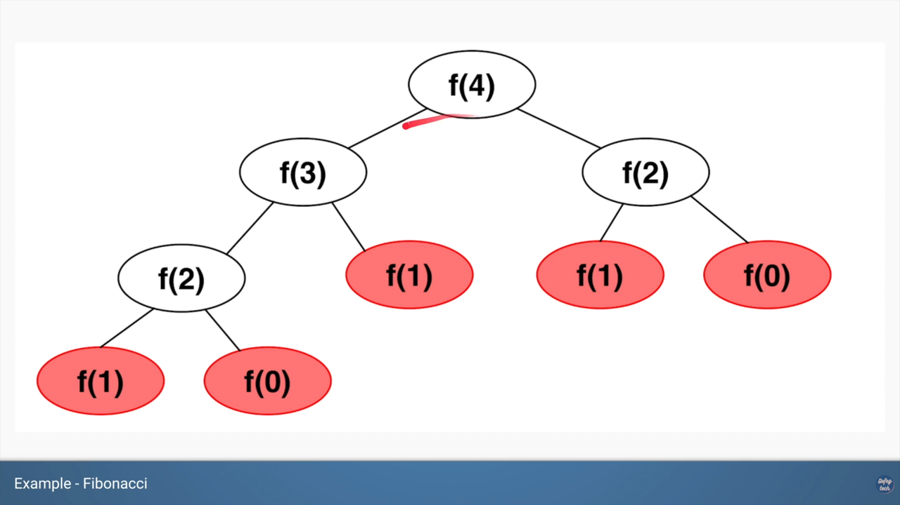
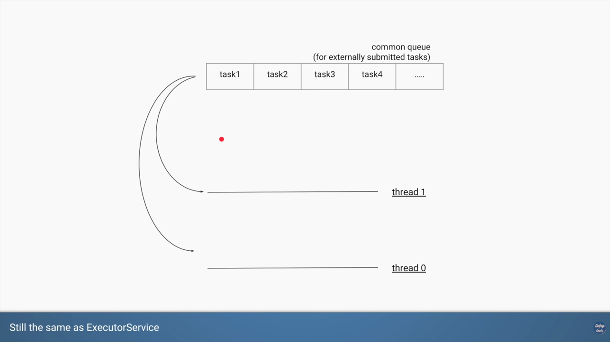
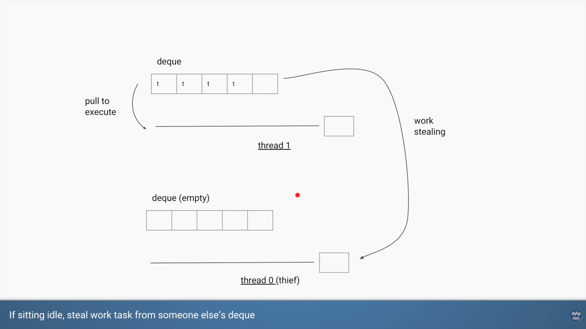
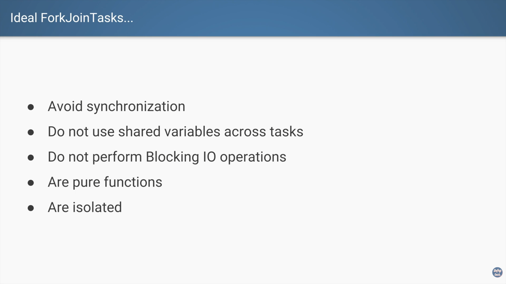

# 9. ForkJoinPool and Parallel Programming

---

## What is ForkJoinPool?

ForkJoinPool is a specialized `ExecutorService` designed for **recursive divide-and-conquer** tasks. It extends the standard thread pool with two key optimizations:

1. **Per-thread work queues (deques)** — Each thread has its own double-ended queue
2. **Work-stealing** — Idle threads steal tasks from busy threads



### How Fork-Join Works

1. **Fork:** Split a large task into smaller sub-tasks
2. **Compute:** Process sub-tasks (potentially forking further)
3. **Join:** Combine results from sub-tasks



---

## Work-Stealing Architecture

### Standard ExecutorService vs ForkJoinPool

In a standard `ExecutorService`, all threads share a single blocking queue:

```
Standard ExecutorService:
┌─────────────────────────────────┐
│    Shared Blocking Queue        │
│  [task1][task2][task3][task4]   │
└─────────────────────────────────┘
         ↓     ↓     ↓     ↓
       t0     t1     t2    t9
       (contention when fetching)
```

ForkJoinPool gives each thread its own deque:



```
ForkJoinPool:
┌──────────────────┐  Common Queue (external submissions)
│[task1][task2]... │
└──────────────────┘
        ↓
  ┌─────┐  ┌─────┐  ┌─────┐
  │deque│  │deque│  │deque│
  └─────┘  └─────┘  └─────┘
     ↓       ↓       ↓
    t0      t1      t2
```

### Work-Stealing in Action



When a thread's deque is empty:
1. Thread becomes idle
2. It "steals" a task from another thread's deque
3. Stealing happens from the **bottom** (oldest tasks)
4. Owner thread works from the **top** (newest tasks — LIFO)

```
Thread 0 deque: [Task A, Task B, Task C]  ← owner pops from top (LIFO)
Thread 1 deque: []                        ← idle, steals from bottom (FIFO)

Thread 1 steals Task A from Thread 0's bottom
→ After: Thread 0: [Task B, Task C], Thread 1: [Task A]
```

**Why this is efficient:**
- No contention when working on own deque
- Stealing happens rarely (only when idle)
- Stealing old tasks means they're likely larger (not yet split), giving the thief more work

### Advantages of Per-Thread Queues

- Just keep picking tasks from own queue
- No blocking (unless during stealing)
- Easier scheduling
- Better cache locality (thread works on related sub-tasks)

---

## Creating ForkJoinPool

```java
import java.util.concurrent.ForkJoinPool;

// Default pool — parallelism = availableProcessors
ForkJoinPool defaultPool = new ForkJoinPool();

// Custom parallelism
ForkJoinPool customPool = new ForkJoinPool(8);

// The common pool (shared, used by parallel streams and CompletableFuture)
ForkJoinPool commonPool = ForkJoinPool.commonPool();
```

---

## Submitting Tasks

### Methods inherited from ExecutorService

| Operation | Method |
|-----------|--------|
| Execute Runnable | `execute(Runnable)` |
| Submit Runnable | `submit(Runnable)` |
| Submit Callable | `submit(Callable)` |

### Fork-Join specific methods

| Operation | External Client | Within Fork-Join Task |
|-----------|-----------------|----------------------|
| Async execution | `execute(ForkJoinTask)` | `fork()` |
| Await and get result | `invoke(ForkJoinTask)` | `invoke()` |
| Async execution + Future | `submit(ForkJoinTask)` | `fork()` (ForkJoinTask IS a Future) |

```java
// External submission
ForkJoinPool pool = new ForkJoinPool();
Integer result = pool.invoke(new MyRecursiveTask(data));  // blocks until done

// Or async
ForkJoinTask<Integer> future = pool.submit(new MyRecursiveTask(data));
Integer result = future.get();
```

---

## ForkJoinTask — The Base Class

ForkJoinTask is the base class for tasks that run in ForkJoinPool. It implements `Future`, so you can use `get()`, `join()`, `cancel()`, `isDone()`, `isCancelled()`.

### RecursiveTask\<V\> — Returns a value



```java
public class Fibonacci extends RecursiveTask<Integer> {
    final int n;
    
    public Fibonacci(int n) { this.n = n; }
    
    @Override
    protected Integer compute() {
        if (n <= 1) {
            return n;  // base case
        }
        
        Fibonacci f1 = new Fibonacci(n - 1);
        f1.fork();  // async: push to deque, another thread may steal it
        
        Fibonacci f2 = new Fibonacci(n - 2);
        Integer result2 = f2.compute();  // sync: compute in current thread
        
        Integer result1 = f1.join();  // wait for f1 to complete
        
        return result1 + result2;
    }
}

// Usage
ForkJoinPool pool = new ForkJoinPool();
Integer fib10 = pool.invoke(new Fibonacci(10));  // 55
```

### RecursiveAction — No return value

```java
public class ParallelSort extends RecursiveAction {
    private final int[] array;
    private final int start, end;
    private static final int THRESHOLD = 1000;
    
    public ParallelSort(int[] array, int start, int end) {
        this.array = array;
        this.start = start;
        this.end = end;
    }
    
    @Override
    protected void compute() {
        if (end - start <= THRESHOLD) {
            Arrays.sort(array, start, end);  // sequential for small
            return;
        }
        
        int mid = start + (end - start) / 2;
        
        ParallelSort left = new ParallelSort(array, start, mid);
        ParallelSort right = new ParallelSort(array, mid, end);
        
        invokeAll(left, right);  // fork both, wait for both
        
        merge(array, start, mid, end);
    }
}
```

---

## Best Practices for Fork-Join Tasks

### Ideal ForkJoinTasks should:

- **Avoid synchronization** — Work-stealing doesn't work well with locks
- **Not use shared mutable variables** — Each task should work on its own data
- **Not perform blocking I/O** — Blocks the thread, reducing parallelism
- **Be pure functions** — Same input → same output
- **Be isolated** — No side effects

### Fork-Join Pattern

```java
@Override
protected Result compute() {
    if (isSmallEnough()) {
        return solveDirectly();  // base case
    }
    
    // Split
    SubTask left = new SubTask(leftHalf);
    SubTask right = new SubTask(rightHalf);
    
    // Fork (one or both)
    left.fork();
    
    // Compute (do work in current thread)
    Result rightResult = right.compute();
    
    // Join
    Result leftResult = left.join();
    
    // Combine
    return combine(leftResult, rightResult);
}
```

### Common Mistake — Forking Both

```java
// ❌ Suboptimal — both tasks forked, current thread does nothing
left.fork();
right.fork();
return left.join() + right.join();

// ✓ Better — current thread computes one task
left.fork();
Result rightResult = right.compute();  // use current thread
return left.join() + rightResult;
```

### Choosing the Threshold

The threshold determines when to stop splitting and solve sequentially:

```java
private static final int THRESHOLD = 1000;

if (data.length <= THRESHOLD) {
    return solveSequentially(data);
}
```

**Guidelines:**
- Too small threshold → overhead of task creation dominates
- Too large threshold → not enough parallelism
- Rule of thumb: 100-10,000 elements per task depending on computation cost

---

## Use Cases

ForkJoinPool is ideal for:

- **Sorting** — Merge sort, quick sort
- **Matrix multiplication** — Block-based parallel multiplication
- **Tree traversal** — Process branches in parallel
- **Game AI** — Best move finder (minimax with alpha-beta pruning)
- **Image processing** — Parallel filters on image regions
- **MapReduce-style computations** — Aggregating large datasets

---

## ForkJoinPool vs ExecutorService

| Aspect | ExecutorService | ForkJoinPool |
|--------|----------------|--------------|
| Queue | Single shared queue | Per-thread deques |
| Idle threads | Wait on queue | Steal work |
| Task type | Independent tasks | Recursive tasks that spawn sub-tasks |
| Best for | I/O-bound, independent work | CPU-bound, divide-and-conquer |
| Overhead | Lower | Higher (work-stealing machinery) |

---

## Parallel Streams and ForkJoinPool

Parallel streams use `ForkJoinPool.commonPool()` by default:

```java
List<Integer> numbers = IntStream.rangeClosed(1, 1_000_000)
    .boxed()
    .collect(Collectors.toList());

// Uses ForkJoinPool.commonPool()
int sum = numbers.parallelStream()
    .mapToInt(Integer::intValue)
    .sum();
```

To use a custom pool:

```java
ForkJoinPool customPool = new ForkJoinPool(4);
int sum = customPool.submit(() ->
    numbers.parallelStream()
        .mapToInt(Integer::intValue)
        .sum()
).join();
```

---

## Quick Reference

| Need | Solution |
|------|----------|
| Create default pool | `new ForkJoinPool()` |
| Use shared pool | `ForkJoinPool.commonPool()` |
| Task with return value | Extend `RecursiveTask<V>` |
| Task without return | Extend `RecursiveAction` |
| Async submit to deque | `task.fork()` |
| Wait for result | `task.join()` |
| Submit and wait | `pool.invoke(task)` |
| Fork multiple | `invokeAll(task1, task2)` |
| Check parallelism | `pool.getParallelism()` |
