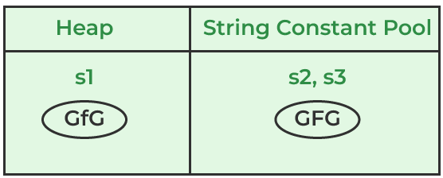

## 9. Strings

### String Basics

Strings in Java are immutable objects (same as C#). They are stored in the String Pool (interning).

```java
// Creation
String s1 = "Hello";                    // string literal (interned)
String s2 = new String("Hello");        // new object on heap (not interned)
String s3 = String.valueOf(42);         // from primitive

// Length
int len = s1.length();  // method, not property!

// Concatenation
String full = "Hello" + " " + "World";  // compiler optimizes literals
String name = "Hello" + userName;       // uses StringBuilder internally
```

### Common String Methods

```java
s.charAt(0)                   // 'H'
s.substring(1, 4)             // "ell" (startIndex, endIndex) — NOT length!
s.indexOf("lo")               // 3
s.lastIndexOf("l")            // 3
s.contains("ell")             // true
s.startsWith("He")            // true
s.endsWith("lo")              // true
s.toUpperCase()               // "HELLO"
s.toLowerCase()               // "hello"
s.trim()                      // removes leading/trailing whitespace
s.strip()                     // Unicode-aware trim (Java 11+)
s.isBlank()                   // true if empty or only whitespace (Java 11+)
s.isEmpty()                   // true if length == 0
s.replace("l", "L")           // "HeLLo"
s.replaceAll("\\d+", "")     // regex replace
s.split(",")                  // String[]
s.toCharArray()               // char[]
String.join(", ", list)       // join collection
s.repeat(3)                   // "HelloHelloHello" (Java 11+)
```
This is the standard, optimized pattern used in **LeetCode** string problems to bypass Java's string immutability.
```
string s = "ABC";
char[] charArr = s.toCharArray();
charArr[2] = 'X';
s = new String(charArr);
```

**C# trap:** `substring(beginIndex, endIndex)` — the second parameter is end INDEX, not length!

### String Formatting

```java
// printf-style
String msg = String.format("Hello, %s! You are %d years old.", name, age);

// Formatted (Java 15+)
String msg = "Hello, %s! You are %d years old.".formatted(name, age);

// Text Blocks (Java 15+) — like C# raw string literals
String json = """
        {
            "name": "Alice",
            "age": 30
        }
        """;
```

### StringBuilder (Mutable Strings)

#### What is String Immutability?

Once a `String` object is created, its content can never be changed. Every "modification" actually creates a brand new `String` object, leaving the original untouched.

```java
String s = "Hello";
s.concat(" World");       // returns a NEW String — s is unchanged!
System.out.println(s);    // still "Hello"

s = s.concat(" World");   // s now points to the NEW object "Hello World"
                          // the old "Hello" still exists in memory (until GC collects it)
```

**What happens internally with concatenation in a loop:**

```java
String result = "";
for (int i = 0; i < 5; i++) {
    result = result + i;   // creates a NEW String object every iteration!
}
// Iteration 0: "" + "0" → new String "0"        (old "" abandoned)
// Iteration 1: "0" + "1" → new String "01"      (old "0" abandoned)
// Iteration 2: "01" + "2" → new String "012"    (old "01" abandoned)
// ...5 objects created and 4 thrown away — wasteful!
```

**Why immutability exists:**
- **Thread safety** — immutable strings can be shared across threads without synchronization
- **String Pool** — interning only works because strings never change (safe to share references)
- **Security** — class names, file paths, and URLs passed as strings can't be tampered with after creation
- **Hashing** — `hashCode()` is cached because content never changes (fast `HashMap` keys)

#### How StringBuilder Makes Strings Mutable

`StringBuilder` maintains an internal `char[]` (character array) buffer that it modifies in-place — no new objects are created on each operation:

```java
StringBuilder sb = new StringBuilder("Hello");
sb.append(" World");   // modifies the SAME internal buffer — no new object
sb.append("!");        // still the same object, buffer grows if needed
System.out.println(sb); // "Hello World!"
```

**Internal structure:**

```
StringBuilder sb = new StringBuilder("Hello");

sb internals:
┌──────────────────────────────────────────────┐
│ char[] value = ['H','e','l','l','o', , , , ]  │  ← pre-allocated buffer (capacity 21)
│ int count = 5                                 │  ← actual length used
└──────────────────────────────────────────────┘

sb.append(" World");
┌──────────────────────────────────────────────┐
│ char[] value = ['H','e','l','l','o',' ','W','o','r','l','d', , , ]  │  ← same buffer, extended
│ int count = 11                                                      │
└──────────────────────────────────────────────┘
```

No new objects created — it just writes more characters into the existing buffer. If the buffer is full, it reallocates a larger one (typically doubles capacity).

#### StringBuilder vs String Concatenation

```java
// Bad — O(n²) time, creates n intermediate String objects
String result = "";
for (int i = 0; i < 10000; i++) {
    result += i;  // new String every iteration
}

// Good — O(n) time, modifies one internal buffer
StringBuilder sb = new StringBuilder();
for (int i = 0; i < 10000; i++) {
    sb.append(i);  // mutates the same object
}
String result = sb.toString();  // convert to String once at the end
```

#### Common StringBuilder Methods

```java
StringBuilder sb = new StringBuilder();
sb.append("Hello");           // append at end
sb.append(" ");
sb.append("World");
sb.insert(5, ",");            // insert at index → "Hello, World"
sb.delete(5, 6);              // delete range [5, 6) → "Hello World"
sb.replace(0, 5, "Hi");      // replace range → "Hi World"
sb.reverse();                 // reverse in-place → "dlroW iH"
sb.setCharAt(0, 'D');         // replace single char
sb.deleteCharAt(0);           // delete single char
int len = sb.length();        // current length
sb.setLength(0);              // clear contents (reuse buffer)
String result = sb.toString(); // convert to immutable String
```


### StringBuffer (Thread-Safe Mutable Strings)

#### What Problem Does StringBuffer Solve?

`StringBuilder` is fast but not thread-safe. If multiple threads append to the same `StringBuilder` concurrently, you get corrupted output — characters are lost, garbled, or the internal buffer throws an exception.

`StringBuffer` solves this by synchronizing every method — only one thread can modify the buffer at a time.

```java
// Problem: StringBuilder with multiple threads — DATA CORRUPTION
StringBuilder unsafeSb = new StringBuilder();

Thread t1 = new Thread(() -> {
    for (int i = 0; i < 1000; i++) unsafeSb.append("A");
});
Thread t2 = new Thread(() -> {
    for (int i = 0; i < 1000; i++) unsafeSb.append("B");
});
t1.start(); t2.start();
t1.join(); t2.join();

// Result: unpredictable! Could be less than 2000 chars, garbled, or ArrayIndexOutOfBoundsException

// Solution: StringBuffer — synchronized, thread-safe
StringBuffer safeSb = new StringBuffer();

Thread t1 = new Thread(() -> {
    for (int i = 0; i < 1000; i++) safeSb.append("A");
});
Thread t2 = new Thread(() -> {
    for (int i = 0; i < 1000; i++) safeSb.append("B");
});
t1.start(); t2.start();
t1.join(); t2.join();

// Result: always exactly 2000 chars (1000 A's + 1000 B's, interleaved)
System.out.println(safeSb.length());  // guaranteed 2000
```

#### How StringBuffer Works Internally

Every method in `StringBuffer` is marked `synchronized`, meaning the calling thread must acquire a lock before executing:

```java
// StringBuffer source (simplified):
public synchronized StringBuffer append(String str) {
    // only one thread can be inside this method at a time
    super.append(str);
    return this;
}

// StringBuilder source (simplified):
public StringBuilder append(String str) {
    // no lock — multiple threads can corrupt the buffer
    super.append(str);
    return this;
}
```

#### Common StringBuffer Methods

Same API as `StringBuilder` — they share the same parent class (`AbstractStringBuilder`):

```java
StringBuffer buf = new StringBuffer();
buf.append("Hello");
buf.append(" World");
buf.insert(5, ",");
buf.delete(5, 6);
buf.replace(0, 5, "Hi");
buf.reverse();
buf.setCharAt(0, 'D');
buf.deleteCharAt(0);
buf.setLength(0);             // clear
String result = buf.toString();
```
#### StringBuilder vs StringBuffer

| | `StringBuilder` | `StringBuffer` |
|--|-----------------|----------------|
| Thread-safe | No | Yes (synchronized methods) |
| Performance | Faster | Slower (synchronization overhead) |
| When to use | Single-threaded (99% of cases) | Multi-threaded access to same builder |

**Rule:** Always use `StringBuilder` unless multiple threads are writing to the same instance (which is rare — usually each thread builds its own string).

### String vs StringBuilder vs StringBuffer

| | `String` | `StringBuilder` | `StringBuffer` |
|--|----------|-----------------|----------------|
| Mutability | Immutable — every change creates a new object | Mutable — modifies internal buffer in-place | Mutable — modifies internal buffer in-place |
| Thread-safe | Yes (immutable = inherently thread-safe) | No (not synchronized) | Yes (all methods are `synchronized`) |
| Performance | Slowest for repeated modifications (O(n²) in loops) | Fastest for single-threaded mutations | Slower than StringBuilder (lock overhead) |
| Storage | String Pool (literals) or heap (`new`) | Heap only | Heap only |
| Since | Java 1.0 | Java 1.5 | Java 1.0 |
| Use case | Fixed text, keys, constants, passing around | Building strings in loops, single-threaded | Multi-threaded access to same builder (rare) |
| `.equals()` | Overridden — compares content | Not overridden — same as `==` (reference only) | Not overridden — same as `==` (reference only) |

```java
// String — new object on every concatenation
String s = "Hello";
s = s + " World";   // old "Hello" abandoned, new "Hello World" created

// StringBuilder — same object mutated
StringBuilder sb = new StringBuilder("Hello");
sb.append(" World");  // no new object, buffer extended in-place

// StringBuffer — same as StringBuilder but synchronized
StringBuffer buf = new StringBuffer("Hello");
buf.append(" World");  // thread-safe but slower
```

**When to use what:**
- `String` — the default. Use for values you don't modify repeatedly.
- `StringBuilder` — when building or modifying strings in a loop or across multiple steps. Use 99% of the time you need mutability.
- `StringBuffer` — only when multiple threads are writing to the *same* instance simultaneously (very rare in practice; usually each thread builds its own string).

### String Comparison

```java
// ALWAYS use .equals() for content comparison
str1.equals(str2)                // case-sensitive
str1.equalsIgnoreCase(str2)      // case-insensitive
str1.compareTo(str2)             // lexicographic comparison (returns int)
// 0: The two strings are completely equal.
// Negative integer (< 0): The calling string comes before the argument string in the dictionary.
// Positive integer (> 0): The calling string comes after the argument string in the dictionary.

// NEVER use == for string comparison (compares references!)
```

---


### String Pool and Interning

The JVM maintains a special memory area called the String Pool (also called the intern pool) in the heap (metaspace since Java 7+). When you create a string using a literal, the JVM checks the pool first — if an identical string already exists, it returns the same reference instead of creating a new object.

#### Why `==` Works on String Literals

```java
String s1 = "abc";
String s2 = "abc";
s1 == s2;   // true — both point to the SAME object in the String Pool
```

This is `true` because:
1. When `s1 = "abc"` executes, the JVM creates `"abc"` in the String Pool.
2. When `s2 = "abc"` executes, the JVM finds `"abc"` already in the pool and reuses it.
3. Both `s1` and `s2` hold the same reference → `==` returns `true`.

#### How Many Objects Does `new String("Hello")` Create?

```java
String s = new String("Hello");
```

Potentially **two** objects are involved:

1. **String Pool** — The literal `"Hello"` is created in the string pool at class loading time (or the first time this literal is encountered). This happens regardless of the `new` keyword.
2. **Heap** — `new String(...)` explicitly creates a second object on the heap that copies the content of the pooled `"Hello"`.

So `s` points to the heap copy, not the pool one:

```java
String s = new String("Hello");
String literal = "Hello";

System.out.println(s == literal);      // false — different objects
System.out.println(s.equals(literal)); // true  — same content
```

**One nuance**: if `"Hello"` already exists in the pool from earlier in the program, then only the heap object is newly created. The pool entry is reused, not duplicated. So it's more accurate to say `new String("Hello")` creates **at most** two objects — one guaranteed (heap), one only if the literal wasn't already pooled.

You can make `s` point back to the pooled version using `intern()`:

```java
String s = new String("Hello").intern();
String literal = "Hello";
System.out.println(s == literal); // true — both point to pool
```

#### `new String()` Bypasses the Pool

```java
String s1 = "abc";                  // from pool
String s2 = new String("abc");     // new object on heap, NOT in pool
s1 == s2;       // false — different objects in memory
s1.equals(s2);  // true  — same content
```

`new String(...)` always creates a fresh object on the heap, even if an identical string exists in the pool.

```
String Pool (in heap):
┌────────────────────┐
│  "abc"  ◄───── s1  │   (s1 points into the pool)
└────────────────────┘

Heap (outside pool):
┌────────────────────┐
│  "abc"  ◄───── s2  │   (s2 points to a separate object)
└────────────────────┘
```

#### Manual Interning with `intern()`

You can force a heap string into the pool using `.intern()`:

```java
String s1 = "abc";
String s2 = new String("abc");
String s3 = s2.intern();   // returns the pooled "abc" reference

s1 == s2;   // false (s2 is on heap)
s1 == s3;   // true  (intern() returned the pool reference)
s2 == s3;   // false (s2 is still a separate heap object)
```

#### `.intern()` places string if it doesnot exist in pool
```java
String s1 = new String("GFG");
String s2 = s1.intern();
System.out.println(s1 == s2);       // false: comparing memory locations 
System.out.println(s1.equals(s2));  // true: comparing values
String s3 = "GFG";
System.out.println(s2 == s3);       // true: comparing s2 and s3 in SCP
```
Explanation:
- When the string "GFG" is created using new `String("GFG")`, it is stored in the `Heap`.
- When `s1.intern()` is called, it checks the `String Pool` and places `"GFG"` there, if not already present.
- `s2` now refers to the same object in the SCP, while s1 still points to the object in the Heap.
- Therefore, `s1 == s2` returns `false`, but `s1.equals(s2)` returns `true`.
s3, created with the string literal "GFG", refers directly to the object in the `String Pool`, so `s2 == s3` returns true.



#### Does String Concatenation (`+`) Create a New String in Heap or Pool?

It depends on whether the concatenation is a compile-time constant or a runtime operation.

**Compile-time constants → Pool**

If both operands are literals or `final` constants, the compiler folds them at compile time and the result goes into the string pool:

```java
String s1 = "Hello" + " World";   // compiler folds to "Hello World" → pool
String s2 = "Hello World";
System.out.println(s1 == s2);     // true — same pooled object

final String a = "Hello";
String s3 = a + " World";         // a is final, so this is also compile-time → pool
System.out.println(s1 == s3);     // true
```

**Runtime concatenation → Heap**

If any operand is a non-final variable, the concatenation happens at runtime and creates a new object on the heap:

```java
String a = "Hello";               // not final
String s1 = a + " World";         // runtime — new object on heap
String s2 = "Hello World";
System.out.println(s1 == s2);     // false — s1 is on heap, s2 is in pool
System.out.println(s1.equals(s2)); // true
```

Under the hood, the compiler typically translates runtime `+` into `StringBuilder.append()` calls (or `invokedynamic` string concatenation since Java 9), which always produce a heap object.

### Where is the String Pool Stored?

Since Java 7, the String Pool is stored in the heap. Before that (Java 6 and earlier), it lived in PermGen (a fixed-size memory area), which caused `OutOfMemoryError: PermGen space` when too many strings were interned. Moving it to the heap solved that — the pool can now grow dynamically and its objects are eligible for garbage collection like any other heap object.

```
Java 6:
┌─────────────────────────────────┐
│ Heap (objects, arrays)          │
└─────────────────────────────────┘
┌─────────────────────────────────┐
│ PermGen (String Pool, metadata) │  ← fixed size, easily ran out
└─────────────────────────────────┘

Java 7+:
┌─────────────────────────────────┐
│ Heap                            │
│  ├── Regular objects            │
│  └── String Pool (interned)     │  ← now part of heap, GC-eligible
└─────────────────────────────────┘
┌─────────────────────────────────┐
│ Metaspace (class metadata)      │  ← replaced PermGen in Java 8
└─────────────────────────────────┘
```

Interned strings can be garbage collected if no live references point to them — which wasn't possible when the pool was in PermGen.

### Why String is a Class (Not a Primitive)

Java has exactly 8 primitive types — `byte`, `short`, `int`, `long`, `float`, `double`, `char`, `boolean`. This is a closed, fixed set. `String` is not one of them because:

1. **Variable size** — Primitives are fixed-size values (4 bytes for `int`, 8 bytes for `double`). A string can be 0 characters or 10 million characters. This variable-length nature requires heap allocation, which is the object model.

2. **Needs methods** — You need `.length()`, `.substring()`, `.equals()`, `.toUpperCase()`, etc. Primitives cannot have methods in Java — only objects can.

3. **Immutability enforcement** — By making `String` a `final` class with no setters, Java guarantees strings cannot be mutated. This enables safe sharing across threads and interning in the String Pool.

4. **No custom value types in Java** — Unlike C# (which has `struct`), Java has no mechanism to define new primitive/value types. Anything beyond the 8 built-in primitives must be a class.

```java
// String is an object — it has methods, lives on the heap, and can be null
String s = "hello";
s.length();       // 5 — primitives can't do this
s.toUpperCase();  // "HELLO"

String nullable = null;  // valid — objects can be null
int x = null;            // ❌ compile error — primitives cannot be null
```

#### Key Takeaways

| Scenario | `==` Result | Why |
|----------|-------------|-----|
| `"abc" == "abc"` | `true` | Same pooled reference |
| `new String("abc") == "abc"` | `false` | Heap object vs pool object |
| `new String("abc") == new String("abc")` | `false` | Two different heap objects |
| `"abc" == ("ab" + "c")` | `true` | Compile-time constant folding |
| `"abc" == ("ab" + variable)` | `false` | Runtime concatenation creates new object |
| `"abc" == new String("abc").intern()` | `true` | `intern()` returns pool reference |

**Rule of thumb:** Always use `.equals()` for string comparison. Never rely on `==` — even if it works with literals, it's fragile and breaks the moment strings come from user input, files, or runtime concatenation.

#### Interview Question: What is the difference between == and .equals()?

`==` compares **references** (whether two variables point to the same object in memory), while `.equals()` compares **values** (whether the content is logically the same).

```java
String a = new String("hello");
String b = new String("hello");

System.out.println(a == b);      // false — different objects in memory
System.out.println(a.equals(b)); // true  — same content
```

**String pool caveat:**

String literals are interned in a shared pool, so `==` can be misleading:

```java
String x = "hello";
String y = "hello";

System.out.println(x == y);      // true — both point to the same pooled object
System.out.println(x.equals(y)); // true
```

This works by coincidence of the pool, not because `==` checks content. Use `new String(...)` and it breaks:

```java
String z = new String("hello");
System.out.println(x == z);      // false — z bypasses the pool
System.out.println(x.equals(z)); // true
```

**For primitives**, `==` compares values directly since there are no objects involved:

```java
int a = 5;
int b = 5;
System.out.println(a == b); // true — value comparison
```

**Rule of thumb:** Use `==` for primitives, `.equals()` for objects.

---

